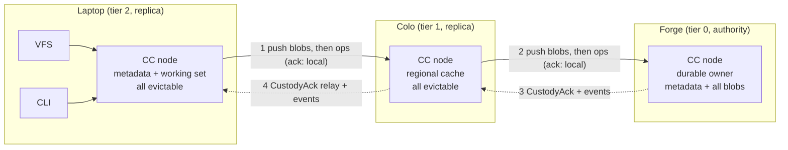
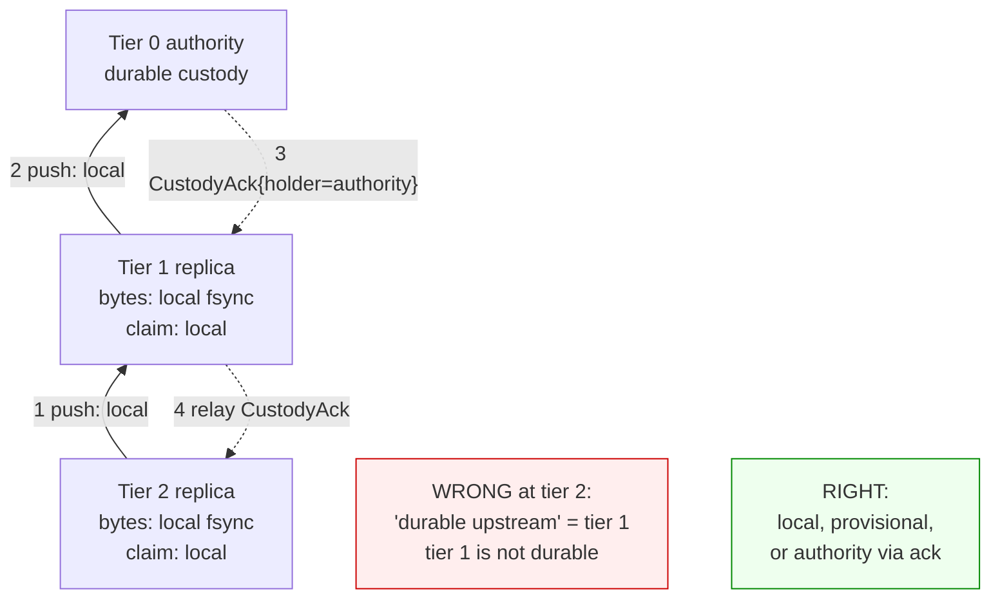
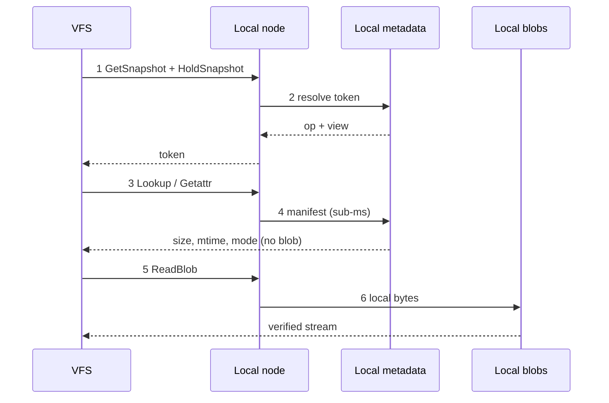
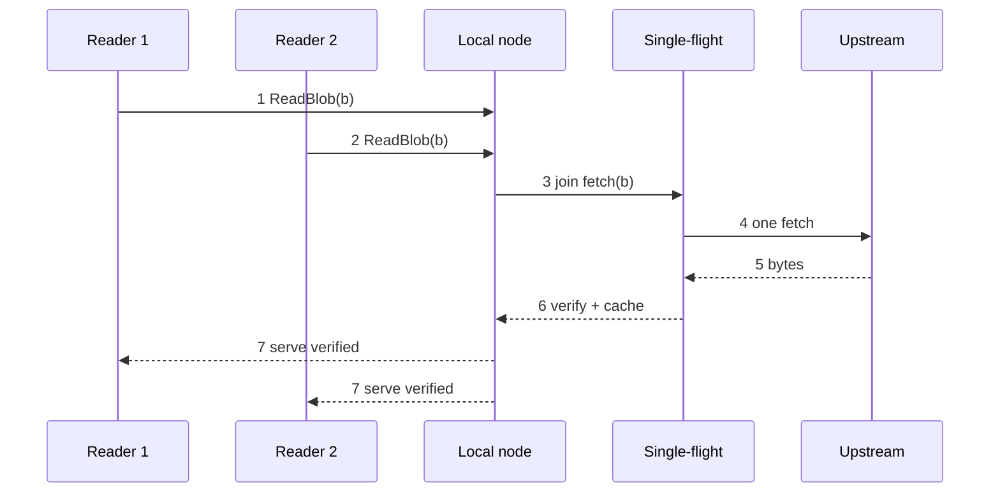
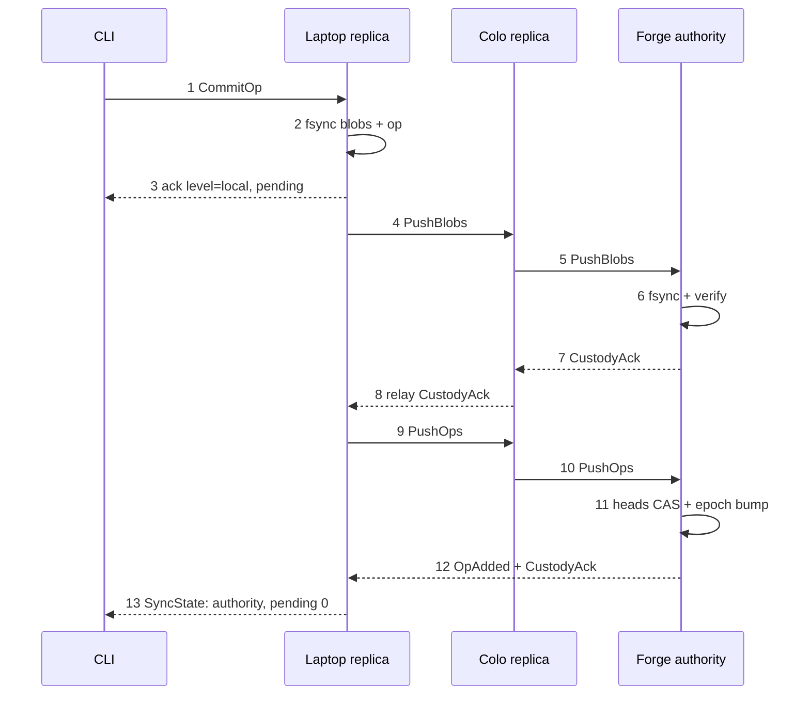
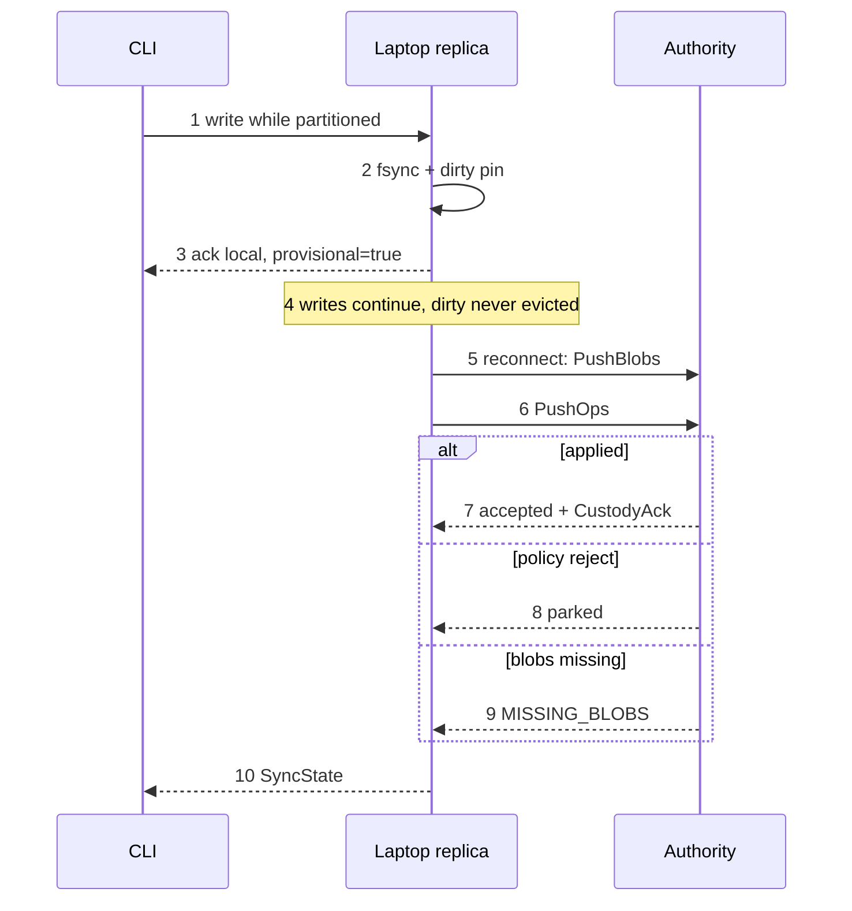
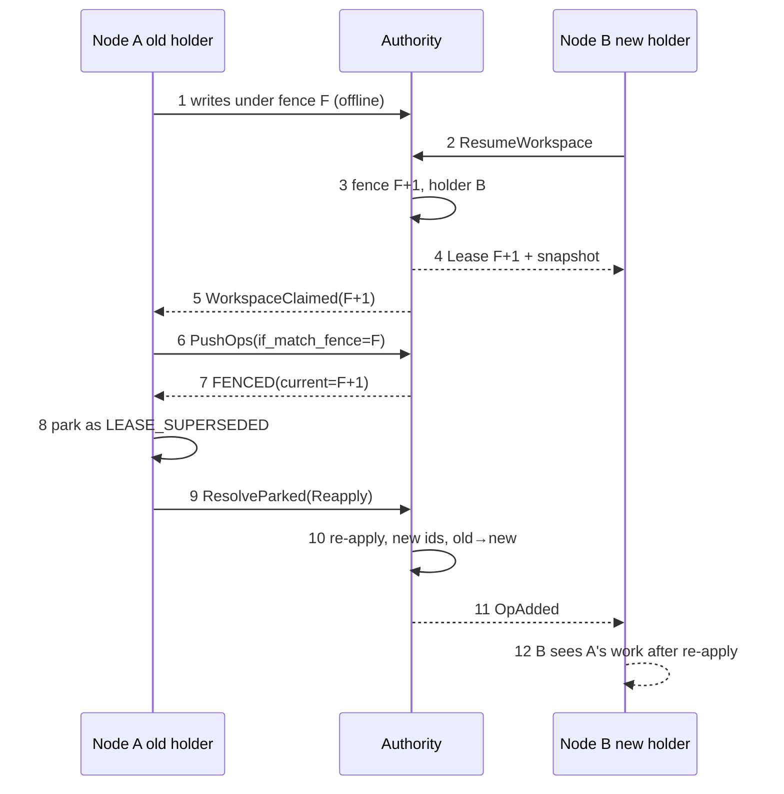
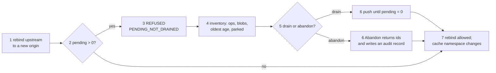
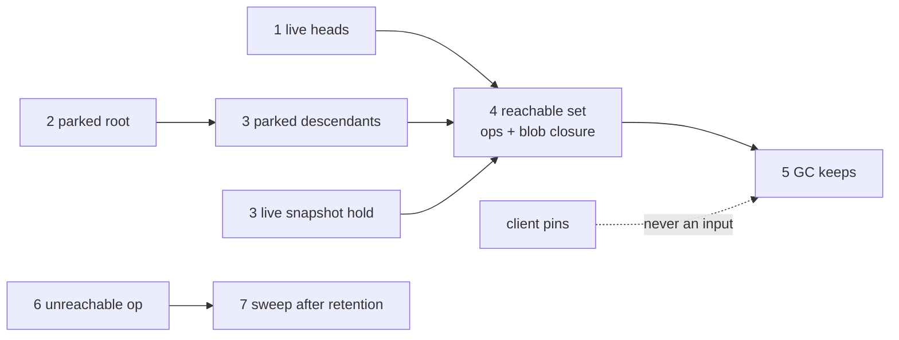
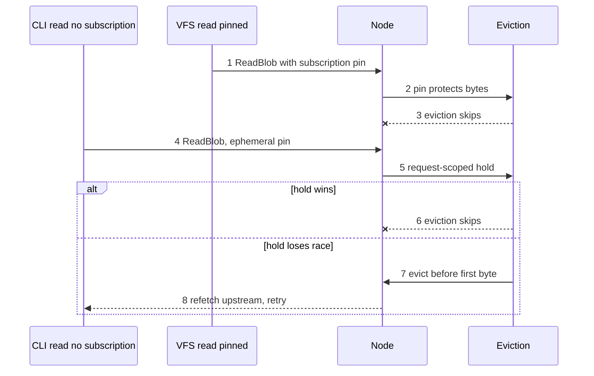

# ADR-0001: Multi-tier commit cloud nodes — role-parameterised, locally durable, push-coherent

- **Status:** Proposed — blocked on the three open decisions in §12 (OQ-1, OQ-2, OQ-3)
- **Revision:** 5 (r1–r4 rejected in review for unsatisfiable invariants and unreadability; resolutions in §16.1)
- **Date:** 2026-10-28
- **Owners:** CC design owner (TBD), jj-vfs maintainer (TBD)
- **Reviewers:** storage/durability, security, jj-lib liaison, forge/ops
- **Evidence:** briefs A (jj-commit-cloud), B (jj-vfs), C (prior art); provenance and citation index in §14.1 and Appendix B

## 0. What this is, in plain language

### 0.1 The problem, in user terms

A developer works in a jj repo on a laptop, but history and contents live on a server. The editor, build system and shell see the repo through a FUSE mount, so ordinary commands work unchanged. Today every metadata lookup crosses the network, and a FUSE `stat` can stream a file's entire contents just to learn its size [B§4]. Offline it is unusable; on a large repo it is slow even online. The goal is a local commit cloud that answers metadata instantly, serves bytes locally, accepts offline work, and reconciles without losing or silently rewriting it.

Terms: a **repo** is a versioned file tree plus its operation log; **jj** is the version-control system; **FUSE** is the kernel interface for userspace filesystems; the **VFS** is the daemon presenting one; a **node** is one running commit-cloud program.

### 0.2 The mental model

The commit cloud is **one node program** storing a repo's **content-addressed blobs** — file contents named by the SHA-256 of their bytes — plus its **operation log**, the graph of operations recording changes to bookmarks (named pointers), working-copy commits (the uncommitted state) and visible heads (the commits readers see). A node can run at any depth: laptop, colo, or forge. A node is either the repo's **owner**, the **authority**, or a **copy that defers upward**, a **replica**. Only the authority is durable: its bytes survive a node crash and are the system of record. A replica holds a working set and may be emptied at any time. Each replica has exactly one **upstream**.

The laptop is a replica, the colo is a replica, the forge is the authority. VFS and CLI talk only to the laptop node over a per-user Unix socket; a request it cannot answer goes one hop up. Steps 1–2 push upward; 3–4 return custody and events.

**D-1 — Topology.**



**What to notice.** Every node holds metadata; only the forge is durable. A laptop miss costs a colo round trip; a colo miss a WAN round trip; a forge miss is a bug or data GC could not remove.

### 0.3 Roles at a glance

|Role|In plain words|Analogy|Guarantees|Does not|
|---|---|---|---|---|
|**authority**|Owns the repo; decides truth, deletion, immutable bookmarks.|Warehouse owning inventory and ledger.|Bytes survive replica loss; one truth; one GC owner.|Laptop speed; warehouse backup.|
|**replica**|Holds a working set, defers upward, may be emptied overnight.|Local depot with no standing to say "stock exists".|Low latency for what it holds; offline writes.|Survival; the right to grant custody.|
|**chain**|Laptop → colo → forge, one upstream per hop.|Regional depot → national warehouse.|A miss resolves one hop at a time.|That "we have it" means "it is safe".|

### 0.4 The whole idea in five sentences

**Read:** every read names a pinned operation (one fixed snapshot shared by the sequence); metadata is local and sub-ms; missing bytes block briefly, then fetch or retry. **Write:** a write is fsynced locally before ack; the ack states the durability achieved and what is pending; blobs are pushed before the op referencing them. **Offline:** a disconnected replica accepts writes, marks them provisional and dirty, never evicts them, and reconciles by pushing blobs, then ops, then a heads compare-and-swap. **Coherence:** authority and replicas push events down a subscription, so a local VFS learns of new ops, blobs and custody changes without polling. **Eviction:** everything not dirty or pinned is LRU-evictable; the authority reclaims only what is unreachable from heads, parked operations and live snapshot holds.

### 0.5 Reading guide

|If you are…|Read first|Keep as reference|
|---|---|---|
|Approving or rejecting|§1, §7, §15, §12|§4, §14|
|Implementing|§2, §3, §6|§4, §5, §9|
|Operating or supporting|§9, §10, §11, §12|Appendix B|

### 0.6 Terms used before they are defined

None. Terms are defined where they first appear above; §2 is a lookup table, not the entry point.

## 1. Framing

**Decision to approve or reject.** Build commit cloud as **one node binary whose behaviour is set by a per-(node, repo) role binding** — `authority` (durable owner, upstream optional) or `replica` (exactly one upstream, not durable, wholly evictable) — exposing **one gRPC surface** for control, metadata, blobs and sync. Every local CLI and VFS mount talks only to its local node over a per-user Unix socket. Reads carry a snapshot token and may be held. Writes are fsynced locally before ack and report the achieved level (`local`, `upstream`, `authority`) plus a `provisional` flag and cumulative pending counts. An op is announced only when its blobs are locally fsynced or in **authority custody**, an explicit, retention-bounded acknowledgement rather than an assumption about the upstream chain. Dirty state is never evicted and blocks origin switching. Coherence is server push. Parked ops are retained and recoverable. GC roots are heads, parked lineages and live snapshot holds, never client pins.

Approving commits the team to a replication/coherence plane as a first-class subsystem, to a documented RPO for offline writes, and to the proposition that **a replica is a cache, not a backup**. D1–D31 are reproduced verbatim in Appendix A and cited inline by number.

## 2. Domain language

|Term|Definition|
|---|---|
|**node**|One CC process with identity and storage. Not a host: two may share one (D3).|
|**authority**|The repo's single durable owner: immutability, bookmark policy, CAS and merge, repo ids, GC. May have no upstream (D1).|
|**replica**|Exactly one upstream; non-durable by role; wholesale-evictable; serves reads, accepts writes, reconciles later. Never a backup.|
|**tier**|`tier(authority)=0`, else `1+tier(upstream)`. Lag budgets only.|
|**origin / upstream**|Upstream = the single parent a replica pushes to. Origin = the authority identity a repo id is bound to (D18).|
|**repo id**|Opaque, server-assigned, bound to the authority identity; the cache namespace.|
|**op**|Immutable change `{parents[], view, metadata, envelope_version}`, content-addressed (I17).|
|**op head / DAG**|Member of the live per-repo set with monotone `heads_epoch`; a set, never a pointer. Parent links form the DAG.|
|**view**|Bookmark targets, wc commits, visible heads. Conflicts are represented, not rejected.|
|**snapshot token / pinned op / view / hold**|Token `{repo_id, op_id, heads_epoch}` names the pinned op and its snapshot view; a hold is a retention claim on it for a client sequence, a GC root.|
|**blob**|Immutable bytes keyed by SHA-256; whole-object transfer in v1 (D15, D16).|
|**tree manifest**|Immutable `name → {blob_id \|tree_id \|symlink, size, mode, mtime}` map; superset of jj's tree object (D19).|
|**durable**|Crash-durable at this node (survives process/OS crash, not disk loss). Stronger claims say **custody**.|
|**custody**|The authority's retention-bounded promise to keep and serve a blob. Only the authority grants it (D1).|
|**CustodyAck / provisional**|Ack `{blob_id, holder, retained_until_ms, custody_seq}`, relayed down the push path. `provisional` = locally fsynced, not replicated, surfaced.|
|**dirty / pending / evicted**|Not yet in authority custody; dirty is immune to eviction. Evicted = removed from a replica cache, still custodied upstream.|
|**parked op**|Accepted from a writer, rejected by authority policy (immutability, ff-only, fence). Stored, surfaced, recoverable (D7c).|
|**lease / fence**|Lease = local admission to write one workspace. Fence = epoch the **authority** checks at push; replicas never enforce it.|
|**pin**|TTL-bounded, per-`(repo, user, client)` blob-id set ordering eviction only. Never a GC input (D22).|
|**sync state**|Pending by level, bytes, age, custody lag, parked ops, holds, reachability, park reasons (D7d).|
|**offline grant**|Authority-signed, locally verifiable capability `{repo, user, rights, not_after, grant_epoch}` (D24).|
|**cache / sync**|*Reserved:* cache = evictable, rebuildable tier-local storage, never the whole node; sync = replication between adjacent tiers only.|

## 3. Bounded contexts

|Context|Responsibility|Kind|Owns|
|---|---|---|---|
|**Control**|Identity, registration, role bindings, workspace resume/leases, delegated identity, authority-only grants.|supporting|bindings, fences, grants|
|**Metadata**|Op log, heads + epoch, views, bookmarks + policy, commit headers, manifests, immutability, merge. Leases are rows in its transaction.|**core**|the only linearizable state|
|**Blob**|SHA-256 content, streaming, verification on serve, custody bookkeeping.|generic|bytes|
|**Coherence**|Push, subscribe, levels, pending, dirty registry, `CustodyAck`, reconcile, parked set, sync state.|**core**|tier-graph behaviour|
|**Cache/eviction**|Byte accounting, LRU, pins, quotas, prefetch, per-user namespaces.|supporting|evictable bytes|
|**GC/retention**|Reachability, retention, holds, sweep. Owner: authority operator; behind `RetentionPolicy`.|supporting|reclamation|
|**Client**|jj-lib and VFS adapters; ephemeral inode→tree maps and the pinned token.|supporting|session state|

**Context map.** Client→Control (unary), Client→Metadata (unary + streaming, pinned), Client→Blob (streaming). Metadata→Coherence on commit and CAS; Coherence→upstream via `PushBlobs`, `PushOps`, `Subscribe`, retried. Cache fills from Blob then upstream; Coherence vetoes dirty eviction and manages pins. GC marks via Metadata/Blob and sweeps under the metadata write lock. Control validates bindings and fences inside that transaction.

**Custody vs locality.** "Durable at this node" and "durable somewhere" differ. D10 needs the second; D13 needs locality lazy. Revision 1 conflated them by naming the upstream chain a custodian — false above tier 1, where the upstream is a replica. Custody is now an explicit authority acknowledgement with a retention horizon; locality is separate and truthful.

A tier-2 node can fsync bytes and a tier-1 replica can do the same, but neither is durable by role. If tier 2 calls tier 1 its "durable custodian", it points at a node that may be emptied. Only the authority issues custody, and the acknowledgement travels back down the chain. Steps 1–2 push local; 3 the authority acks; 4 the ack relays.

**D-8 — Custody at depth ≥ 2.**



**What to notice.** Tier 1 acknowledges bytes it holds but has no durability to confer. Only step 3 creates custody; step 4 lets tier 2 say `authority`. Until then, `local` (or `provisional`). This is why `upstream` is legal only at tier 1.

**Store vs Cache.** `Store` is durable and authoritative; `Cache` is evictable and rebuildable. They share one trait, `BlobSource` (`get`, `has`). They share **no** metadata trait: a cache has no CAS, epoch or linearizability.

## 4. Invariants

Each is testable; the bracketed id is the check in §14.3.

- **I1 Authority announcement.** The authority announces an op only after every referenced blob is fsynced in its store and covered by an unexpired `CustodyAck`. *(MT-1a)*
- **I2 Replica announcement.** Any node announces an op only after every referenced blob is locally fsynced there or covered by a live `CustodyAck`; no announced op references a blob that is neither. *(MT-1b)*
- **I3 No false durability.** `upstream` is reported only at tier 1; above tier 1 an uncustodied write reports `local` with `provisional=true`. *(TC-3)*
- **I4 Truthful locality.** `HasBlob.local` and `BlobAvailable` mean bytes an offline read can serve; `custody[]` is the authority's promise; never conflated. *(IT-4)*
- **I5 Pinned reads.** Every read carries a token; reads sharing it resolve to one op and view. "Now" is never implicit. *(IT-5)*
- **I6 Stale is explicit.** One RPC never returns a partially applied op. A sequence may fail at an op boundary with `STALE_SNAPSHOT{retryable}`; the re-pin is observable. *(IT-6)*
- **I7 Server reads are pure.** No metadata read RPC mutates authoritative state. `ResolveOpHeads` is a separate, observable write the ACL invokes before reading. *(TC-7)*
- **I8 One writer per workspace.** At most one fence is current per `(repo, workspace)`. A lease is local admission; the fence is enforced only at the authority at push. *(IT-8)*
- **I9 Monotone epochs.** `heads_epoch` and workspace `fence` strictly increase and never reset across restart. *(PT-9, FI-9)*
- **I10 Immutability.** Immutable-bookmark/snapshot checks run inside the authority's push CAS transaction; replicas never enforce; violations park. *(IT-10)*
- **I11 Ack truthfulness.** Reported level ≤ achieved; `sync_seq`, pending counts and `SyncState` agree at the ack's watermark. *(TC-11)*
- **I12 Dirty immunity.** No eviction removes dirty ops/blobs, including transitive dirtiness; all-dirty quota → `QUOTA_EXHAUSTED`, zero bytes evicted; dirty is never dropped without an `Abandon` inventory. *(PT-12, IT-12)*
- **I13 No origin switch while dirty.** Rebinding upstream requires pending 0 or an `Abandon` returning discarded ids and bytes. *(IT-13)*
- **I14 Parked lineage survives.** Parked ops and descendants are retained until explicit resolution; `Reapply` produces new ids and persists an old→new map for the repo's life; `Discard` returns the inventory. Parked lineages are GC roots. *(IT-14, MT-14)*
- **I15 GC roots and exclusion.** GC input = heads ∪ parked lineages ∪ live snapshot holds ∪ retention. Client pins are never input. Push and sweep share the repo metadata write lock. *(PT-15, FI-15)*
- **I16 Push order.** Blobs → op → heads CAS; an op with an absent blob is rejected `MISSING_BLOBS`, heads/epoch unchanged. *(PT-16, TC-16)*
- **I17 Op id determinism.** SHA-256 over a canonical, version-stamped envelope; identical bytes ⇒ identical id; writer-computed with no round trip. *(PT-17)*
- **I18 Blob integrity and size.** Bytes are verified against the key on write and serve; `tree.size` must equal blob length; mismatch → `CORRUPT_BLOB`/`SIZE_MISMATCH`. *(FI-18)*
- **I19 Single-flight.** Concurrent demand for one blob at a node collapses to one upstream fetch, capped per repo. *(IT-19)*
- **I20 Deterministic attributes.** Size, mtime, exec bit and child order are pure functions of the pinned snapshot; order is total and bytewise. *(PT-20, FU-20)*
- **I21 Cursor stability.** A cursor is valid only in its issuing snapshot; foreign/expired → `CURSOR_INVALID`, never a silent skip. *(TC-21)*
- **I22 Authorization at serve.** Every blob serve checks identity, grant, grant epoch and per-user namespace before bytes leave, including cached bytes. *(IT-22)*
- **I23 No ack debounce.** No time-based batching on the ack path; coalescing happens after ack. *(TC-23)*
- **I24 Wholesale eviction only when drained.** A replica may be dropped in full only with pending 0; otherwise refused with an inventory. *(IT-24)*
- **I25 Multi-upstream not foreclosed.** `UpstreamRef` is a list validated to length ≤ 1; push idempotency assumes nothing about parentage. *(PT-25)*
- **I26 Role per repo.** One node may be authority for A and replica for B with no cross-repo namespace, quota or credential leakage. *(MT-26)*

## 5. RPC surface

The surface is wider than jj-lib's Backend/OpStore/OpHeadsStore/WorkspaceService set because jj-lib was not designed for snapshots, push, custody or leasing [A§8]. Every local-first capability is a named RPC: a read that needs retention asks for a hold; a write says which level it achieved; a replica asks for sync state. Unary calls are idempotent on `request_id`; streams resume by `seq`. A `ResumeWorkspace` retry with the same `request_id` returns the same fence; a new one is a new claim.

```proto
service Control {
  rpc RegisterRepo(RegisterRepoRequest) returns (RepoRegistration);
  rpc BindRole(BindRoleRequest) returns (RepoBinding);
  rpc ResumeWorkspace(ResumeRequest) returns (Lease);            // claim + fence bump, idempotent
  rpc RenewLease(RenewRequest) returns (Lease);
  rpc ReleaseLease(ReleaseRequest) returns (Empty);
  rpc WhoOwnsRepo(RepoRef) returns (OwnerInfo);
  rpc MintOfflineGrant(GrantRequest) returns (OfflineGrant);     // authority only
  rpc RevokeGrants(RevokeRequest) returns (GrantEpoch);          // authority only
}
service Metadata {
  rpc GetSnapshot(SnapshotRequest) returns (Snapshot);           // {token, op_id, heads_epoch, view_id}
  rpc HoldSnapshot(HoldRequest) returns (SnapshotHold);          // {token, ttl}
  rpc ReleaseSnapshotHold(HoldRef) returns (Empty);
  rpc GetOpHeads(RepoRef) returns (OpHeads);
  rpc ReadOps(ReadOpsRequest) returns (stream Op);
  rpc ReadTree(TreeRequest) returns (TreeManifest);
  rpc ListDir(ListDirRequest) returns (ListDirPage);
  rpc Lookup(LookupRequest) returns (Entry);
  rpc ReadBookmarks(SnapshotRef) returns (Bookmarks);
  rpc GetIndexCheckpoint(SnapshotRef) returns (MaybeCheckpoint);
  rpc CommitOp(CommitOpRequest) returns (WriteAck);
  rpc PushOps(PushOpsRequest) returns (PushResult);
  rpc ResolveParked(ResolveRequest) returns (ResolveResult);     // Reapply|Discard, old->new
  rpc ListPending(PendingRequest) returns (PendingInventory);
}
service Blobs {
  rpc ReadBlob(ReadBlobRequest) returns (stream Chunk);          // v1 offset must be 0
  rpc ReadBlobs(ReadBlobsRequest) returns (stream BlobChunk);
  rpc WriteBlob(stream BlobChunk) returns (BlobAck);
  rpc HasBlob(HasBlobRequest) returns (HasBlobReply);            // {local[], custody[], pending[], absent[]}
  rpc LocateBlob(BlobRef) returns (CustodyChain);
}
service Sync {
  rpc Subscribe(SubscribeRequest) returns (stream SyncEvent);    // resume_seq, pin_set, holds
  rpc GetSyncState(RepoRef) returns (SyncState);
  rpc Abandon(AbandonRequest) returns (AbandonResult);           // discarded ids, bytes, sync_seq
}
message WriteAck { bytes op_id=1; Level level=2; bool provisional=3; uint64 sync_seq=4;
  uint64 heads_epoch=5; uint64 fence_epoch=6; uint32 pending_ops=7; uint64 pending_blobs=8; uint64 pending_bytes=9; }
enum Level { LOCAL=0; UPSTREAM=1; AUTHORITY=2; }
message CustodyAck { bytes blob_id=1; bytes holder=2; uint64 retained_until_ms=3; uint64 custody_seq=4; }
message SyncEvent { oneof event { OpAdded; OpHeadsChanged; BlobAvailable; BlobPending; ReplicaLag;
  PinAck; PinDropped; ParkedOpChanged; CustodyAck; WorkspaceClaimed; GrantEpochChanged; } }
message CcError { string code=1; bool retryable=2; uint32 retry_after_ms=3; RetryInfo retry=4; string detail=5; }
```

`sync_seq` is per-node monotone; `pending_*` is cumulative at that seq; a replica adopts the upstream `heads_epoch` on push, while `fence` comes only from the authority. Three additions matter. `Subscribe` replaces polling for D9 and carries pins and custody. `HoldSnapshot` keeps metadata and the blob closure of one op alive for a client sequence, the only way to guarantee "readdir then read" across RPCs. `ResumeWorkspace` plus `WorkspaceClaimed` is the workspace-resume story (§6.5).

**Error taxonomy.** `retryable=true` implies `retry_after_ms > 0` and `RetryInfo`; `retryable=false` implies neither.

|Code|Retry|Client action|
|---|---|---|
|`STALE_SNAPSHOT`|yes|re-pin, retry|
|`CURSOR_INVALID`|yes|re-pin; cursor bound to an older snapshot|
|`SEQ_EXPIRED`|yes|resubscribe without `resume_seq`, full resync|
|`BLOB_NOT_LOCAL`|yes|wait/retry; FUSE `EAGAIN`|
|`BLOB_EVICTED`|yes|refetch; in-flight reads hold an ephemeral pin|
|`MISSING_BLOBS`|yes|upload the named blobs, retry push|
|`HEAD_CAS_CONFLICT`|yes|retry with jitter after re-reading heads|
|`FENCED`|no|workspace resumed elsewhere; park and resolve|
|`LEASE_SUPERSEDED`|no|park; resolve or discard|
|`IMMUTABLE_VIOLATION`|no|parked; surface|
|`PARKED_OP`|no|resolve the parked lineage|
|`SIZE_MISMATCH`|no|reject: manifest size ≠ blob length|
|`QUOTA_EXHAUSTED`|yes|free/evict, retry|
|`CORRUPT_BLOB`|yes|refetch; never surface|
|`OP_GONE`|no|op GC'd; re-pin at a newer op|
|`BASE_GC`|no|base gone; full resync and reapply|
|`PENDING_NOT_DRAINED`|no|drain or `Abandon` before rebinding|
|`GRANT_EXPIRED`|no|online reauth|
|`GRANT_EPOCH_STALE`|yes|contact authority for the current epoch|
|`OFFLINE_READ_ONLY`|no|grant lacks a write right|
|`PERMISSION_DENIED`|no|—|
|`REPO_ORIGIN_MISMATCH`|no|re-register against the correct origin|
|`PROTOCOL_VERSION`|no|upgrade the node|
|`UNIMPLEMENTED`|no|optional surface|

**Transport.** One long-lived HTTP/2 channel per (process, peer), multiplexed; local peers use `$XDG_RUNTIME_DIR/cc-<uid>/…`, mode `0700`, hashed leaf names under 108 bytes. The `daemon` crate is not reused: it is a 536-line per-call UDS proxy (`daemon/src/proxy_*.rs`) with no pin, custody or connection state we need [A§12]. `lib/src/util.rs:106-122` spawns a thread and runtime per trait call; the new client retains one channel.

## 6. Write and read paths

Each diagram is preceded by the story and followed by the one thing that matters. Step numbers in prose, diagram and invariants are the same.

### 6.1 A warm read: metadata first, bytes second

The common case is `stat` or `lookup` on a file the laptop knows. The client gets a snapshot token; for a sequence it also takes a **hold**, a retention claim that keeps the operation alive. `lookup` is answered from the local manifest, which carries size, mode and mtime, so no blob is touched. Only a byte read reaches the blob store.

Steps: 1 VFS gets snapshot and hold; 2 node resolves locally; 3–4 lookup/stat from the manifest (sub-ms); 5–6 `ReadBlob` streamed and verified locally.

**D-2 — Warm read.**



**What to notice.** `stat` never reads a blob, and the hold — not the token — makes the multi-RPC sequence safe.

### 6.2 A cold read: one fetch for many readers

The file is in the pinned tree but its bytes are not local. Two readers ask at once; the node joins them into one upstream fetch, verifies once, caches, and serves both. A timeout returns a retryable miss, never a torn file; FUSE maps it to `EAGAIN`, because ordinary tools do not retry `read`.

Steps: 1–2 two readers; 3–4 single-flight joins them into one fetch; 5–6 verify and cache; 7 both served. Timeout: `BLOB_NOT_LOCAL{retryable}` → `EAGAIN`.

**D-3 — Cold read with single-flight.**



**What to notice.** One fetch per blob, not per reader; a miss is a bounded stall then a retryable error.

### 6.3 An online write: the acknowledgement tells the truth

The CLI commits. The node fsyncs new blobs and the op, then acks `local` with a provisional flag and pending count. In parallel, push sends blobs upward, then the op; the authority fsyncs, issues a custody ack, and only when it returns does sync state say `authority`. The heads CAS decides head membership; the subscription pushes state down.

Steps: 1–3 commit and local ack; 4–8 blobs up, custody ack back; 9–11 op push, CAS, events; 12–13 authority, pending 0.

**D-4 — Online write.**



**What to notice.** Two truths are visible: `local` at step 3 and `authority` at step 12; collapsing them loses offline honesty.

### 6.4 An offline write, and the reconnect

On a train, the path is unchanged through step 3 but push fails, so the ack is `local, provisional=true, pending=N`. That is a promise about the laptop's disk and an explicit statement that nothing left. Dirty data is immune to eviction. On reconnect the authority answers applied, parked, or missing-blobs; only the first clears dirty.

Steps: 1–3 partitioned write and provisional ack; 4 writes continue dirty; 5–6 reconnect push; 7–9 applied/parked/missing; 10 sync state.

**D-5 — Offline write and reconnect.**



**What to notice.** Missing-blobs retries, a park waits for a human, acceptance clears dirty; the three must not be collapsed.

### 6.5 Workspace resumed on a second node

D4's one-writer rule is enforced by an authority-issued fence, and a writer can be offline. A edits W under fence F; B resumes W; the authority bumps to F+1. A reconnects and is fenced: its work parks as `LEASE_SUPERSEDED` and is re-applied onto B's head. New op ids are produced because an op id commits to its parents; an old→new map persists for the repo's life.

Steps: 1–2 A offline, B resumes; 3–5 fence F+1 and event; 6–8 A fenced, parks; 9–10 reapply with new ids; 11–12 B sees the work.

**D-6 — Workspace resume.**



**What to notice.** B does not see A's work until re-apply, and A's CLI says so; applying under a dead fence is split brain.

### 6.6 Rebinding origin while dirty

The origin is the authority a repo id is bound to, and the repo id is the cache namespace. A rebind therefore discards the cache, but not dirty data that exists nowhere else. It is refused while pending is non-zero; the user sees an inventory and chooses drain or abandon. Steps: 1 rebind; 2 check pending; 3 refuse; 4 inventory; 5 choose; 6 drain/abandon; 7 allow.

**D-7 — Origin switch while dirty.**



**What to notice.** The refusal prevents silently dropping offline work; `Abandon` records the loss.

### 6.7 Merge: what converges and what does not

Convergence is a property of the **op DAG**, not every view field. The authority reduces the head set by ancestry, then merges each field by a stated rule; this is why two offline bookmark moves can both park.

|Field|Rule|User-visible outcome|
|---|---|---|
|**visible heads**|Union, then drop ancestors. On an index miss, keep both and flag `heads_unresolved`.|One head normally; two only when genuinely unordered.|
|**wc commits**|Per workspace, highest `(fence_epoch, op_id)` wins; loser parks `LEASE_SUPERSEDED`. D4 makes this rare.|Most recently resumed wins; older work parks.|
|**bookmarks, ff-only**|Non-ff move parks as `BOOKMARK_CONFLICT{bookmark, targets[]}`; bookmark stays at the common base until resolution.|Both offline moves park; CLI shows both targets; user resolves.|
|**bookmarks, authority-wins**|Authority target kept; the other parks.|Deterministic, one side surfaced.|
|**bookmarks, manual**|Both targets retained as conflicts; reads expose the conflict; writes require resolution.|The conflict is data, not an error.|

The merge op's parents are the reduced head set; its view is the field-wise result. Remaining bookmark conflicts are recorded, not invented away. This is Coda-style reintegration, not last-write-wins: a human may be required, and the system says when.

## 7. Options

**Option 0 — Status quo plus a read cache.** Keep today's server as the only authority, put a blob cache (optionally a git promisor) in front, keep the daemon. *Optimises:* zero new durability/coherence risk, fastest path, published precedent. *Costs:* metadata round trips on every `lookup`/`readdir` (the VFS has no cache), no snapshot pinning so long reads can tear, no offline writes, roles, push or custody. *Wins when* users are always online and repos small. *Fails* offline or far from the authority. *Best argument:* no new failure mode, and the promisor lesson — an absent promisor remote makes a clone unusable and produces hard corruption — is avoided by one always-on authority. Custody makes that lesson explicit, and AFS's store-and-forward whole-file model is the ancestor of D12: the local write completes, and the store to the shared tier follows.

**Option B — Thin local replica (compliant staging milestone).** Local node caches metadata and blobs, serves reads locally, forwards writes synchronously to the authority; no offline writes, dirty registry or merge. *Optimises:* latency and simplicity; one writer. *Costs:* offline writes are disabled until reconcile ships (D7 deferred, not violated); WAN on every write; invalidation still needed. *Wins when* the first milestone ships before reconcile exists. *Fails* offline. This is a **configuration of A** (`replica.accept_offline_writes=false`), not a competing architecture; the wire format is identical.

**Option C — Symmetric peers, every node an authority, fan-in now.** *Optimises:* symmetry, local autonomy, no tier starvation. *Costs:* distributed reachability with no safe GC; no single immutability point; merge rises to every write; fencing has no owner. *Wins when* a federated no-owner product is the goal — it is not (D1). *Best argument against A:* A's asymmetry lets a laptop authority hold data the forge never sees, so "cloud" is a courtesy; C makes every copy equal. Answer: D1 chooses an owner; C cannot satisfy D17/D22.

**Option D — Two tiers only** is A with `max_depth=1`: same code, less machinery; a deployment profile, not an alternative.

|Dimension|0 (status quo)|B (thin replica)|C (symmetric)|A (chosen)|
|---|---|---|---|---|
|Offline writes (D7)|no|deferred|yes|yes|
|Arbitrary depth|no|read-only|yes|yes|
|RPO of acked write|authority commit|authority commit|node disk|node disk unless push fit|
|GC safety|one authority|one authority|unsolved|one authority, explicit roots|
|Immutability point|one|one|none|one, in CAS txn|
|Pinned reads|no|yes|yes|yes|
|Time to first demo|**shortest**|short|long|medium|
|Failure surface|network|network|merge storms, GC races|reconcile, parking, quota|
|Multi-upstream|no|no|native|additive (I25)|

**Recommendation: A**, staged through B's discipline: ship A's wire format and roles first with offline writes disabled by config, then enable dirty-pinning and reconcile. Reject C. Keep 0 as rollback, D as a configuration.

## 8. Sub-decisions argued in detail

### 8a. fsync / durability semantics (D12)

||a2: block until upstream-durable|a1: local-only|**Agreed (D12)**|
|---|---|---|---|
|Returns when|authority holds op + blobs|local fsync|local fsync + bounded push|
|RPO of acked write|~0|node disk loss|node disk loss unless push completed|
|p99|WAN RTT + commit, unbounded|local fsync|local fsync + min(push, ~250 ms)|
|Offline|fsync fails|works, silently diverges|works, reported `local`/`provisional`|
|User signal|none|none (violates D7d)|"N ops pending push"|

**Keep D12.** It preserves local-first while making replication visible. The bound is policy (~250 ms, placeholder), skipped under backoff. fsync never reports `unknown`: an interrupted push reports `local` + pending (I11). **A laptop whose disk dies inside the push window loses acked writes**; `SyncState` and the CLI must say so. At tier ≥ 2 an offline ack is `local` + `provisional=true`; D11 fixes the three enum values.

### 8b. Op visibility vs blob readiness (D13)

||b2: announce when the whole blob set is local|b1: fail-fast `BLOB_NOT_LOCAL`|**Agreed (D13)**|
|---|---|---|---|
|Op visibility|bounded by full tree transfer (can be GB)|immediate|immediate|
|Cold read|never cold|immediate error|blocks ≤ timeout, then retryable|
|FUSE/POSIX|`open` fails until data lands|`read()` gets `EAGAIN`; tools rarely retry|`read()` may block; `stat`/`readdir` truthful|
|Shape|starvation: a 10 GB tree never appears|false failures, never a hang|bounded stall, then retryable|

**Keep D13.** b2 ties visibility to content volume, fatal at GVFS scale [C§2.9]. b1 turns a transient cold state into user-visible failure. `open()` succeeds without content; first-touch reads are slow; `stat` never lies (I18/I20); `mmap` cannot express "retry later" and a fault surfaces `SIGBUS`, which **breaks the tool**, so mmap on cold blobs is unsupported; `fsync` on a file means the workspace snapshot (D12/D14). FUSE: `BLOB_NOT_LOCAL` → `EAGAIN`; stale token → `ESTALE` (OQ-3).

### 8c. Pinning alternatives (D22)

|Option|Pros|Cons|
|---|---|---|
|**None**|zero surface|readdir→read loses blobs under pressure|
|**TTL lease RPC**|simple, no stream|renewal traffic; silent renewal failure; crashed client pins for a TTL|
|**Handle-bound refcount**|exact release; dies with the connection|no `open`/`release`; 10k-entry readdir ⇒ 10k handles; leaks block eviction|
|**Subscription pin set** (chosen)|reuses D9; dies with liveness; no new RPC|coarse: over-pins or truncates (safe misses)|

**Recommend subscription pins**, keyed `(repo, user, client)` so user A cannot delay user B's eviction. Cap count and bytes; on overflow drop oldest and emit `PinDropped`. Pins never reach GC (I15). A remount loses pins; a **pin grace** of 60 s (placeholder) survives the disconnect, and the mount re-declares pins before serving.

### 8d. Offline authorization (D24) — **OPEN DECISION**

|Option|Pros|Cons|Failure|
|---|---|---|---|
|**(i) strict deny on expiry**|unambiguous; zero crypto|the user's repo is unreadable offline — cancels D1/D7|a 12-hour flight bricks the workspace|
|**(ii) bounded grace, read-only**|simple; keeps read access|unauthenticated time; stolen device keeps access; weak clock trust|silent widening|
|**(iii) signed repo+user TTL grant, verified locally** — **recommended**|offline, bounded, attenuable, revocation by epoch [C§2.8]|new format, key distribution, clock trust; revocation = TTL + propagation|revoked user until TTL|
|**(iv) local trust boundary**|trivial; honest for one user|violates D23; collapses on a colo|cross-tenant exposure|

**Recommend (iii).** Minting is **authority-only**; replicas verify the signature. `RevokeGrants` bumps `grant_epoch`, published via `GrantEpochChanged`; a replica refuses grants below its known epoch and, after `grant_epoch_stale_window` (7 days, placeholder) without news, refuses with `GRANT_EPOCH_STALE`. The wire carries opaque `grant_bytes` + `grant_epoch`, so the token format can change without a wire break. Expiry uses wall clock plus ±5 min skew and a persisted last-seen-wall-clock boot guard; monotonic clocks only for local elapsed time. Offline writes require a valid grant with a write right. **Open question:** the maximum offline write window, and whether a revoked user's residual access is bounded by it.

### 8e. Index checkpoint (D20)

|Option|Pros|Cons|
|---|---|---|
|Replicate the index as authoritative|fast cold start|derived state replicated: format coupling, invalidation storms, no authority validation|
|Rebuild only|always correct, no surface|cold start pays O(commits); `ListProjectCommits` returns every id (`common/proto/backend.proto:109-115`)|
|Optional opaque checkpoint (D20)|fast, deletable, validated|export/validate surface; a wrong checkpoint can poison; rebuild still needed|

**Recommendation:** rebuild-only in v1, with `GetIndexCheckpoint` returning `UNIMPLEMENTED`, so the checkpoint is additive. Keep D20's semantics: version-tagged, imported only on exact format match and head validation, cache, never authoritative, safe to delete. Trigger: cold start > 5 s p95 at > 100k commits.

### 8f. Derived attributes

`size` = blob length in the manifest, checked against the blob (I18); `mode` = exec bit; `mtime` = writer-recorded content time, never the reading node's clock. Directory `mtime` = timestamp of the op that last changed its entry list. Perforce's default **preserves depot modtime**; `+m` opts into sync-time mtimes [C§2.1], so our choice matches the default. *(Assumption to confirm with the VFS owner.)*

### 8g. Timer ordering

|Timer|Default (placeholder)|Must satisfy|If violated|
|---|---|---|---|
|Retention `R`|30 days|`R >` offline window `W`|a replica offline for `W` pushes onto a GC'd base (`BASE_GC`)|
|Snapshot hold `H`|1 h max; 60 s per CLI|`H ≤ R`|holds pin metadata beyond retention; GC starves|
|Pin TTL `P`|5 min + 60 s grace|`P < H`|pins outlive the sequence; wasted bytes|
|Lease `L`|24 h|`L ≥ W + skew`|lease expires mid-offline; fence reservation ambiguous|
|Offline grant `G`|`G = W` (12 h)|`G = W`|writes stop early, or outlive authorization|

### 8h. Op model alternatives (D5)

D5 requires comparing the chosen multi-writer DAG with two alternatives. **(i) Single-writer authority with leased op-id ranges.** The authority leases each writer a range; ops are ordered by range, so there is no merge and no id rewrite. But offline writing requires leasing ranges in advance, range exhaustion blocks writes, and identity is authority-assigned, breaking I17 and content-addressed dedup. **(ii) Hybrid forward-when-connected, author-when-partitioned.** Online writes get authority-assigned ids and order; offline writes are authored locally and re-identified on reconnect. This reduces merge frequency but creates two identity paths and exactly the old→new rewrite problem of §6.5, now on the hot path. **(iii) Chosen: content-addressed DAG plus merge.** One path online and offline; ids never change; merge is rare because D4 makes forks workspace-granular. Cost: merge and bookmark-conflict machinery, accepted because D4 makes forks rare.

## 9. Consistency and failure

Two edge cases need pictures before the matrix, because they are where a plausible implementation goes wrong silently.

The authority may reclaim only what no live client can still ask for. The roots are current heads, any parked op and therefore its parked descendants, and any live snapshot hold. Client pins are not roots: they order eviction at a replica, and feeding them into GC would let a client stop reclamation forever. A parked op at the base of an offline chain must keep its descendants alive even though none is a head. Steps: 1 heads; 2 parked root; 3 descendants/hold; 4 reachable set; 5 keep; 6–7 sweep.

**D-9 — GC reachability.**



**What to notice.** Parked is a root, not a leak; holds are roots with a TTL; pins are invisible to GC. Revision 1 left parked ops outside the root set while calling them append-only.

A VFS read holds a subscription pin, so eviction skips it. A CLI read has no subscription and takes a request-scoped ephemeral pin for the stream. If the ephemeral pin loses the race before the first byte, the read retries from upstream (`BLOB_EVICTED`), never a truncated stream. An already-streaming handle keeps its bytes alive. Steps: 1–3 pinned read is safe; 4–6 ephemeral pin; 7–8 lost race retries.

**D-10 — Eviction racing a read.**



**What to notice.** The CLI case is a shorter-lived pin, not an exception; failure is retryable, not a partial read.

|Failure|Detection|Symptom|Response|Data-loss risk|Recovery|
|---|---|---|---|---|---|
|Upstream down|push error, stream close|writes acked `local`/`provisional`|backoff push, `ReplicaLag`, writes continue|node disk only|reconnect, §6.4|
|Replica disk full|fsync/quota error|`QUOTA_EXHAUSTED`, not `EIO`|evict non-dirty; refuse dirty (I12)|none until `Abandon`|free space, drain, abandon|
|Crash mid-write|blob present/op absent or inverse|none|orphan blob re-uploaded; op visible after txn|none on crash|retry; orphan GC|
|Tier ≥ 2 crash, provisional only|restart inventory|pending gone|reported with ids|**yes: local disk was the only copy**|re-author or accept|
|Blob corrupt/lost at replica|hash/length mismatch (I18)|`CORRUPT_BLOB`, refetch|treat as miss|none|automatic|
|Op-head fork|two heads, epoch bump|none; merge in log|authority merges §6.7|none|automatic; conflicts surfaced|
|Immutable violation|check inside CAS (I10)|push parked, head unchanged|park + surface|none|resolve/discard|
|Stale snapshot/hold|token outside retention|`STALE_SNAPSHOT` retryable|refuse; re-pin|none|retry|
|Offline > retention|base GC'd|`BASE_GC`/`OP_GONE`|refuse push; full resync|possible if base only local|resync, reapply|
|Origin switch with dirty|pending > 0|refusal + inventory (I13)|block; drain or abandon|recorded if abandoned|§6.6|
|GC vs replica fetch|`OP_GONE`/`BLOB_NOT_LOCAL`|retryable miss or op loss|holds protect live tokens|none for held snapshots|re-pin|
|GC vs `CommitOp`|lock ordering|none|mark/commit share write lock|none|retry|
|Clock skew|grant `not_after`, mtimes|`GRANT_EXPIRED`/`GRANT_EPOCH_STALE`|stored mtimes; wall clock + skew|none|fix clock, renew|
|Split brain/resume|fence mismatch|`FENCED` for old writer|current fence only; old ops park|none; work retained|re-apply or discard|
|Eviction during read|ephemeral pin|none or one retryable miss|request-scoped pin; refetch|none|automatic|
|Subscription seq expired|resume seq too old|`SEQ_EXPIRED`|full resync, no gap|none|resubscribe|
|Parked lineage GC'd|parked not marked|parked ops disappear|**must not happen**; I14/I15 test|yes if bug|regression blocks release|
|Authority disk loss|node gone|repo unavailable|single copy; no holder|**repo loss**|storage snapshots; backup deferred|
|Grant revoked offline|epoch on reconnect|refused|`GRANT_EPOCH_STALE`; reauth|none|online reauth|

## 10. Reversibility

|Decision|Cost later|Reversal condition|
|---|---|---|
|Client-computed canonical op identity|**High** — keys, dedup, idempotency, old→new maps|full re-key migration; cheap before any repo exists|
|Two roles, one authority per repo|**High** — enforcement, GC, merge, fencing assume it|multi-authority merge, distributed GC, arbitration|
|CustodyAck protocol|**Medium** — removing it makes I1 unprovable|keep acks but change the holder set|
|fsync semantics|**Medium** — tools bind to ack meaning|change if WAN p99 falls below local fsync|
|Lazy visibility + blocking read|**Low** — node flag|eager announce if stalls dominate and repos are small|
|Subscription pins|**Medium** — pressure behaviour, not correctness|handle refcounts if over-pinning wastes > 20%|
|Snapshot holds|**Low** — additive; GC already reads roots|remove if retention suffices|
|SHA-256 keys (D15)|**High** — wire ids, filenames, ACL truncation|only if jj-lib relaxes id width|
|Lease/fence|**Medium** — workspace identity and resume UX|remove only if D4 becomes a server-side lock|
|Offline grant format|**Medium** — tokens in the field, key ids, epochs|dual-accept window|

## 11. Operability and upgrade

**Observability.** Metrics carry `{node_id, repo_id, tier, level}`; cardinality is capped per repo/user (no op-id/blob-id labels). Logs carry `trace_id`, `repo_id`, `user_id`, `op_id`, `blob_id`, `sync_seq`, `fence`, `park_reason`; traces propagate across tiers. `LocateBlob` returns the custody chain and `WhoOwnsRepo` the authority identity; without them support cannot answer "where are the bytes" or "who owns this repo". `SyncState` carries `parked[]` with reason and age, `holds[]`, and pending by level.

**Upgrade.** On-disk format and op-envelope canonicalisation are versioned (`envelope_version`, `store_format_version`, `wire_major`). Changing the envelope changes op ids, so v1 freezes canonicalisation; mixed-version push is rejected `PROTOCOL_VERSION`; rolling a tier needs dual-serve (duplicate ids, merge storm) or stop-the-world. The ADR chooses **stop-the-world for envelope changes**, rolling for additive wire.

## 12. Risks and open questions

|#|Risk / question|Owner|Resolution|
|---|---|---|---|
|R1|**OQ-1:** custody semantics (authority ack + `provisional` vs fourth enum level); if rejected, partitioned writes must be refused, cancelling D7|CC design owner|operator decision; record both readings|
|R2|**OQ-2:** offline authorization window, clock trust, revocation residual|security reviewer|answer §8d, then threat-model|
|R3|**OQ-3:** FUSE errno for stale token (`ESTALE` vs `EAGAIN`)|jj-vfs maintainer|ratify in VFS adapter spec|
|R4|Metadata too large to hold at every tier|CC design owner|E1′ (§14.5)|
|R5|ff-only/immutability need reachability; today `is_ancestor` is `ancestor == descendant` (`server/src/jj_lib_adapters.rs:536-540`) [A§15.6]|storage reviewer|index-backed bounded walk; spike|
|R6|Transitive dirty-pinning can wedge a node|ops owner|dirty quota + `Abandon` UX; measure offline volume|
|R7|Merge rate assumed rare (D5), unmeasured|CC design owner|`merge_rate_per_1k_ops` in a pilot (E2)|
|R8|Authority disk loss without upstream = repo loss|product/ops|accepted §9/§15; backup deferred|
|R9|32-byte SHA-256 vs jj's fixed 16-byte op / 20-byte commit ids|jj-lib liaison|truncate with collision check at write; fork only if needed|

## 13. Deferred decisions

1. Multi-upstream/fan-in (D2): structure permits (I25); not implemented.
2. Authority handover/failover and app-level backup/restore; v1 states the exposure.
3. Packing/segments/KV (D15): inode pressure vs compaction cost; segments break per-object deletion; KV hides byte accounting for LRU. v1 is one file per object.
4. Ranged reads and chunking (D16): whole-object reads make `read(offset=1 GiB, len=4 KiB)` transfer 1 GiB unless a per-open stream is reused.
5. Live reflection into a live mount (D25) is **structural**, not additive: `load_at_head` runs once (`jj-vfs/src/main.rs:49-51`); v1 mounts are pinned until remount.
6. Prefetch beyond LRU warm-up (D26); never every blob of a head.
7. GC numbers: retention, mark cadence, batch size, hold caps.
8. Checkpoint export (§8e trigger).
9. `mmap`: unsupported in v1 (SIGBUS is a crash, not a retry).
10. Encryption at rest and TLS for non-local peers.
11. `/commits/` may be removed; nothing depends on it.

## 14. Evidence and validation

### 14.1 Provenance

Briefs A/B/C are cited but **not attached**; Appendix B maps every citation. Code claims cite this working copy (commit `47688804`) with `file:line`; everything else is inference or assumption. D1–D31 are in Appendix A, so the decision stands alone.

### 14.2 Known versus assumed

**Known.** Op ids are server-computed (`server/src/op_store.rs:78-98`) as truncated SHA-1 over view, parents, hostname and timestamps (`server/src/hash_utils.rs:193-225`); op ids are 16 bytes, commit ids 20 (`common/src/lib.rs:15-18`) [A§1]. `GetOpHeads` only reads (`server/src/op_store.rs:165-187`); reconciliation is separate (`:210-224`), but jj-lib `load_at_head` calls `resolve_op_heads` (`server/src/reconcile_op_heads.rs:94-100`) [A§15.4]. `is_ancestor` is equality, `common_ancestors` empty, `all_heads_for_gc` unsupported (`server/src/jj_lib_adapters.rs:536-556`) [A§15.6]. The VFS sizes files by reading them (`jj-vfs/src/commit_tree_file.rs:131-139`), mounts RO (`jj-vfs/src/main.rs:30`), has no write path, and loads at head once (`main.rs:49-51`) [B§4, B§6]. `ListProjectCommits` returns every id (`common/proto/backend.proto:109-115`). The daemon is a 536-line per-call proxy; the client spawns thread+runtime per call (`lib/src/util.rs:106-122`) [A§12].

**Assumed.** Manifest bytes/file (§14.5); merge rate ≤ 1/100; a ~250 ms push completes on a LAN; coarse pins waste < 20%; ff-only ancestry ≤ 50 ms p99.

### 14.3 Traceability

|Invariants|Primary check|Falsified if|
|---|---|---|
|I1–I3 custody/levels|MT-1a/b + TC-3: 3 tiers, kill tier-1 mid-push|an announced blob is retrievable nowhere, or `upstream` is reported above tier 1|
|I4 truthful locality|IT-4: offline node, `HasBlob`/`ReadBlob`|`local` for unreadable bytes, or custody hidden|
|I5–I6 pinned/stale|IT-5/6: 5 writes between token and two reads; prune past retention|reads differ; partial items; silent advance|
|I7 pure reads|TC-7: state before/after every read RPC|any change, or unobservable `ResolveOpHeads`|
|I8–I9 writer/epochs|IT-8 + PT-9/FI-9: two claimants; kill -9 at epoch bump|both write; epoch/fence repeats or decreases|
|I10–I11 immutability/ack|IT-10 + TC-11: immutable move; level vs custody|head changes; claimed level exceeds custody|
|I12–I13 dirty/origin|PT-12 + IT-13: all-dirty quota; rebind with pending|any dirty byte evicted; rebind succeeds or discard unrecorded|
|I14–I15 parked/GC|MT-14 + PT-15/FI-15: park with 3 descendants, pause between mark and sweep|any parked op lost; announced op loses a blob; pin changes reclamation|
|I16–I17 push/id|PT-16/17: push without blob; canonical bytes, map permutation|op applied with absent blob; id differs or needs a round trip|
|I18 integrity/size|FI-18: bit flip; size mismatch|corrupt bytes served/applied; stat lies|
|I19–I21 fetch/attrs/cursor|IT-19 + FU-20 + TC-21: 100 cold reads; same token on two nodes; cursor across snapshots|fetch counter > 1; attrs differ; silent skip|
|I22–I23 authz/debounce|IT-22 + TC-23: uid A then uid B; injected clock|bytes leave; a fixed floor in ack delay|
|I24–I26 eviction/roles|IT-24 + PT-25 + MT-26: drop dirty replica; compile-fail on 2-element `UpstreamRef`; role split|dirty eviction succeeds; type permits fan-in; cross-repo reach|

### 14.4 Test layers

1. **Protocol** (`tc_*`, tonic only): error taxonomy over every code; unary replay; stream resume/`SEQ_EXPIRED`; model-based state machine; error precedence.
2. **Properties** (`proptest`, independent model): merge convergence; blob-before-op; pinned read never tears; dirty never evicted; GC roots; transitive dirty at depth 3; dedup; reconcile idempotency; canonicalisation; epochs.
3. **UDS integration**: `spawn_uds_authority(TempDir)`, `spawn_replica`, socket dir 0700, path < 108 bytes; remount pin grace.
4. **Multi-tier** (authority ← replica ← replica): custody kill, origin switch, tier eviction, 200-op catch-up, workspace resume, parked cascade.
5. **Fault injection** (`CC_CRASH_AFTER` at blob fsync, txn begin, heads CAS, epoch bump, ack sent, push enqueued): kill -9 matrix; disk full → `QUOTA_EXHAUSTED`; partition → `provisional`; clock skew.
6. **FUSE** (`fusermount3`, one required lane): stat 1 GB → zero blob bytes; readdir then read; `EAGAIN`/`ESTALE`; mmap unsupported.

### 14.5 Falsifying experiment E1′ (metadata footprint)

**Hypothesis.** Manifests are ≤ 512 B per file, so a 3M-file repo needs ≤ 1.5 GB and metadata reads stay local. Manifests are content-addressed and immutable, so **per-op metadata grows with changed directories, not repo size**; E1′ tests churn.

**Measurement.** Synthetic 200 000 files / 4 000 directories; record bytes/file and per-op growth after 10 000 random single-file changes; serve `Lookup`/`ListDir` over UDS from SQLite + files, no cache, p99 over 10 000 calls; `GetSnapshot` p99 at 10⁵ ops under pruning; tier-2 catch-up time.

**Thresholds (placeholders).** Pass: ≤ 512 B/file, ≤ 2 GB projected at 3M files, p99 ≤ 5 ms. Fail: > 1 KiB/file (> 3 GB) or any p99 > 20 ms. Any fail reopens §3/§8c; 2 GB / 3M = 715 B, so 1 KiB is hard falsification.

**Timebox.** 2 engineer-days; no production code; reuses `common/proto` and the SQLite store. **Non-goals:** op-log volume, cold-start rebuild, real-name entropy, blob locality, inode cost (counted, not asserted).

### 14.6 Ranked assumptions

1. **Manifest bytes/file** — 2 days; failure rewrites §3/§8c. E1′.
2. **Merge rate ≤ 1/100** — instrument the op log (E2); else reconcile is hot.
3. **~250 ms push completes on LAN** — reuse E2.
4. **Op canonicalisation stable** — days to test, catastrophic to change.
5. **SHA-256 ↔ jj 16/20-byte ids is lossless enough** — truncate-and-check spike.
6. **Pins over/under-pin ≤ 20%** — simulate (E3).
7. **ff-only ancestry ≤ 50 ms p99** — index spike (E4).
8. **Offline grant window** — security review, not code.

### 14.7 Forbidden test anti-patterns

- **Vacuous passes:** every invariant test fails when its guard is removed.
- **Wall-clock coupling:** no `sleep` ordering, absolute latency asserts, or timeout tuning; injected clocks/counters.
- **"It didn't crash":** every check names a post-condition.
- **Self-fulfilling oracles:** independent model, never its own log.
- **Snapshot acceptance on mismatch:** no blessing divergent payloads.
- **Latency-as-proof for I19/I23:** counters and sequence numbers only.
- **Retry loops hiding non-idempotency:** retrying until success proves nothing.
- **Silent FUSE skips:** one required lane.

### 14.8 Production metrics and the decision each drives

|Metric|Unit|Decision|
|---|---|---|
|`ack_p99_by_level`|ms|`local` ≫ fsync ⇒ regression; `upstream` > bound + RTT ⇒ shrink bound|
|`pending_ops_peak`, `pending_bytes_peak`|count, bytes|dirty quota; `Abandon` UX|
|`pending_age_p99`|seconds|> 1 h routinely ⇒ "cloud" claim false|
|`merge_rate_per_1k_ops`|ratio|> 10 ⇒ reconcile is hot|
|`parked_op_count` + age|count, s|growth ⇒ policy or UX gap|
|`blob_miss_ratio`, `blob_fetch_p99`|fraction, ms|under-pinning; over-pin > 20% ⇒ refcounts|
|`singleflight_collapse_ratio`|ratio|< 0.8 ⇒ coalescing broken|
|`corrupt_blob_total`|events|any non-zero ⇒ page|
|`evicted_while_pinned`|events|> 0 ⇒ pins too coarse|
|`stale_snapshot_ratio`|fraction|> 1% ⇒ retention/holds short|
|`metadata_bytes_per_file`|bytes|> 512 ⇒ reopen §3|

## 15. ADR core

**Decision.** Role-parameterised nodes (authority | replica per (node, repo)) behind one gRPC surface; snapshot-pinned reads with explicit holds; local fsync before ack with truthful levels plus `provisional` and pending; authority custody acknowledgement before op announcement; lazy locality with a blocking-then-retryable read; server-push coherence; subscription pins that order eviction but never GC; leases as local admission with fencing only at the authority; authority-enforced immutability and bookmark policy; recoverable parked lineages; GC roots = heads ∪ parked ∪ holds ∪ retention; sync state as a first-class query.

**Positive.** One code path at any depth; the laptop is a genuine node; offline writes with a stated RPO; metadata locality; one owner for merge and GC; acceptance and replication decoupled.

**Negative.** A replication/coherence plane, reconcile path, dirty bookkeeping and three user-visible states; offline/provisional writes have local-disk RPO; a replica is not a backup; **authority disk loss without upstream is repo loss** (accepted for v1; backup deferred); bookmark conflicts can require a human; envelope changes require a stop-the-world upgrade.

**Alternatives.** Option 0, B (staging), C (symmetric), D (depth-1 profile). Rejected per §7; B is the first configuration, 0 the rollback, D a profile.

**Status.** Proposed. Acceptance requires OQ-1 (custody/`provisional`) and OQ-2 (offline authorization); OQ-3 must be ratified before the FUSE adapter ships.

## 16. Acceptance criteria and the riskiest assumption

- **AC1 (I8, I11)** A CLI write with upstream unplugged acks `local, provisional=true, pending_ops≥1` in ≤ 50 ms p99; `GetSyncState` agrees at `sync_seq`. (VFS writes are out of scope; the revision mounts `RO` [B§6].)
- **AC2 (I12)** Full-cache eviction with all data dirty → `QUOTA_EXHAUSTED`, zero bytes reclaimed.
- **AC3 (I5)** `readdir` plus reads of every entry, heads advanced in between, yields bytes consistent with the pinned op.
- **AC4 (I6)** A token older than retention → `STALE_SNAPSHOT{retryable}`, zero stream items.
- **AC5 (I8, I9, I14)** Two claimants: loser `FENCED`, ops park `LEASE_SUPERSEDED`, `Reapply` applies them with new ids and a complete map.
- **AC6 (I16)** Push with a missing blob → `MISSING_BLOBS`, heads/epoch unchanged; retry succeeds after upload.
- **AC7 (I11)** kill -9 at each failpoint: acked `local` ops reappear same ids, no duplicates; only `provisional` data on a *lost disk* may vanish, reported with ids.
- **AC8 (I18)** A flipped byte → `CORRUPT_BLOB`, refetch; size mismatch rejected `SIZE_MISMATCH`.
- **AC9 (I10)** Immutable move from a replica parks at the authority; reason in `SyncState.parked[]`.
- **AC10 (I15)** Pin-all vs pin-none reclaims the same bytes; a hold extends retention by its TTL and no more.
- **AC11 (I22)** User B reading user A's cached blob → `PERMISSION_DENIED`.
- **AC12 (I20)** `stat` of a 1 GB file returns correct size/mtime with zero blob bytes; attrs match at one token.
- **AC13 (I19)** 100 concurrent cold reads → one upstream fetch, identical bodies.
- **AC14 (I13, I14)** Rebind with pending > 0 refused; `Abandon` returns discarded ids/bytes and writes the audit record.
- **AC15 (I23)** A 1000-op burst, with an injected clock, shows no fixed debounce floor.
- **AC16 (I1–I3)** Three tiers, kill tier-1 mid-push: every blob of an op announced at tier-2 is readable from tier-2 or the authority; no announced op references a blob found nowhere; no `upstream` above tier 1.
- **AC17 (I9, I13)** With `lease_ttl ≥ offline window`, writes continue after lease expiry offline; only the current fence is accepted on reconnect; `lease_ttl < window` fails startup.
- **AC18 (I14, §6.5)** Workspace resumed on B while A offline: A's ops park, `Reapply` makes B see them, no op applied without the map.
- **AC19 (I14, I15)** A parked op with three parked descendants survives GC at retention 0; `Discard` cascades with all four ids.
- **AC20 (I15)** Pause GC between mark and sweep, then commit: either op and blobs retained, or `CommitOp` fails `BASE_GC` and retries.
- **AC21 (I9, I21)** After restart, an old `resume_seq` → `SEQ_EXPIRED`, full resync, no gap or duplicate seq.
- **AC22 (I26)** A node authority for A and replica for B leaks no A namespace, quota or credential into B.

**Single riskiest assumption.** That the metadata plane — ops, commit headers and especially **tree manifests** — is small enough to hold in full at every tier, so pinned metadata reads are always local. Manifests grow with file count, not commit count, the dimension large repos stress. **Experiment: E1′ (§14.5)**, two engineer-days, one rule: ≤ 512 B/file, ≤ 2 GB projected at 3M files, p99 ≤ 5 ms for `Lookup`/`ListDir`/`GetSnapshot`; fail at > 1 KiB/file or any p99 > 20 ms. If false, a component appears (partial/cone metadata replication or a VFS metadata cache), changing §3 and §8c.

### 16.1 Critic objections resolved differently

- **B1 fourth durability level.** Upheld in substance; resolution differs: D11 fixes the enum, so partition acceptance is `local` + `provisional=true`, not a fourth value. Same information, no wire break; I1–I3 are restated and D-8 shows the rule.
- **B8 authority backup.** Not designed; "authority disk loss without upstream = repo loss" is an explicit accepted risk in §9/§15. Better needs a new backup/restore decision.
- **B9 Option B.** B is a compliant staging configuration of A; Option 0 is the honest do-less baseline. Prior art is load-bearing; the Perforce `+m` claim is corrected.

## Appendix A: Ratified decisions (D1–D31)

D1 Roles: exactly two. "authority" = durable, owns the repo, handles metadata and blobs, MAY have no upstream at all (first-class, fully supported local-first configuration). "replica" = has exactly one upstream for that repo, is NOT durable, and may be evicted wholesale at any time. Roles are configured PER (node, repo), not per node: one node can be authority for repo A and replica for repo B.

D2 Topology v1: a tree. One upstream per (node, repo). Multi-upstream / fan-in is DEFERRED but must not be structurally foreclosed.

D3 A node serves N repos x M VFS mounts. Multi-user machines must be supported with per-user isolation.

D4 Exactly one VFS instance is the writer for a given workspace, and is the only CC client for that workspace (workspace lease/claim). No concurrent multi-writer on one workspace.

D5 Op model: multi-writer, content-addressed op DAG. Simultaneous op lineages converge by DAG merge. Because of D4, forks only occur at workspace granularity (workspace resumed elsewhere, or written while offline), so merge is a rare path, not the hot path. The document MUST compare this against (i) single-writer authority with leased op-id ranges and (ii) hybrid forward-when-connected / author-when-partitioned.

D6 Reads are served at a pinned op (MVCC snapshot token carried in the request). A readdir followed by reads must not tear across ops. If a snapshot is too old, an explicit retryable "stale snapshot, retry" error is acceptable and preferred over silent tearing.

D7 Partition tolerance: a replica accepts writes while disconnected and reconciles later. Required consequences to state as invariants: (a) any op or blob not yet durable upstream is dirty-pinned and immune to eviction; (b) a node with dirty state may not switch origin or be evicted until drained or explicitly abandoned; (c) ops rejected by upstream (e.g. immutable bookmark violation) are parked and surfaced, never silently discarded; (d) sync state is a first-class, user-visible protocol concept.

D8 Bookmark divergence: per-bookmark policy ff-only | authority-wins | manual. Default: ff-only with park-and-surface.

D9 Synchronization is server push over gRPC server-streaming, not polling: op added, op-heads changed, blob now available, replica lag. The VFS is notified without asking, so that a local VFS and its local CC stay effectively in sync.

D10 Ordering invariant: an op is never announced to readers before every blob it references is durable at the node announcing it (blob-before-op). No dangling references, at either a replica or an authority.

D11 The protocol carries explicit durability levels: local | upstream | authority. Every write ack reports the level actually achieved plus a pending-work count. Metadata writes are durable with explicit acks; blob writes are eventually consistent.

D12 fsync semantics (agreed): fsync returns once the replica has the data locally durable, plus a bounded push attempt; the response reports the achieved durability level (local or upstream) and pending count; the CLI/VFS surfaces "N ops pending push". The document MUST explain this in detail and compare it with (a1) local-durable-only and (a2) block-until-upstream-durable, including RPO and offline-failure consequences.

D13 Op visibility vs blob readiness (agreed): metadata/tree always visible immediately; blobs fetched lazily; a read on a not-yet-local blob BLOCKS up to a timeout and then returns a retryable error (EAGAIN-equivalent); stat never lies because size/mtime come from metadata. The document MUST explain this and compare with (b1) fail-fast BlobNotLocal and (b2) announce-an-op-only-when-its-whole-blob-set-is-local.

D14 Debounce/throttle is a VFS concern (target ~1 op/sec for VFS snapshots). CC must not debounce or delay acks arbitrarily; it accepts bursts and may coalesce internally only without delaying acks.

D15 Keys are SHA-256 content hashes only. v1 storage unit is one file per object. Packing/segments/KV is a later evaluation: the document must lay out the options and their trade-offs without deciding.

D16 v1 blob reads are whole-object streaming. Range/offset reads and large-file chunking are a later phase; note the FUSE implications.

D17 Immutability: snapshots are immutable; revisions evolve through successive snapshots; bookmarks can be marked immutable, and that protection is enforced by the authority (not merely advisory at replicas).

D18 Cache key namespace is the server-assigned repo id, which is bound to the upstream origin identity, so switching origin equals wholesale cache eviction. Repo ids are server-assigned, not content-derived.

D19 Metadata in scope for the local layer: op log, op heads, commit headers, tree manifests, and derived VFS attributes (per-directory child lists with stable ordering, file sizes, mtimes). Serving metadata from the local node must be near-instant; blob service is best-effort.

D20 jj's local index is NOT a replicated object. The authority may expose an optional, opaque, jj-version-tagged index checkpoint at op X; a replica may import it only if the format version matches and it validates against the op head, and must otherwise rebuild. Semantics: cache, never authoritative, always safe to delete, non-normative optimization. The document must argue this versus replicating the index and versus rebuilding only.

D21 Two distinct abstractions: Store (durable, authoritative, pluggable: SQLite/Spanner for metadata, local files/GCS for blobs) and Cache (evictable, tier-local). Both behind Rust traits, sharing a trait where that is genuinely sound. Concrete store implementations are out of scope.

D22 Pins: replicas pin via the subscription stream (coarse pin set, stream liveness acts as the lease, TTL as safety net) purely to order eviction. Authority garbage collection uses reachability-from-heads plus a retention window and must NEVER take client pins as input. The document must explain pin alternatives (none / TTL lease RPC / handle-bound refcount / subscription pins) with pros and cons.

D23 Auth: client identity is delegated and propagated up the chain. A replica must refuse to serve cached blobs to an unauthorized client. Per-user cache namespaces on multi-user nodes.

D24 Offline authorization is UNDECIDED. Document four options in detail with pros and cons and a recommendation, and mark the decision explicitly open: (i) strict deny on token expiry; (ii) bounded grace window, read-only, marked degraded; (iii) signed, repo+user-scoped, TTL-capped offline grant validated locally (recommended); (iv) local trust boundary. Note that writes offline always require valid (non-expired) authorization.

D25 The VFS /commits/ virtual directory may be removed entirely; the design must not depend on it. Live reflection of remote ops into a live mount is PARKED as a deferred decision.

D26 Prefetch is configurable per node. At minimum: LRU warm-up of previously cached content. Never prefetch every blob for an op head on large repos.

D27 Eviction: dirty/unreplicated data is never evicted; everything else is LRU by bytes.

D28 Transport is gRPC only, served over HTTP/2 or a Unix domain socket. The local VFS->CC path uses a unique socket path, not loopback TCP.

D29 No hard constraints from the cloud team lead. New dependencies allowed. Do NOT propose reusing the existing daemon crate.

D30 NON-GOALS for this document: implementing VFS snapshotting, implementing pluggable stores, implementing packing/compaction, running any PoC, writing production code.

D31 Deliverable: an ADR/decision memo, written to docs/design/ADR-0001-multi-tier-commit-cloud-nodes.md in the current working directory.

## Appendix B: Evidence index

The briefs are external to this repository; this index makes each citation self-describing.

- **Brief A — jj-commit-cloud evidence.** Current server, store, op-id, adapter and daemon behaviour, and gaps against a jj-lib-shaped backend. Cited as `[A§1]` (op ids/hashing), `[A§8]` (missing watch/snapshot/ack surface), `[A§12]` (per-call thread/runtime/channel), `[A§15.4]` (read-that-writes), `[A§15.6]` (ff-only/immutability stubs).
- **Brief B — jj-vfs evidence.** FUSE read-only mount, missing write path, whole-blob size calculation, no metadata cache, `EIO`-only errors. Cited as `[B§4]` (size requires blob; no open/release), `[B§6]` (no write path), `[B§9]` (error mapping).
- **Brief C — prior-art evidence.** Perforce proxy/edge and `+m`, Git promisor, Coda reintegration, Spanner commit-wait, lease fencing, capabilities, GVFS locality, fetch storms, single-flight. Cited as `[C§2.1]` (Perforce), `[C§2.2]` (fetch storms), `[C§2.3]` (jj op is not the exchange unit), `[C§2.6]` (single-flight), `[C§2.7]` (leases/clock), `[C§2.8]` (capabilities), `[C§2.9]` (GVFS scale).

Design use: Perforce → tier tree and depot mtime; Git promisor → custody bookkeeping and Option 0; Coda → reintegration; Spanner → authority CAS/ack; lease fencing → fence at push; capabilities → offline grant; GVFS → metadata locality; AFS → D12 local durability. All code-level claims are re-verified in §14.2 with `file:line`; no claim rests on a brief alone.
