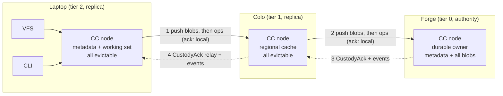
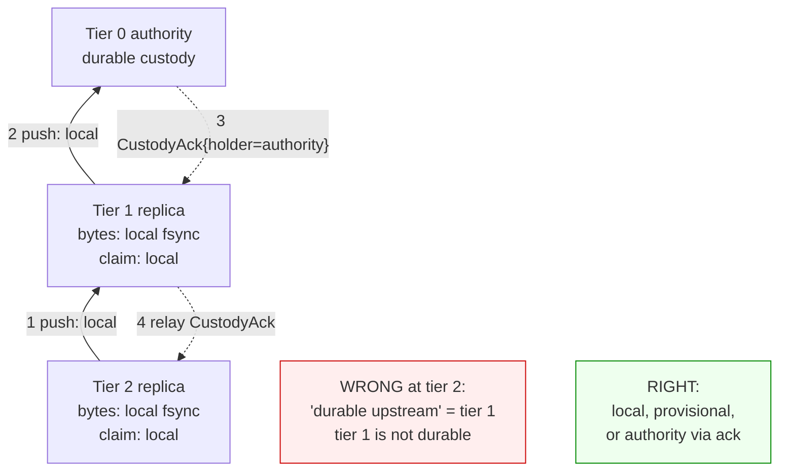
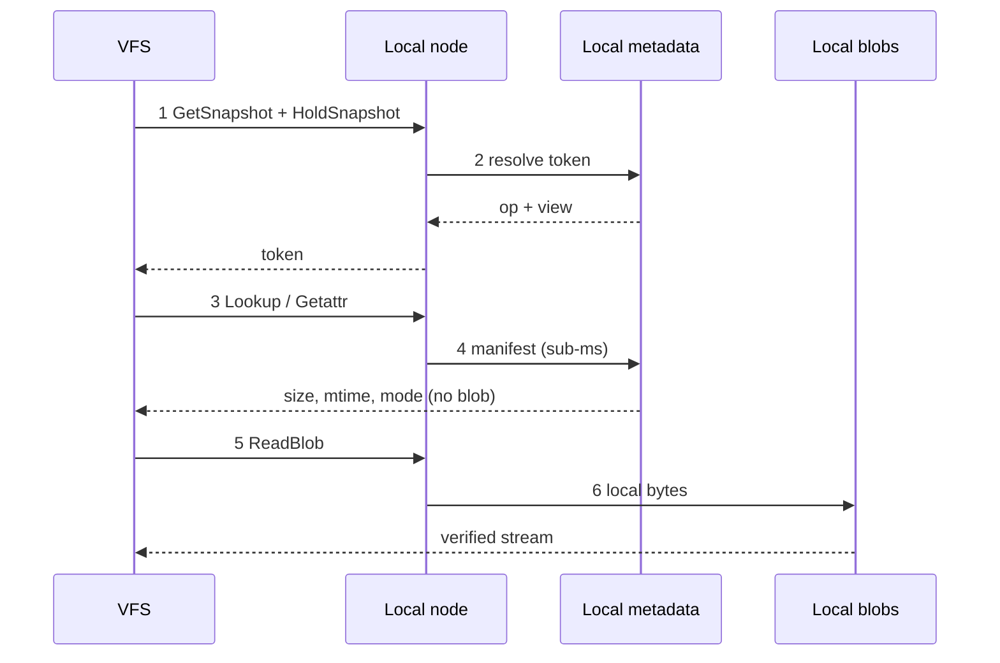
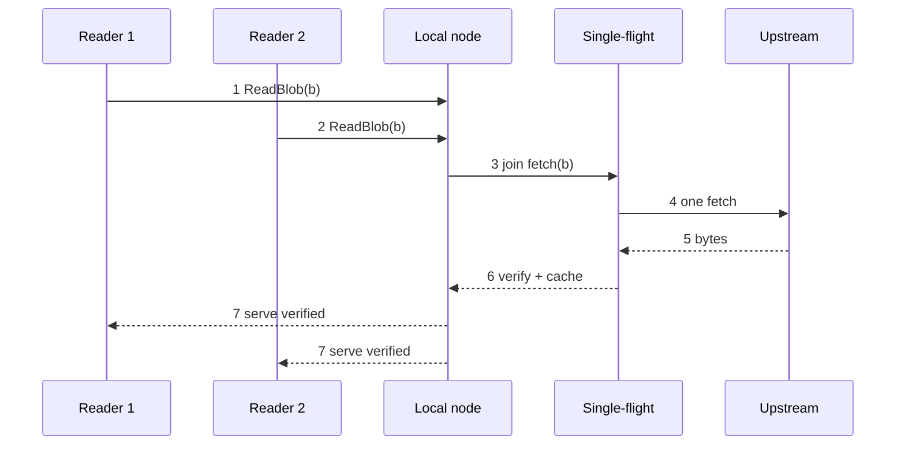
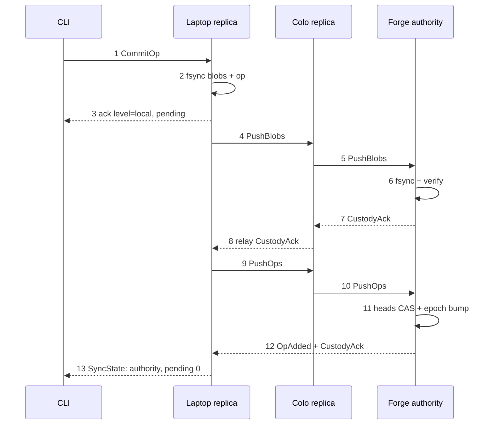
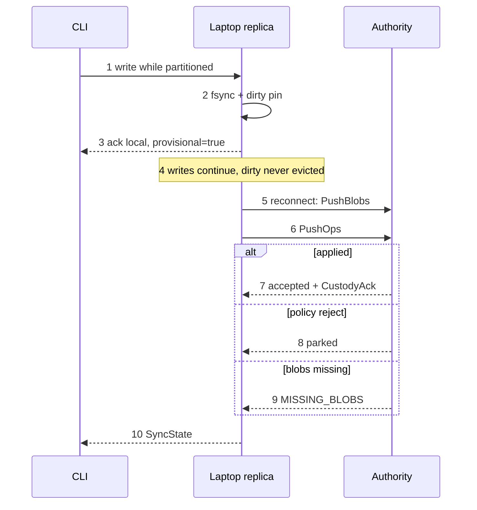
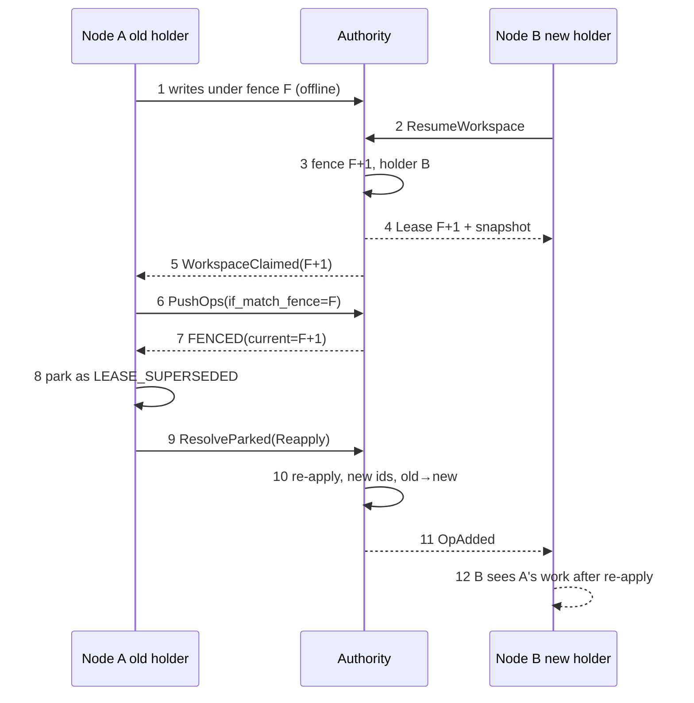
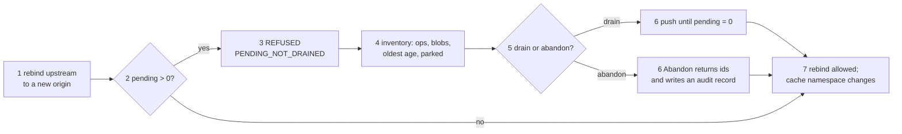
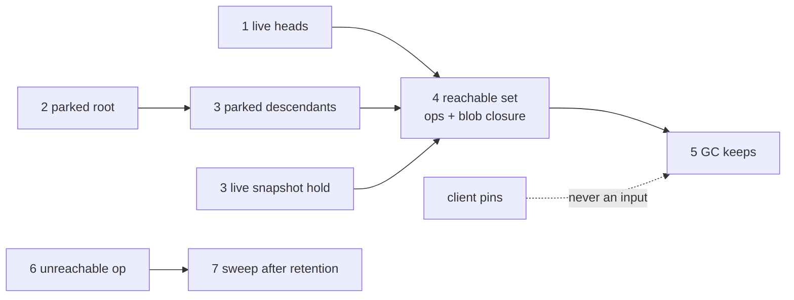
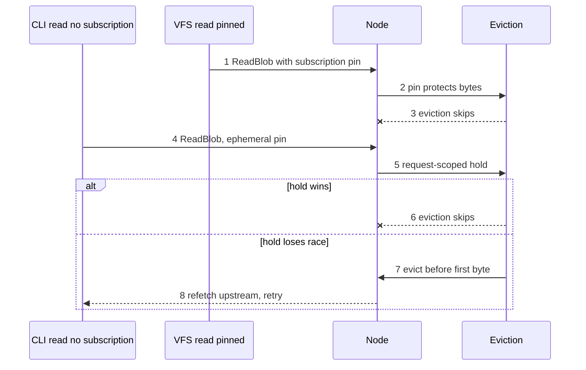

# Multi-tier commit cloud for jj — design

**Status:** Proposal for review. **No decision in this document is ratified.** Every D-number is a drafting proposal that can be reopened; §10 lists the ones that block implementation.
**Open questions:** five — OQ-1 custody acknowledgement, OQ-2 offline authorization, OQ-3 FUSE error code for a stale snapshot, OQ-4 announcement rule at a replica (D10 against I2), OQ-5 accepting authority-disk-loss exposure.
**Owner:** Bogdan (operator). Concept approval: Google team lead. No deadline is set.
**Evidence:** briefs A (jj-commit-cloud), B (jj-vfs), C (prior art). Every code citation is `file:line` against commit `47688804`; Appendix B makes each brief citation self-describing.

## Bottom line

- **Conclusion.** Build commit cloud as one node program whose role is set per (node, repo): **authority** — the durable owner, which may have no upstream at all — or **replica**, which has exactly one upstream, is not durable, and may be emptied at any time. Every CLI and every VFS mount talks only to its local node, over a per-user Unix socket. Reads name a pinned snapshot. Writes are fsynced locally before acknowledgement and report the durability they actually reached. Coherence is server push. A replica is a cache, not a backup.
- **Why it matters.** Today a single `stat` can stream a whole file across the network to learn its size, and offline work is impossible. This design is what makes metadata local, bytes local, and offline work acceptable without silently losing it.
- **Recommended option.** Option A, shipped first in Option B's configuration (offline writes disabled) so the wire format lands before the reconcile path. Option 0 is the rollback. Option C (every node an authority) is rejected.
- **Confidence.** High on structure: the role split, the custody rule and the push order all follow from one commitment — one durable owner per repo — and survived adversarial review. Medium on the load-bearing number: whether tree manifests fit at every tier. One two-day experiment (E1′) decides it.
- **What would change the recommendation.** E1′ failing at > 1 KiB per file forces partial metadata or a VFS metadata cache. Refusing OQ-1 cancels offline writes.
- **Next action.** Decide OQ-1 to OQ-4, then run E1′. Do not start the replication plane before E1′ answers.

## 1. The problem

A developer works in a jj repo on a laptop; history and contents live on a server. Editor, build system and shell see the repo through a FUSE mount, so ordinary commands work unchanged. Three things are wrong today:

- Every metadata lookup crosses the network, and the VFS has no cache of its own [B§4].
- A FUSE `stat` streams a file's entire contents just to learn its size [B§4].
- Offline, the mount is unusable; on a large repo it is slow even online.

The goal is a local commit cloud that answers metadata in microseconds, serves bytes locally when it has them, accepts work while disconnected, and reconciles later without losing or silently rewriting anything.

Terms used above: a **repo** is a versioned file tree plus its operation log; **jj** is the version-control system; **FUSE** is the kernel interface for user-space filesystems; the **VFS** is the daemon that presents one; a **node** is one running commit-cloud process.

## 2. The proposal

One node program stores a repo's content-addressed **blobs** — file contents named by the SHA-256 of their bytes — and its **operation log**: a graph of operations recording changes to bookmarks (named pointers), working-copy commits and visible heads. A node runs at any depth: laptop, colo, forge.

For each repo, a node is either the **authority** — the durable owner, which may have no upstream at all — or a **replica**, with exactly one upstream, not durable, and emptyable. Only the authority is durable: its bytes are the system of record. A replica holds a working set and defers upward.

**D-1 — Topology.**



**What to notice.** Every node holds metadata; only the forge is durable. A laptop miss costs a colo round trip; a colo miss a WAN round trip; a forge miss is a bug or data that garbage collection could not remove.

### Roles at a glance

| Role | In plain words | Analogy | Guarantees | Does not |
|---|---|---|---|---|
| **authority** | Owns the repo; decides truth, deletion, immutable bookmarks. | Warehouse owning inventory and ledger. | Bytes survive replica loss; one truth; one GC owner. | Laptop speed; warehouse backup. |
| **replica** | Holds a working set, defers upward, may be emptied overnight. | Local depot with no standing to say "stock exists". | Low latency for what it holds; offline writes. | Survival; the right to grant custody. |
| **chain** | Laptop → colo → forge, one upstream per hop. | Regional depot → national warehouse. | A miss resolves one hop at a time. | That "we have it" means "it is safe". |

### The idea in five sentences

**Read:** every read names a pinned operation, one fixed snapshot shared by the whole sequence; metadata is local and sub-millisecond; missing bytes block briefly, then fetch or return a retryable error. **Write:** a write is fsynced locally before acknowledgement; the acknowledgement states the durability reached and what is still pending; blobs are pushed before the operation that references them. **Offline:** a disconnected replica accepts writes, marks them provisional and dirty, never evicts them, and reconciles by pushing blobs, then operations, then a heads compare-and-swap. **Coherence:** authority and replicas push events down a subscription, so a local VFS learns of new operations, blobs and custody changes without polling. **Eviction:** everything that is not dirty or pinned is evictable least-recently-used; the authority reclaims only what is unreachable from heads, parked operations and live snapshot holds.

### What the parts are

| Part | Responsibility | Holds |
|---|---|---|
| **Control** | Identity, repo registration, role bindings, workspace resume and leases, delegated identity, authority-only grants. | bindings, fences, grants |
| **Metadata** | Operation log, heads and epoch, views, bookmarks and policy, commit headers, tree manifests, immutability, merge. Leases are rows in its transaction. | the only linearizable state |
| **Blobs** | SHA-256 content, streaming, verification on write and serve, custody bookkeeping. | bytes |
| **Coherence** | Push, subscribe, durability levels, pending accounting, dirty registry, custody acknowledgements, reconcile, parked set, sync state. | behaviour across tiers |
| **Cache** | Byte accounting, LRU, pins, quotas, prefetch, per-user namespaces. | evictable bytes only |
| **GC** | Reachability, retention, holds, sweep. Runs at the authority, behind a retention policy. | reclamation |
| **Clients** | jj-lib and VFS adapters; ephemeral inode→tree maps; the pinned token. | session state |

Clients call Control (unary), Metadata (unary and streaming, pinned) and Blobs (streaming). Metadata triggers Coherence on commit and on heads compare-and-swap; Coherence talks upstream through `PushBlobs`, `PushOps` and `Subscribe`. Cache fills from Blobs, then upstream. Coherence vetoes eviction of dirty data and owns pins. GC marks through Metadata and Blobs and sweeps under the metadata write lock; Control validates bindings and fences inside that same transaction.

`Store` and `Cache` stay separate abstractions. `Store` is durable and authoritative, pluggable (SQLite or Spanner for metadata, files or GCS for blobs). `Cache` is evictable and rebuildable. They share exactly one trait, `BlobSource` (`get`, `has`), and no metadata trait at all: a cache has no compare-and-swap, no epoch and no linearizability. Sharing more would let eviction delete authority data.

### Custody is not locality

"Durable at this node" and "durable somewhere" are different claims, and it is tempting to conflate them by treating the upstream chain as a custodian. That is false at depth ≥ 2, where the upstream is itself a replica: a tier-2 node that calls tier-1 its "durable custodian" is pointing at a node that may be emptied tonight.

Custody is therefore an explicit, retention-bounded acknowledgement issued by the authority and relayed back down the chain. Locality stays separate and honest: it means bytes this node can serve right now.

**D-8 — Custody at depth ≥ 2.**



**What to notice.** Tier 1 acknowledges bytes it holds but has no durability to confer. Only step 3 creates custody; step 4 lets tier 2 say `authority`. Until then the honest answer is `local`, or `provisional` if the bytes exist only on that disk. This is why `upstream` is a legal level only at tier 1.

## 3. Scope

**In.** Node roles and their binding; replication and coherence; the metadata plane (operation log, heads, views, commit headers, tree manifests, derived VFS attributes); the blob plane; pinned reads; writes with explicit durability; offline acceptance, dirty tracking and reconcile; cache, eviction, pinning and garbage collection; the protocol changes those require; acceptance criteria and one falsifying experiment.

**Out.** VFS snapshotting and any VFS write path; implementing the pluggable stores; packing, segmentation and compaction; running a proof of concept during this design pass; production code; any change to the `jj-vfs` repository; CLI↔VFS coordination; encryption at rest; TLS for non-local peers; backup and restore.

Two constraints worth stating where they will be seen:

- **Transport is gRPC only**, over HTTP/2 or a Unix domain socket. The local VFS-to-node path uses a unique socket path under `$XDG_RUNTIME_DIR`, never loopback TCP.
- **The operator specified SHA-256 content hashes.** Today's server and jj-lib use git-compatible SHA-1: operation ids are 16 bytes and commit ids 20 (`common/src/lib.rs:12-14`), and jj-lib's `CommitId`/`FileId` are fixed-width. A client-plane mapping layer converts 32-byte keys to jj's 16/20-byte ids. This is a real cost, tracked as risk R9, not a rename.

## 4. How it behaves

Each flow below is the story, then the picture, then the one thing that matters. Step numbers match the prose and the rules in §5.

### 4.1 A warm read: metadata first, bytes second

The common case is `stat` or `lookup` on a file the laptop already knows about. The client takes a snapshot token, and for a multi-call sequence a **hold** — a retention claim that keeps that operation alive. `lookup` is answered from the local manifest, which carries size, mode and mtime, so no blob is touched. Only a byte read reaches the blob store.

Steps: 1 VFS gets snapshot and hold; 2 node resolves locally; 3–4 lookup and stat come from the manifest, sub-millisecond; 5–6 bytes stream from the local store, verified.

**D-2 — Warm read.**



**What to notice.** `stat` never reads a blob, and the hold — not the token — is what makes a multi-call sequence safe.

### 4.2 A cold read: one fetch for many readers

The file is in the pinned tree but its bytes are not local. Two readers ask at once; the node joins them into a single upstream fetch, verifies once, caches, and serves both. A timeout returns a retryable miss, never a torn file. FUSE maps it to `EAGAIN`, because ordinary tools do not retry `read`.

Steps: 1–2 two readers; 3–4 single-flight joins them into one fetch; 5–6 verify and cache; 7 both served. On timeout: `BLOB_NOT_LOCAL{retryable}` → `EAGAIN`.

**D-3 — Cold read with single-flight.**



**What to notice.** One fetch per blob, not per reader; a miss is a bounded stall followed by a retryable error.

### 4.3 An online write: the acknowledgement tells the truth

The CLI commits. The node fsyncs the new blobs and the operation, then acknowledges `local` with a provisional flag and a pending count. In parallel, push sends blobs upward, then the operation; the authority fsyncs, issues a custody acknowledgement, and only when that returns does sync state say `authority`. The heads compare-and-swap decides head membership; the subscription pushes state back down.

Steps: 1–3 commit and local acknowledgement; 4–8 blobs up and custody acknowledgement back; 9–11 operation push, compare-and-swap, events; 12–13 authority reached, pending zero.

**D-4 — Online write.**



**What to notice.** Two truths are visible — `local` at step 3, `authority` at step 12. Collapsing them into one "ok" is exactly what makes offline behaviour dishonest.

### 4.4 An offline write, and the reconnect

On a train the path is unchanged through step 3, but push fails, so the acknowledgement is `local, provisional=true, pending=N`. That is a promise about the laptop's disk and an explicit statement that nothing left it. Dirty data is immune to eviction. On reconnect the authority answers one of three things — applied, parked, or missing blobs — and only the first clears dirty.

Steps: 1–3 partitioned write and provisional acknowledgement; 4 writes continue, still dirty; 5–6 reconnect and push; 7–9 applied, parked, or missing; 10 sync state.

**D-5 — Offline write and reconnect.**



**What to notice.** Missing-blobs retries, a park waits for a human, acceptance clears dirty. Collapsing those three into "did it work?" is where offline systems lose data.

### 4.5 Workspace resumed on a second node

The one-writer-per-workspace rule is enforced by an authority-issued fence, and a writer can be offline. A edits workspace W under fence F; B resumes W; the authority bumps to F+1. A reconnects and is fenced: its work parks as `LEASE_SUPERSEDED` and is re-applied onto B's head. New operation ids are produced, because an operation id commits to its parents; an old→new map persists for the life of the repo.

Steps: 1–2 A offline, B resumes; 3–5 fence F+1 and event; 6–8 A fenced, work parks; 9–10 re-apply with new ids; 11–12 B sees the work.

**D-6 — Workspace resume.**



**What to notice.** B does not see A's work until re-apply, and A's CLI says so. Applying under a dead fence is split brain.

### 4.6 Rebinding origin while dirty

The origin is the authority a repo id is bound to, and the repo id is the cache namespace. A rebind therefore discards the cache — but not dirty data that exists nowhere else. It is refused while anything is pending; the user sees an inventory and chooses to drain or abandon.

Steps: 1 rebind; 2 check pending; 3 refuse; 4 inventory; 5 choose; 6 drain or abandon; 7 allow.

**D-7 — Origin switch while dirty.**



**What to notice.** The refusal is what prevents silently dropping offline work; `Abandon` records the loss rather than erasing it.

### 4.7 Merge: what converges, and what does not

Convergence is a property of the operation graph, not of every view field. The authority reduces the head set by ancestry, then merges each field by a stated rule. This is why two offline bookmark moves can both end up parked.

| Field | Rule | What the user sees |
|---|---|---|
| **visible heads** | Union, then drop ancestors. On an index miss, keep both and flag `heads_unresolved`. | One head normally; two only when genuinely unordered. |
| **working-copy commits** | Per workspace, the highest `(fence_epoch, op_id)` wins; the loser parks as `LEASE_SUPERSEDED`. | The most recently resumed workspace wins; older work parks. |
| **bookmarks, fast-forward-only** | A non-fast-forward move parks as `BOOKMARK_CONFLICT{bookmark, targets[]}`; the bookmark stays at the common base until resolved. | Both offline moves park; the CLI shows both targets; a human resolves. |
| **bookmarks, authority-wins** | The authority's target is kept; the other parks. | Deterministic, one side surfaced. |
| **bookmarks, manual** | Both targets are retained as conflicts; reads expose the conflict; writes require resolution. | The conflict is data, not an error. |

The merge operation's parents are the reduced head set; its view is the field-wise result. Remaining bookmark conflicts are recorded, not invented away. This is Coda-style reintegration, not last-write-wins: a human may be required, and the system says when.

## 5. Rules the system must keep

Each is testable; the bracketed id is the check in §12.3. These rules are the design's own proposals. Each rests on a decision in Appendix A, and none of those is ratified yet.

- **I1 Authority announcement.** The authority announces an operation only after every referenced blob is fsynced in its store and covered by an unexpired custody acknowledgement. *(MT-1a)*
- **I2 Replica announcement.** Any node announces an operation only after every referenced blob is locally fsynced there or covered by a live custody acknowledgement; no announced operation references a blob that is neither. *(MT-1b)*
- **I3 No false durability.** `upstream` is reported only at tier 1. Above tier 1 an uncustodied write reports `local` with `provisional=true`. *(TC-3)*
- **I4 Truthful locality.** `HasBlob.local` and `BlobAvailable` mean bytes an offline read can serve. `custody[]` is the authority's promise. The two are never conflated. *(IT-4)*
- **I5 Pinned reads.** Every read carries a token, and reads sharing it resolve to one operation and one view. "Now" is never implicit. *(IT-5)*
- **I6 Stale is explicit.** One RPC never returns a partially applied operation. A sequence may fail at an operation boundary with `STALE_SNAPSHOT{retryable}`, and the re-pin is observable. *(IT-6)*
- **I7 Server reads are pure.** No metadata read RPC mutates authoritative state. `ResolveOpHeads` is a separate, observable write that the client adapter invokes before reading. *(TC-7)*
- **I8 One writer per workspace.** At most one fence is current per (repo, workspace). A lease is local admission; the fence is enforced only by the authority, at push. *(IT-8)*
- **I9 Monotone epochs.** `heads_epoch` and workspace `fence` strictly increase and never reset across restart. *(PT-9, FI-9)*
- **I10 Immutability.** Immutable-bookmark and snapshot checks run inside the authority's push compare-and-swap transaction; replicas never enforce them; violations park. *(IT-10)*
- **I11 Ack truthfulness.** The reported level never exceeds the achieved one; `sync_seq`, pending counts and `SyncState` agree at the acknowledgement's watermark. *(TC-11)*
- **I12 Dirty immunity.** No eviction removes dirty operations or blobs, including transitive dirtiness. An all-dirty quota yields `QUOTA_EXHAUSTED` with zero bytes evicted; dirty data is never dropped without an `Abandon` inventory. *(PT-12, IT-12)*
- **I13 No origin switch while dirty.** Rebinding upstream requires pending zero, or an `Abandon` that returns the discarded ids and bytes. *(IT-13)*
- **I14 Parked lineage survives.** Parked operations and their descendants are retained until explicit resolution; `Reapply` produces new ids and persists an old→new map for the life of the repo; `Discard` returns the inventory. Parked lineages are garbage-collection roots. *(IT-14, MT-14)*
- **I15 GC roots and exclusion.** GC input is heads ∪ parked lineages ∪ live snapshot holds ∪ retention. Client pins are never an input. Push and sweep share the repo metadata write lock. *(PT-15, FI-15)*
- **I16 Push order.** Blobs, then operation, then heads compare-and-swap. An operation with an absent blob is rejected `MISSING_BLOBS` with heads and epoch unchanged. *(PT-16, TC-16)*
- **I17 Operation id determinism.** SHA-256 over a canonical, version-stamped envelope; identical bytes give an identical id; the writer computes it with no round trip. *(PT-17)*
- **I18 Blob integrity and size.** Bytes are verified against the key on write and on serve; `tree.size` must equal the blob length; a mismatch yields `CORRUPT_BLOB` or `SIZE_MISMATCH`. *(FI-18)*
- **I19 Single-flight.** Concurrent demand for one blob at one node collapses into a single upstream fetch, capped per repo. *(IT-19)*
- **I20 Deterministic attributes.** Size, mtime, executable bit and child order are pure functions of the pinned snapshot; ordering is total and bytewise. *(PT-20, FU-20)*
- **I21 Cursor stability.** A cursor is valid only inside its issuing snapshot; a foreign or expired cursor yields `CURSOR_INVALID`, never a silent skip. *(TC-21)*
- **I22 Authorization at serve.** Every blob serve checks identity, grant, grant epoch and per-user namespace before bytes leave, including bytes already cached. *(IT-22)*
- **I23 No acknowledgement debounce.** No time-based batching on the acknowledgement path; coalescing happens only after acknowledgement. *(TC-23)*
- **I24 Wholesale eviction only when drained.** A replica may be dropped in full only with pending zero; otherwise the request is refused with an inventory. *(IT-24)*
- **I25 Multi-upstream not foreclosed.** `UpstreamRef` is a list validated to length at most one; push idempotency assumes nothing about parentage. *(PT-25)*
- **I26 Role per repo.** One node may be authority for A and replica for B with no cross-repo namespace, quota or credential leakage. *(MT-26)*

## 6. The wire

The surface is wider than jj-lib's Backend, OpStore, OpHeadsStore and WorkspaceService set, because jj-lib was not designed for snapshots, push, custody or leasing [A§8]. Every local-first capability is a named RPC: a read that needs retention asks for a hold; a write says which level it reached; a replica asks for its sync state. Unary calls are idempotent on `request_id`; streams resume by `seq`. A `ResumeWorkspace` retry with the same `request_id` returns the same fence; a new one is a new claim.

```proto
service Control {
  rpc RegisterRepo(RegisterRepoRequest) returns (RepoRegistration);
  rpc BindRole(BindRoleRequest) returns (RepoBinding);
  rpc ResumeWorkspace(ResumeRequest) returns (Lease);            // claim + fence bump, idempotent
  rpc RenewLease(RenewRequest) returns (Lease);
  rpc ReleaseLease(ReleaseRequest) returns (Empty);
  rpc WhoOwnsRepo(RepoRef) returns (OwnerInfo);
  rpc MintOfflineGrant(GrantRequest) returns (OfflineGrant);     // authority only
  rpc RevokeGrants(RevokeRequest) returns (GrantEpoch);          // authority only
}
service Metadata {
  rpc GetSnapshot(SnapshotRequest) returns (Snapshot);           // {token, op_id, heads_epoch, view_id}
  rpc HoldSnapshot(HoldRequest) returns (SnapshotHold);          // {token, ttl}
  rpc ReleaseSnapshotHold(HoldRef) returns (Empty);
  rpc GetOpHeads(RepoRef) returns (OpHeads);
  rpc ReadOps(ReadOpsRequest) returns (stream Op);
  rpc ReadTree(TreeRequest) returns (TreeManifest);
  rpc ListDir(ListDirRequest) returns (ListDirPage);
  rpc Lookup(LookupRequest) returns (Entry);
  rpc ReadBookmarks(SnapshotRef) returns (Bookmarks);
  rpc GetIndexCheckpoint(SnapshotRef) returns (MaybeCheckpoint);
  rpc CommitOp(CommitOpRequest) returns (WriteAck);
  rpc PushOps(PushOpsRequest) returns (PushResult);
  rpc ResolveParked(ResolveRequest) returns (ResolveResult);     // Reapply|Discard, old->new
  rpc ListPending(PendingRequest) returns (PendingInventory);
}
service Blobs {
  rpc ReadBlob(ReadBlobRequest) returns (stream Chunk);          // v1 offset must be 0
  rpc ReadBlobs(ReadBlobsRequest) returns (stream BlobChunk);
  rpc WriteBlob(stream BlobChunk) returns (BlobAck);
  rpc HasBlob(HasBlobRequest) returns (HasBlobReply);            // {local[], custody[], pending[], absent[]}
  rpc LocateBlob(BlobRef) returns (CustodyChain);
}
service Sync {
  rpc Subscribe(SubscribeRequest) returns (stream SyncEvent);    // resume_seq, pin_set, holds
  rpc GetSyncState(RepoRef) returns (SyncState);
  rpc Abandon(AbandonRequest) returns (AbandonResult);           // discarded ids, bytes, sync_seq
}
message WriteAck { bytes op_id=1; Level level=2; bool provisional=3; uint64 sync_seq=4;
  uint64 heads_epoch=5; uint64 fence_epoch=6; uint32 pending_ops=7; uint64 pending_blobs=8; uint64 pending_bytes=9; }
enum Level { LOCAL=0; UPSTREAM=1; AUTHORITY=2; }
message CustodyAck { bytes blob_id=1; bytes holder=2; uint64 retained_until_ms=3; uint64 custody_seq=4; }
message SyncEvent { oneof event { OpAdded; OpHeadsChanged; BlobAvailable; BlobPending; ReplicaLag;
  PinAck; PinDropped; ParkedOpChanged; CustodyAck; WorkspaceClaimed; GrantEpochChanged; } }
message CcError { string code=1; bool retryable=2; uint32 retry_after_ms=3; RetryInfo retry=4; string detail=5; }
```

`sync_seq` is per-node and monotone; `pending_*` is cumulative at that sequence number. A replica adopts the upstream's `heads_epoch` on push, while `fence` comes only from the authority. Three parts of the surface carry most of the design: `Subscribe` replaces polling and carries pins and custody; `HoldSnapshot` keeps the metadata and blob closure of one operation alive for a client sequence and is the only way to guarantee "readdir, then read" across RPCs; `ResumeWorkspace` plus `WorkspaceClaimed` is the whole workspace-resume story in §4.5.

**Errors.** `retryable=true` implies `retry_after_ms > 0` and `RetryInfo`; `retryable=false` implies neither.

| Code | Retry | Client action |
|---|---|---|
| `STALE_SNAPSHOT` | yes | re-pin and retry |
| `CURSOR_INVALID` | yes | re-pin; the cursor belongs to an older snapshot |
| `SEQ_EXPIRED` | yes | resubscribe without `resume_seq`; full resync |
| `BLOB_NOT_LOCAL` | yes | wait and retry; FUSE `EAGAIN` |
| `BLOB_EVICTED` | yes | refetch; in-flight reads hold an ephemeral pin |
| `MISSING_BLOBS` | yes | upload the named blobs and retry the push |
| `HEAD_CAS_CONFLICT` | yes | retry with jitter after re-reading heads |
| `FENCED` | no | workspace resumed elsewhere; park and resolve |
| `LEASE_SUPERSEDED` | no | park; resolve or discard |
| `IMMUTABLE_VIOLATION` | no | parked; surface to the user |
| `PARKED_OP` | no | resolve the parked lineage |
| `SIZE_MISMATCH` | no | reject: manifest size differs from blob length |
| `QUOTA_EXHAUSTED` | yes | free or evict, then retry |
| `CORRUPT_BLOB` | yes | refetch; never surface |
| `OP_GONE` | no | operation collected; re-pin at a newer one |
| `BASE_GC` | no | base collected; full resync and reapply |
| `PENDING_NOT_DRAINED` | no | drain or `Abandon` before rebinding |
| `GRANT_EXPIRED` | no | reauthenticate online |
| `GRANT_EPOCH_STALE` | yes | contact the authority for the current epoch |
| `OFFLINE_READ_ONLY` | no | the grant lacks a write right |
| `PERMISSION_DENIED` | no | — |
| `REPO_ORIGIN_MISMATCH` | no | re-register against the correct origin |
| `PROTOCOL_VERSION` | no | upgrade the node |
| `UNIMPLEMENTED` | no | optional surface |

**Transport.** One long-lived HTTP/2 channel per (process, peer), multiplexed. Local peers use `$XDG_RUNTIME_DIR/cc-<uid>/`, mode `0700`, with hashed leaf names that stay under the 108-byte socket-path limit. The existing `daemon` crate is not reused: it is a 536-line per-call Unix-socket proxy with no pin, custody or connection state we need [A§12]. The current client spawns a thread, a runtime and a channel per trait call (`lib/src/util.rs:106-122`); the new client keeps one channel.

## 7. Options

**Option 0 — status quo plus a read cache.** Keep today's server as the only authority, put a blob cache (optionally a git promisor) in front, keep the daemon. *Optimises:* no new durability or coherence risk, fastest path, published precedent. *Costs:* a metadata round trip on every `lookup` and `readdir`, because the VFS has no cache; no snapshot pinning, so long reads can tear; no offline writes, roles, push or custody. *Wins when* users are always online and repos are small. *Fails* offline, or far from the authority. *Best argument for it:* no new failure mode, and it avoids the promisor trap where a clone becomes unusable and can corrupt when the promisor remote is absent — one always-on authority has no such hole.

**Option B — thin local replica.** A local node caches metadata and blobs, serves reads locally, and forwards writes synchronously to the authority; no offline writes, dirty registry or merge. *Optimises:* latency and simplicity with one logical writer. *Costs:* no offline writes until reconcile ships; a WAN round trip on every write; invalidation still needed. *Wins when* the first milestone must ship before reconcile exists. This is **a configuration of A** (`replica.accept_offline_writes=false`), not a competing architecture — the wire format is identical.

**Option C — symmetric peers, every node an authority, fan-in now.** *Optimises:* symmetry, local autonomy, no tier starvation. *Costs:* distributed reachability with no safe garbage collection; no single immutability point; merge moves onto the hot path; fencing has no owner. *Wins when* a federated, ownerless product is the goal — it is not. *Best argument against A:* A's asymmetry lets a laptop authority hold data the forge never sees, so "cloud" is partly a courtesy; C makes every copy equal.

**Option D — two tiers only** is A with `max_depth=1`: the same code, less machinery. A deployment profile, not an alternative.

| Dimension | 0 (status quo) | B (thin replica) | C (symmetric) | A (proposed) |
|---|---|---|---|---|
| Offline writes | no | deferred | yes | yes |
| Arbitrary depth | no | read-only | yes | yes |
| RPO of an acknowledged write | authority commit | authority commit | node disk | node disk unless the push fit |
| GC safety | one authority | one authority | unsolved | one authority, explicit roots |
| Immutability point | one | one | none | one, inside the compare-and-swap transaction |
| Pinned reads | no | yes | yes | yes |
| Time to first demo | **shortest** | short | long | medium |
| Failure surface | network | network | merge storms, GC races | reconcile, parking, quota |
| Multi-upstream | no | no | native | additive (I25) |

**Recommendation: A**, staged through B's discipline — ship A's wire format and roles first with offline writes disabled by configuration, then enable dirty pinning and reconcile. Reject C. Keep 0 as the rollback and D as a configuration.

## 8. The choices that were argued

Four sub-decisions were put to the operator as alternatives rather than decided silently, because each trades a real property against another. Three are settled; one is open.

### 8a. fsync and durability semantics (D12)

| | a2: block until upstream-durable | a1: local only | **proposed (D12)** |
|---|---|---|---|
| Returns when | the authority holds operation and blobs | local fsync | local fsync plus a bounded push attempt |
| RPO of an acknowledged write | near zero | node disk loss | node disk loss unless the push completed |
| p99 | WAN round trip plus commit, unbounded | local fsync | local fsync plus at most ~250 ms |
| Offline | fsync fails, so writes fail | works but diverges silently | works, reported as `local`/`provisional` |
| User signal | none | none | "N operations pending push" |

**Recommend D12.** It preserves local-first behaviour while making replication visible. The bound is policy (about 250 ms, a placeholder) and is skipped under backoff. fsync never reports "unknown": an interrupted push reports `local` plus a pending count (I11). **A laptop whose disk dies inside the push window loses acknowledged writes**; sync state and the CLI must say so rather than imply otherwise. At tier ≥ 2 an offline acknowledgement is `local` with `provisional=true`; D11 fixes the three enum values, so `provisional` is a flag, not a fourth level.

### 8b. Operation visibility against blob readiness (D13)

| | b2: announce when the whole blob set is local | b1: fail fast with `BLOB_NOT_LOCAL` | **proposed (D13)** |
|---|---|---|---|
| Operation visibility | bounded by a full tree transfer, possibly gigabytes | immediate | immediate |
| Cold read | never cold | immediate error | blocks up to a timeout, then retryable |
| FUSE/POSIX | `open` fails until the data lands | `read()` gets `EAGAIN`; most tools do not retry | `read()` may block; `stat` and `readdir` stay truthful |
| Shape | starvation: a 10 GB tree never appears | false failures, never a hang | bounded stall, then retryable |

**Recommend D13.** b2 ties visibility to content volume, which is fatal at GVFS scale [C§2.9]. b1 turns a transient cold state into a user-visible failure. So: `open()` succeeds without content, first-touch reads are slow, and `stat` never lies (I18, I20). `mmap` cannot express "retry later" — a fault surfaces `SIGBUS`, which breaks the tool rather than the read — so mmap on cold blobs is unsupported in v1. `fsync` on a file means the workspace snapshot (D12, D14). FUSE maps `BLOB_NOT_LOCAL` to `EAGAIN` and a stale token to `ESTALE` (OQ-3).

### 8c. Pinning (D22)

| Option | Pros | Cons |
|---|---|---|
| **None** | zero surface | a readdir-then-read sequence loses blobs under memory pressure |
| **TTL lease RPC** | simple, no stream | renewal traffic; silent renewal failure; a crashed client pins for a full TTL |
| **Handle-bound refcount** | exact release; dies with the connection | no `open`/`release` in the protocol; a 10,000-entry readdir means 10,000 handles; leaks block eviction |
| **Subscription pin set** (proposed) | reuses the push stream; dies with liveness; no new RPC | coarse: over-pins or truncates, and truncation causes a safe miss |

Subscription pins are keyed `(repo, user, client)`, so one user cannot delay another user's eviction. Count and bytes are capped; on overflow the oldest pin is dropped and `PinDropped` is emitted. Pins never reach GC (I15). A remount loses pins, so a **60-second pin grace** (placeholder) survives the disconnect and the mount re-declares its pins before serving.

### 8d. Offline authorization (D24) — **open decision**

| Option | Pros | Cons | Failure |
|---|---|---|---|
| **(i) strict deny on expiry** | unambiguous; no cryptography | the repo is unreadable offline, cancelling the local-first case | a 12-hour flight bricks the workspace |
| **(ii) bounded grace, read-only** | simple; keeps read access | unauthenticated time; a stolen device keeps access; weak clock trust | silent widening |
| **(iii) signed repo+user TTL grant, verified locally** — *recommended* | offline, bounded, attenuable, revocation by epoch [C§2.8] | new format, key distribution, clock trust; revocation is bounded by the TTL | a revoked user until the TTL expires |
| **(iv) local trust boundary** | trivial; honest for a single user | violates D23; collapses on a shared colo | cross-tenant exposure |

**Recommend (iii).** Minting is authority-only; replicas verify the signature. `RevokeGrants` bumps `grant_epoch`, published as `GrantEpochChanged`; a replica refuses grants below its known epoch and, after a staleness window (7 days, placeholder) with no news, refuses with `GRANT_EPOCH_STALE`. The wire carries opaque `grant_bytes` plus `grant_epoch`, so the token format can change without a wire break. Expiry uses wall clock with ±5 minutes of skew plus a persisted last-seen-clock boot guard; monotonic clocks are used only for local elapsed time. Offline writes require a valid grant carrying a write right. **Still open:** the maximum offline write window, and whether a revoked user's residual access is bounded by it.

### 8e. The jj index (D20)

| Option | Pros | Cons |
|---|---|---|
| Replicate the index as authoritative | fast cold start | derived state replicated: format coupling, invalidation storms, no authority validation |
| Rebuild only | always correct, no surface | cold start pays O(commits); `ListProjectCommits` returns every id (`common/proto/backend.proto:109-115`) |
| Optional opaque checkpoint (D20) | fast, deletable, validated | export and validation surface; a wrong checkpoint can poison; rebuild still needed |

**Recommendation:** rebuild-only in v1, with `GetIndexCheckpoint` returning `UNIMPLEMENTED`, so the checkpoint stays additive. Retain D20's proposed semantics — version-tagged, imported only on exact format match plus head validation, cache, never authoritative, always safe to delete. Add the checkpoint when cold start exceeds 5 s p95 at more than 100k commits.

### 8f. Derived attributes

`size` is the blob length recorded in the manifest and checked against the blob (I18). `mode` is the executable bit. `mtime` is the content time recorded by the writer, never the reading node's clock. A directory's `mtime` is the timestamp of the operation that last changed its entry list. Perforce's default preserves depot modification time, with `+m` opting into sync-time mtimes [C§2.1], so this choice matches the commercial default. *(Assumption to confirm with the VFS owner.)*

### 8g. Timer ordering

| Timer | Default (placeholder) | Must satisfy | If violated |
|---|---|---|---|
| Retention `R` | 30 days | `R >` offline window `W` | a replica offline for `W` pushes onto a collected base (`BASE_GC`) |
| Snapshot hold `H` | 1 hour maximum, 60 s per CLI | `H ≤ R` | holds pin metadata beyond retention and GC starves |
| Pin TTL `P` | 5 minutes plus 60 s grace | `P < H` | pins outlive the sequence and waste bytes |
| Lease `L` | 24 hours | `L ≥ W +` skew | the lease expires mid-offline and fence reservation is ambiguous |
| Offline grant `G` | `G = W` (12 hours) | `G = W` | writes stop early, or outlive their authorization |

### 8h. The operation model (D5)

D5 requires comparing the proposed multi-writer graph against two alternatives.

**(i) Single-writer authority with leased id ranges.** The authority leases each writer a range; operations are ordered by range, so there is no merge and no id rewrite. But offline writing requires leasing ranges in advance, range exhaustion blocks writes, and identity becomes authority-assigned, breaking content-addressing and deduplication.

**(ii) Hybrid: forward when connected, author when partitioned.** Online writes get authority-assigned ids and order; offline writes are authored locally and re-identified on reconnect. This reduces merge frequency but creates two identity paths and the same old→new rewrite as §4.5, now on the hot path.

**(iii) Proposed: content-addressed graph plus merge.** One path online and offline; ids never change; merge is rare because exactly one workspace has a writer, so forks are workspace-granular. The cost is merge and bookmark-conflict machinery, accepted for that reason.

## 9. What happens when it breaks

Two edge cases need pictures before the matrix, because they are where a plausible implementation goes wrong silently.

The authority may reclaim only what no live client can still ask for. The roots are current heads, any parked operation and therefore its parked descendants, and any live snapshot hold. Client pins are not roots: they order eviction at a replica, and feeding them into GC would let any client stop reclamation forever. A parked operation at the base of an offline chain must keep its descendants alive even though none of them is a head.

**D-9 — GC reachability.**



**What to notice.** Parked is a root, not a leak; holds are roots with a TTL; pins are invisible to GC.

A VFS read holds a subscription pin, so eviction skips it. A CLI read has no subscription and takes a request-scoped ephemeral pin for the stream. If that pin loses the race before the first byte, the read retries from upstream (`BLOB_EVICTED`) — never a truncated stream. A handle that is already streaming keeps its bytes alive.

**D-10 — Eviction racing a read.**



**What to notice.** The CLI case is a shorter-lived pin, not an exception; failure is retryable, not partial.

| Failure | Detection | Symptom | Response | Data-loss risk | Recovery |
|---|---|---|---|---|---|
| Upstream down | push error, stream close | writes acknowledged `local`/`provisional` | back off, `ReplicaLag`, writes continue | node disk only | reconnect, §4.4 |
| Replica disk full | fsync or quota error | `QUOTA_EXHAUSTED`, not `EIO` | evict non-dirty; refuse dirty (I12) | none until `Abandon` | free space, drain, abandon |
| Crash mid-write | blob present and operation absent, or the inverse | none | orphan blob re-uploaded; operation visible after the transaction | none on crash | retry; orphan GC |
| Tier ≥ 2 crash with provisional data only | restart inventory | pending gone | reported with ids | **yes: the local disk was the only copy** | re-author or accept |
| Blob corrupt or lost at a replica | hash or length mismatch (I18) | `CORRUPT_BLOB`, refetch | treat as a miss | none | automatic |
| Operation-head fork | two heads, epoch bump | none; merge in the log | authority merges (§4.7) | none | automatic; conflicts surfaced |
| Immutable violation | check inside the compare-and-swap (I10) | push parked, head unchanged | park and surface | none | resolve or discard |
| Stale snapshot or hold | token outside retention | `STALE_SNAPSHOT` retryable | refuse; re-pin | none | retry |
| Offline longer than retention | base collected | `BASE_GC` or `OP_GONE` | refuse the push; full resync | possible if the base existed only locally | resync, reapply |
| Origin switch with dirty data | pending > 0 | refusal plus inventory (I13) | block; drain or abandon | recorded if abandoned | §4.6 |
| GC racing a replica fetch | `OP_GONE` or `BLOB_NOT_LOCAL` | retryable miss, or operation loss | holds protect live tokens | none for held snapshots | re-pin |
| GC racing `CommitOp` | lock ordering | none | mark and commit share the write lock | none | retry |
| Clock skew | grant `not_after`, mtimes | `GRANT_EXPIRED` or `GRANT_EPOCH_STALE` | stored mtimes; wall clock plus skew | none | fix the clock, renew |
| Split brain from resume | fence mismatch | `FENCED` for the old writer | only the current fence is accepted; old operations park | none; work retained | re-apply or discard |
| Eviction during a read | ephemeral pin | none, or one retryable miss | request-scoped pin; refetch | none | automatic |
| Subscription sequence expired | resume sequence too old | `SEQ_EXPIRED` | full resync, no gap | none | resubscribe |
| Parked lineage collected | parked set not marked | parked operations disappear | **must not happen**; I14 and I15 test it | yes, if it is a bug | regression blocks release |
| Authority disk loss | node gone | repo unavailable | single copy, no other holder | **repo loss** | storage snapshots; backup deferred |
| Grant revoked while offline | epoch on reconnect | refused | `GRANT_EPOCH_STALE`; reauthenticate | none | online reauthentication |

## 10. Risks

| # | Risk or question | Owner | Resolution |
|---|---|---|---|
| R1 | **OQ-1:** custody semantics — authority acknowledgement plus `provisional`, or a fourth enum level. If rejected, partitioned writes must be refused, which cancels D7. | CC design owner | operator decision; record both readings |
| R2 | **OQ-2:** offline authorization window, clock trust, revocation residual | security reviewer | answer §8d, then threat-model |
| R3 | **OQ-3:** FUSE errno for a stale token (`ESTALE` vs `EAGAIN`) | jj-vfs maintainer | ratify in the VFS adapter spec |
| R4 | Metadata too large to hold at every tier | CC design owner | E1′ (§12.5) |
| R5 | Fast-forward and immutability need reachability, but today `is_ancestor` is just `ancestor == descendant` (`server/src/jj_lib_adapters.rs:536-540`) [A§15.6] | storage reviewer | index-backed bounded walk; spike |
| R6 | Transitive dirty pinning can wedge a node | ops owner | dirty quota plus `Abandon` UX; measure offline volume |
| R7 | Merge is assumed rare (D5) and is unmeasured | CC design owner | `merge_rate_per_1k_ops` in a pilot (E2) |
| R8 | Authority disk loss without an upstream is repo loss | product/ops | exposure stated in §9; accepting it needs sign-off (OQ-5); backup deferred |
| R9 | 32-byte SHA-256 keys against jj's fixed 16-byte operation and 20-byte commit ids | jj-lib liaison | truncate with a collision check on write; fork only if needed |
| R10 | **OQ-4:** D10 as drafted says an announced operation's blobs must be *durable at the announcing node*, which no replica can satisfy (D1); I2 relaxes it to local fsync or authority custody | CC design owner | operator decision: tighten to custody-only, or amend D10 to mean *reachable from the announcing node* |
| R11 | **OQ-5:** authority disk loss without an upstream means repo loss | product/ops | accept explicitly, or fund backup before any pilot |

## 11. Deferred

1. Multi-upstream and fan-in (D2): the structure permits it (I25); not implemented.
2. Authority handover, failover, and application-level backup and restore. v1 states the exposure instead.
3. Packing, segments and key-value storage (D15): inode pressure against compaction cost; segments break per-object deletion; a key-value store hides the byte accounting LRU needs. v1 is one file per object.
4. Ranged reads and chunking (D16): whole-object reads make `read(offset=1 GiB, len=4 KiB)` transfer a gigabyte unless a per-open stream is reused.
5. Live reflection of remote operations into a live mount (D25). This is structural, not additive: the VFS loads at head once (`jj-vfs/src/main.rs:49-51`), so v1 mounts are pinned until remount.
6. Prefetch beyond LRU warm-up (D26). Never every blob of a head.
7. Garbage-collection numbers: retention, mark cadence, batch size, hold caps.
8. Checkpoint export, until the trigger in §8e fires.
9. `mmap`: unsupported in v1, because `SIGBUS` is a crash rather than a retry.
10. Encryption at rest, and TLS for non-local peers.
11. Whether the VFS `/commits/` tree is removed entirely; nothing in this design depends on it.

## 12. Tests, evidence and what would falsify this

### 12.1 Known against assumed

**Known** (each verified by reading the code, not by trusting a brief). Operation ids are computed by the server (`server/src/op_store.rs:78-98`) as a truncated SHA-1 over the view, parents, hostname and timestamps (`server/src/hash_utils.rs:193-225`); operation ids are 16 bytes and commit ids 20 (`common/src/lib.rs:12-14`) [A§1]. `GetOpHeads` only reads (`server/src/op_store.rs:165-187`), and reconciliation is a separate call (`:210-224`) — but jj-lib's `load_at_head` calls `resolve_op_heads` (`server/src/reconcile_op_heads.rs:94-100`), so today a read path triggers a write [A§15.4]. `is_ancestor` is equality, `common_ancestors` returns empty and `all_heads_for_gc` is unsupported (`server/src/jj_lib_adapters.rs:536-556`) [A§15.6]. The VFS sizes files by reading them (`jj-vfs/src/commit_tree_file.rs:131-139`), mounts read-only (`jj-vfs/src/main.rs:30`), has no write path, and loads at head once (`jj-vfs/src/main.rs:49-51`) [B§4, B§6]. `ListProjectCommits` returns every id (`common/proto/backend.proto:109-115`). The daemon is a per-call proxy, and the client spawns a thread and runtime per call (`lib/src/util.rs:106-122`) [A§12].

**Assumed.** Manifest bytes per file (§12.5); merge rate at or below 1 in 100 operations; a 250 ms push completing on a LAN; coarse pins wasting under 20%; fast-forward ancestry under 50 ms p99.

### 12.2 Acceptance criteria

- **AC1 (I8, I11)** A CLI write with the upstream unplugged acknowledges `local, provisional=true, pending_ops≥1` within 50 ms p99; `GetSyncState` agrees at `sync_seq`. (VFS writes are out of scope; the VFS mounts read-only [B§6].)
- **AC2 (I12)** Evicting a full cache whose data is entirely dirty yields `QUOTA_EXHAUSTED` with zero bytes reclaimed.
- **AC3 (I5)** `readdir` followed by reads of every entry, with heads advanced in between, yields bytes consistent with the pinned operation.
- **AC4 (I6)** A token older than retention yields `STALE_SNAPSHOT{retryable}` with zero stream items.
- **AC5 (I8, I9, I14)** Two claimants: the loser gets `FENCED`, its operations park as `LEASE_SUPERSEDED`, and `Reapply` applies them with new ids and a complete map.
- **AC6 (I16)** A push with a missing blob yields `MISSING_BLOBS` with heads and epoch unchanged; the retry succeeds after upload.
- **AC7 (I11)** kill -9 at each failpoint: acknowledged `local` operations reappear with the same ids and no duplicates; only `provisional` data on a *lost disk* may vanish, and it is reported with ids.
- **AC8 (I18)** A flipped byte yields `CORRUPT_BLOB` and a refetch; a size mismatch is rejected as `SIZE_MISMATCH`.
- **AC9 (I10)** An immutable move attempted from a replica parks at the authority, with the reason in `SyncState.parked[]`.
- **AC10 (I15)** Pinning everything and pinning nothing reclaim the same bytes; a hold extends retention by its TTL and no more.
- **AC11 (I22)** User B reading a blob cached for user A gets `PERMISSION_DENIED`.
- **AC12 (I20)** `stat` of a 1 GB file returns the correct size and mtime with zero blob bytes transferred; attributes match at one token.
- **AC13 (I19)** 100 concurrent cold reads trigger one upstream fetch and return identical bodies.
- **AC14 (I13, I14)** Rebinding with pending > 0 is refused; `Abandon` returns the discarded ids and bytes and writes the audit record.
- **AC15 (I23)** A 1000-operation burst with an injected clock shows no fixed debounce floor.
- **AC16 (I1–I3)** Three tiers with tier 1 killed mid-push: every blob of an operation announced at tier 2 is readable from tier 2 or the authority; no announced operation references a blob found nowhere; no `upstream` is reported above tier 1.
- **AC17 (I9, I13)** With `lease_ttl ≥ offline window`, writes continue after the lease expires offline and only the current fence is accepted on reconnect; `lease_ttl <` the window fails at startup.
- **AC18 (I14, §4.5)** A workspace resumed on B while A is offline: A's operations park, `Reapply` makes them visible to B, and no operation is applied without the map.
- **AC19 (I14, I15)** A parked operation with three parked descendants survives GC at retention zero; `Discard` cascades with all four ids.
- **AC20 (I15)** Pausing GC between mark and sweep and then committing leaves the operation and blobs retained, or fails `CommitOp` with `BASE_GC` and retries.
- **AC21 (I9, I21)** After restart, an old `resume_seq` yields `SEQ_EXPIRED`, a full resync, and no gap or duplicate sequence number.
- **AC22 (I26)** A node that is authority for A and replica for B leaks no A namespace, quota or credential into B.

### 12.3 Traceability

| Rules | Primary check | Falsified if |
|---|---|---|
| I1–I3 custody and levels | MT-1a/b and TC-3: three tiers, kill tier 1 mid-push | an announced blob is retrievable nowhere, or `upstream` is reported above tier 1 |
| I4 truthful locality | IT-4: offline node, `HasBlob` and `ReadBlob` | `local` is claimed for unreadable bytes, or custody is hidden |
| I5–I6 pinned and stale | IT-5/6: five writes between a token and two reads; prune past retention | reads differ, items are partial, or the snapshot advances silently |
| I7 pure reads | TC-7: state before and after every read RPC | anything changes, or `ResolveOpHeads` is unobservable |
| I8–I9 writer and epochs | IT-8 plus PT-9/FI-9: two claimants; kill -9 at an epoch bump | both write, or an epoch or fence repeats or decreases |
| I10–I11 immutability and acknowledgement | IT-10 and TC-11: immutable move; claimed level against custody | the head changes, or a claimed level exceeds custody |
| I12–I13 dirty and origin | PT-12 and IT-13: all-dirty quota; rebind with pending | any dirty byte is evicted, or a rebind succeeds or a discard goes unrecorded |
| I14–I15 parked and GC | MT-14 and PT-15/FI-15: park with three descendants; pause between mark and sweep | any parked operation is lost, an announced operation loses a blob, or a pin changes reclamation |
| I16–I17 push and ids | PT-16/17: push without a blob; canonical bytes, map permutation | an operation is applied with an absent blob, or an id differs or needs a round trip |
| I18 integrity | FI-18: bit flip; size mismatch | corrupt bytes are served or applied, or `stat` lies |
| I19–I21 fetch, attributes, cursor | IT-19, FU-20, TC-21: 100 cold reads; one token on two nodes; cursor across snapshots | the fetch counter exceeds one, attributes differ, or a silent skip occurs |
| I22–I23 authorization and debounce | IT-22 and TC-23: user A then user B; injected clock | bytes leave, or a fixed floor appears in acknowledgement delay |
| I24–I26 eviction and roles | IT-24, PT-25, MT-26: drop a dirty replica; compile-fail on a two-element `UpstreamRef`; role split | dirty eviction succeeds, the type permits fan-in, or cross-repo reach exists |

### 12.4 Test layers

1. **Protocol** (`tc_*`, tonic only): the error taxonomy over every code; unary replay; stream resume and `SEQ_EXPIRED`; a model-based state machine; error precedence.
2. **Properties** (`proptest`, independent model): merge convergence; blob-before-operation; a pinned read never tears; dirty data is never evicted; GC roots; transitive dirtiness at depth 3; deduplication; reconcile idempotency; canonicalisation; epochs.
3. **Unix-socket integration**: `spawn_uds_authority(TempDir)`, `spawn_replica`, a `0700` socket directory, path under 108 bytes; remount across the pin grace.
4. **Multi-tier** (authority ← replica ← replica): custody kill, origin switch, tier eviction, 200-operation catch-up, workspace resume, parked cascade.
5. **Fault injection** (`CC_CRASH_AFTER` at blob fsync, transaction begin, heads compare-and-swap, epoch bump, acknowledgement sent, push enqueued): a kill -9 matrix; disk full yields `QUOTA_EXHAUSTED`; a partition yields `provisional`; clock skew.
6. **FUSE** (`fusermount3`, one required lane): `stat` of a 1 GB file transfers zero blob bytes; readdir then read; `EAGAIN` and `ESTALE`; mmap unsupported.

### 12.5 The falsifying experiment: E1′

**Hypothesis.** Manifests are at most 512 bytes per file, so a 3-million-file repo needs at most 1.5 GB and metadata reads stay local. Manifests are content-addressed and immutable, so per-operation metadata grows with *changed directories*, not with repo size; E1′ therefore tests churn, not just size.

**Measurement.** A synthetic repo of 200,000 files across 4,000 directories; record bytes per file and per-operation growth after 10,000 random single-file changes; serve `Lookup` and `ListDir` over a Unix socket from SQLite plus files with no cache, and record p99 over 10,000 calls; `GetSnapshot` p99 at 10⁵ operations under pruning; tier-2 catch-up time.

**Thresholds (placeholders).** Pass: at most 512 bytes per file, at most 2 GB projected at 3 million files, p99 at most 5 ms. Fail: more than 1 KiB per file (over 3 GB) or any p99 above 20 ms. Since 2 GB across 3 million files is 715 bytes, 1 KiB is hard falsification.

**Timebox.** Two engineer-days; no production code; reuses `common/proto` and the SQLite store. **Non-goals:** operation-log volume, cold-start rebuild, real-name entropy, blob locality, inode cost (counted, not asserted).

### 12.6 Ranked assumptions

1. **Manifest bytes per file** — two days; failure rewrites §2 and §8c. Experiment E1′.
2. **Merge rate at or below 1 in 100** — instrument the operation log (E2); otherwise reconcile is hot.
3. **A 250 ms push completes on a LAN** — reuse E2.
4. **Operation canonicalisation is stable** — days to test, catastrophic to change.
5. **SHA-256 to jj's 16/20-byte ids is lossless enough** — a truncate-and-check spike.
6. **Pins over- or under-pin by at most 20%** — simulate (E3).
7. **Fast-forward ancestry at or below 50 ms p99** — an index spike (E4).
8. **The offline grant window** — a security review, not code.

### 12.7 Test anti-patterns that would make this plan worthless

- **Vacuous passes:** every invariant test must fail when its guard is removed.
- **Wall-clock coupling:** no `sleep`-based ordering, absolute latency assertions, or timeout tuning; use injected clocks and counters.
- **"It didn't crash":** every check names a post-condition.
- **Self-fulfilling oracles:** an independent model, never the system's own log.
- **Blessing a mismatch:** never accept a divergent payload as a new snapshot.
- **Latency as proof** for single-flight or debounce: counters and sequence numbers only.
- **Retry loops hiding non-idempotency:** retrying until success proves nothing.
- **Silent FUSE skips:** one required lane.

### 12.8 Production metrics, and the decision each one drives

| Metric | Unit | Decision it drives |
|---|---|---|
| `ack_p99_by_level` | ms | `local` far above fsync means a regression; `upstream` above the bound plus round trip means shrink the bound |
| `pending_ops_peak`, `pending_bytes_peak` | count, bytes | dirty quota; `Abandon` UX |
| `pending_age_p99` | seconds | routinely above an hour means the "cloud" claim is false |
| `merge_rate_per_1k_ops` | ratio | above 10 means reconcile is hot |
| `parked_op_count` and age | count, seconds | growth means a policy or UX gap |
| `blob_miss_ratio`, `blob_fetch_p99` | fraction, ms | under-pinning; over-pinning above 20% means switch to refcounts |
| `singleflight_collapse_ratio` | ratio | below 0.8 means coalescing is broken |
| `corrupt_blob_total` | events | any non-zero value pages someone |
| `evicted_while_pinned` | events | above zero means pins are too coarse |
| `stale_snapshot_ratio` | fraction | above 1% means retention or holds are too short |
| `metadata_bytes_per_file` | bytes | above 512 reopens §2 |

### 12.9 Operability and upgrade

Metrics carry `{node_id, repo_id, tier, level}` with cardinality capped per repo and per user — never operation or blob ids as labels. Logs carry `trace_id`, `repo_id`, `user_id`, `op_id`, `blob_id`, `sync_seq`, `fence` and `park_reason`, and traces propagate across tiers. `LocateBlob` returns the custody chain and `WhoOwnsRepo` the authority identity; without them support cannot answer "where are the bytes" or "who owns this repo". `SyncState` carries `parked[]` with reason and age, `holds[]`, and pending work by level.

On-disk format and operation-envelope canonicalisation are versioned (`envelope_version`, `store_format_version`, `wire_major`). Changing the envelope changes operation ids, so v1 freezes canonicalisation; a mixed-version push is rejected with `PROTOCOL_VERSION`; rolling out an envelope change requires either dual-serve (duplicate ids, merge storm) or stop-the-world. This design chooses stop-the-world for envelope changes and rolling upgrades for additive wire changes.

### 12.10 Reversibility

| Decision | Cost of changing later | Reversal condition |
|---|---|---|
| Client-computed canonical operation identity | **High** — keys, deduplication, idempotency, old→new maps | full re-key migration; cheap before any repo exists |
| Two roles, one authority per repo | **High** — enforcement, GC, merge and fencing all assume it | multi-authority merge, distributed GC, arbitration |
| Custody acknowledgement protocol | **Medium** — removing it makes I1 unprovable | keep acknowledgements but change the holder set |
| fsync semantics | **Medium** — tools bind to what an acknowledgement means | change if WAN p99 falls below local fsync |
| Lazy visibility with blocking reads | **Low** — a node flag | eager announcement if stalls dominate and repos are small |
| Subscription pins | **Medium** — affects pressure behaviour, not correctness | handle refcounts if over-pinning wastes more than 20% |
| Snapshot holds | **Low** — additive; GC already reads a root set | remove if retention alone suffices |
| SHA-256 keys | **High** — wire ids, filenames, mapping layer | only if jj-lib relaxes id width |
| Lease and fence | **Medium** — workspace identity and resume UX | remove only if one-writer becomes a server-side lock |
| Offline grant format | **Medium** — tokens in the field, key ids, epochs | dual-accept window |

### 12.11 Consequences

**It buys** one code path at any depth, a laptop that is a genuine node, offline writes with a stated RPO, metadata locality, one owner for merge and GC, and acceptance decoupled from replication. **It costs** a replication and coherence plane, a reconcile path, dirty bookkeeping and three user-visible states; local-disk RPO for provisional writes; a replica that is not a backup; **authority disk loss without an upstream meaning repo loss**; bookmark conflicts that can require a human; and a stop-the-world upgrade when the envelope changes.

## Appendix A — the 31 proposed decisions

Reproduced from the drafting record, with the status marker corrected from "agreed" to "proposed" in D12 and D13. **None of these is ratified.** They are reproduced so this document stands alone and can be argued against item by item.

**D1** Roles: exactly two. "authority" = durable, owns the repo, handles metadata and blobs, MAY have no upstream at all (first-class, fully supported local-first configuration). "replica" = has exactly one upstream for that repo, is NOT durable, and may be evicted wholesale at any time. Roles are configured PER (node, repo), not per node: one node can be authority for repo A and replica for repo B.

**D2** Topology v1: a tree. One upstream per (node, repo). Multi-upstream / fan-in is DEFERRED but must not be structurally foreclosed.

**D3** A node serves N repos × M VFS mounts. Multi-user machines must be supported with per-user isolation.

**D4** Exactly one VFS instance is the writer for a given workspace, and is the only CC client for that workspace (workspace lease/claim). No concurrent multi-writer on one workspace.

**D5** Op model: multi-writer, content-addressed op DAG. Simultaneous op lineages converge by DAG merge. Because of D4, forks only occur at workspace granularity (workspace resumed elsewhere, or written while offline), so merge is a rare path, not the hot path. The document MUST compare this against (i) single-writer authority with leased op-id ranges and (ii) hybrid forward-when-connected / author-when-partitioned.

**D6** Reads are served at a pinned op (MVCC snapshot token carried in the request). A readdir followed by reads must not tear across ops. If a snapshot is too old, an explicit retryable "stale snapshot, retry" error is acceptable and preferred over silent tearing.

**D7** Partition tolerance: a replica accepts writes while disconnected and reconciles later. Required consequences stated as invariants: (a) any op or blob not yet durable upstream is dirty-pinned and immune to eviction; (b) a node with dirty state may not switch origin or be evicted until drained or explicitly abandoned; (c) ops rejected by upstream (e.g. immutable bookmark violation) are parked and surfaced, never silently discarded; (d) sync state is a first-class, user-visible protocol concept.

**D8** Bookmark divergence: per-bookmark policy ff-only | authority-wins | manual. Default: ff-only with park-and-surface.

**D9** Synchronization is server push over gRPC server-streaming, not polling: op added, op-heads changed, blob now available, replica lag. The VFS is notified without asking, so that a local VFS and its local CC stay effectively in sync.

**D10** Ordering invariant: an op is never announced to readers before every blob it references is durable at the node announcing it (blob-before-op). No dangling references, at either a replica or an authority.

**D11** The protocol carries explicit durability levels: local | upstream | authority. Every write ack reports the level actually achieved plus a pending-work count. Metadata writes are durable with explicit acks; blob writes are eventually consistent.

**D12** fsync semantics (proposed): fsync returns once the replica has the data locally durable, plus a bounded push attempt; the response reports the achieved durability level (local or upstream) and pending count; the CLI/VFS surfaces "N ops pending push". The document MUST explain this in detail and compare it with (a1) local-durable-only and (a2) block-until-upstream-durable, including RPO and offline-failure consequences.

**D13** Op visibility vs blob readiness (proposed): metadata/tree always visible immediately; blobs fetched lazily; a read on a not-yet-local blob BLOCKS up to a timeout and then returns a retryable error (EAGAIN-equivalent); stat never lies because size/mtime come from metadata. The document MUST explain this and compare with (b1) fail-fast BlobNotLocal and (b2) announce-an-op-only-when-its-whole-blob-set-is-local.

**D14** Debounce/throttle is a VFS concern (target ~1 op/sec for VFS snapshots). CC must not debounce or delay acks arbitrarily; it accepts bursts and may coalesce internally only without delaying acks.

**D15** Keys are SHA-256 content hashes only. v1 storage unit is one file per object. Packing/segments/KV is a later evaluation: lay out the options and trade-offs without deciding.

**D16** v1 blob reads are whole-object streaming. Range/offset reads and large-file chunking are a later phase; note the FUSE implications.

**D17** Immutability: snapshots are immutable; revisions evolve through successive snapshots; bookmarks can be marked immutable, and that protection is enforced by the authority (not merely advisory at replicas).

**D18** Cache key namespace is the server-assigned repo id, which is bound to the upstream origin identity, so switching origin equals wholesale cache eviction. Repo ids are server-assigned, not content-derived.

**D19** Metadata in scope for the local layer: op log, op heads, commit headers, tree manifests, and derived VFS attributes (per-directory child lists with stable ordering, file sizes, mtimes). Serving metadata from the local node must be near-instant; blob service is best-effort.

**D20** jj's local index is NOT a replicated object. The authority may expose an optional, opaque, jj-version-tagged index checkpoint at op X; a replica may import it only if the format version matches and it validates against the op head, and must otherwise rebuild. Semantics: cache, never authoritative, always safe to delete, non-normative optimization. Argue this versus replicating the index and versus rebuilding only.

**D21** Two distinct abstractions: Store (durable, authoritative, pluggable: SQLite/Spanner for metadata, local files/GCS for blobs) and Cache (evictable, tier-local). Both behind Rust traits, sharing a trait where that is genuinely sound. Concrete store implementations are out of scope.

**D22** Pins: replicas pin via the subscription stream (coarse pin set, stream liveness acts as the lease, TTL as safety net) purely to order eviction. Authority garbage collection uses reachability-from-heads plus a retention window and must NEVER take client pins as input. Explain pin alternatives (none / TTL lease RPC / handle-bound refcount / subscription pins) with pros and cons.

**D23** Auth: client identity is delegated and propagated up the chain. A replica must refuse to serve cached blobs to an unauthorized client. Per-user cache namespaces on multi-user nodes.

**D24** Offline authorization is UNDECIDED. Document four options in detail with pros and cons and a recommendation, and mark the decision explicitly open: (i) strict deny on token expiry; (ii) bounded grace window, read-only, marked degraded; (iii) signed, repo+user-scoped, TTL-capped offline grant validated locally (recommended); (iv) local trust boundary. Note that writes offline always require valid (non-expired) authorization.

**D25** The VFS `/commits/` virtual directory may be removed entirely; the design must not depend on it. Live reflection of remote ops into a live mount is PARKED as a deferred decision.

**D26** Prefetch is configurable per node. At minimum: LRU warm-up of previously cached content. Never prefetch every blob for an op head on large repos.

**D27** Eviction: dirty/unreplicated data is never evicted; everything else is LRU by bytes.

**D28** Transport is gRPC only, served over HTTP/2 or a Unix domain socket. The local VFS→CC path uses a unique socket path, not loopback TCP.

**D29** No hard constraints from the cloud team lead. New dependencies allowed. Do NOT propose reusing the existing daemon crate.

**D30** NON-GOALS for this document: implementing VFS snapshotting, implementing pluggable stores, implementing packing/compaction, running any PoC, writing production code.

**D31** Deliverable: an ADR/decision memo, written to `docs/design/` in the current working directory.

## Appendix B — evidence index

The three briefs are outside this repository; this index makes every citation self-describing.

- **Brief A — jj-commit-cloud evidence.** Current server, store, op-id, adapter and daemon behaviour, and its gaps against a jj-lib-shaped backend. Cited as `[A§1]` (op ids and hashing), `[A§8]` (missing watch, snapshot and acknowledgement surface), `[A§12]` (per-call thread, runtime and channel), `[A§15.4]` (a read path that writes), `[A§15.6]` (fast-forward and immutability stubs).
- **Brief B — jj-vfs evidence.** FUSE read-only mount, missing write path, whole-blob size calculation, no metadata cache, `EIO`-only error mapping. Cited as `[B§4]` (size requires the blob; no open/release), `[B§6]` (no write path), `[B§9]` (error mapping).
- **Brief C — prior-art evidence.** Perforce proxy and edge behaviour including `+m`; Git promisor and fetch storms; Coda reintegration; Spanner commit-wait; lease fencing; capabilities; GVFS locality; single-flight. Cited as `[C§2.1]` (Perforce), `[C§2.2]` (fetch storms), `[C§2.3]` (a jj operation is not the exchange unit), `[C§2.6]` (single-flight), `[C§2.7]` (leases and clocks), `[C§2.8]` (capabilities), `[C§2.9]` (GVFS scale).

How the prior art is used: Perforce for the tier tree and depot mtime; the Git promisor for custody bookkeeping and Option 0's failure mode; Coda for reintegration; Spanner for authority compare-and-swap and acknowledgement; lease fencing for enforcing the fence at push; capabilities for the offline grant; GVFS for metadata locality; AFS store-and-forward for D12's local durability. No claim rests on a brief alone: every code-level assertion in §12.1 is re-checked with `file:line`.

## Appendix C — what did not carry over, and what conflicts

This document replaces `ADR-0001-multi-tier-commit-cloud-nodes.md`, which will be deleted. Everything of design substance was carried over. What was deliberately not carried over:

1. **Revision history and the critic's finding log** (revisions 1–5, findings B1–B11, and the "resolved differently" table). This is process history, not design. The two findings with lasting design consequences are already in the text: custody is split from locality (§2), and an authority without backup means repo loss (§9, R8).
2. **Domain-driven labels.** The earlier document grouped responsibilities into "bounded contexts" and marked each as core, supporting or generic. The responsibility table in §2 carries the same content without that vocabulary; nothing was lost by dropping the labels, and no later section depended on them.
3. **Per-finding test identifiers as a separate taxonomy.** The `TC-`/`PT-`/`IT-`/`MT-`/`FI-`/`FU-` codes survive in §5 and §12.3 as traceability anchors, but the earlier prose that explained the taxonomy itself is gone.
4. **The `[A§n]`/`[B§n]`/`[C§n]` shorthand as an unexplained convention.** The citations remain, and Appendix B now states what each one covers and that the briefs live outside the repository.

Three conflicts exist between the inputs to this document. All are recorded rather than silently resolved:

1. **D10 against I2.** D10, as drafted, says an operation is not announced before every blob it references is *durable at the node announcing it*. At a replica nothing is durable by role (D1), so the literal text cannot hold there. I2 and the custody rule in §2 are the reading this document uses **pending OQ-4**: locally fsynced **or** covered by a live authority custody acknowledgement. If you choose the strict reading instead, replicas must not announce anything until the authority holds it, and offline work becomes invisible to other nodes until reconnect.
2. **Decision numbering between inputs.** The handoff's summary table numbers its own list 1–34, while the drafting record is D1–D31 and includes process constraints (D29–D31) the summary folds into other lines. The numbers do not correspond after about item 15 — for example, "server push" is item 10 in the summary but D9, and "metadata cached" is item 18 but D19. Appendix A is authoritative; cite D-numbers, never summary ordinals.
3. **A stale second copy.** An earlier revision of the previous document still sits in the main `jj-commit-cloud` working copy (385 lines, 7,112 words) while the reviewed revision lives in the design workspace (859 lines, 10,013 words). The main copy is stale working-copy state, not a competing design; run `jj workspace update-stale` there before reading anything from it.

One genuine gap, stated rather than papered over:

- **Metadata cold start is unspecified.** Every read path in §4 assumes the operation, view and manifests are already local. Nothing describes how a node that has never seen a repo obtains them — the initial fill, its single-flight behaviour, its progress reporting, or what `GetSnapshot` returns while it is in flight. E1′ measures catch-up for a warm node, not bootstrap. This needs a decision before implementation; the likely shape is the same single-flight pattern as blobs, with `GetSnapshot` returning a retryable `NOT_READY` rather than an empty view.
