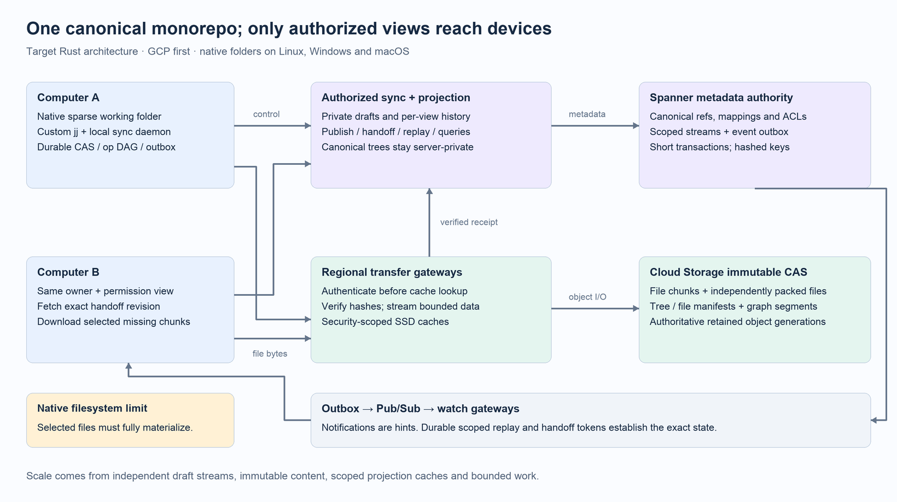
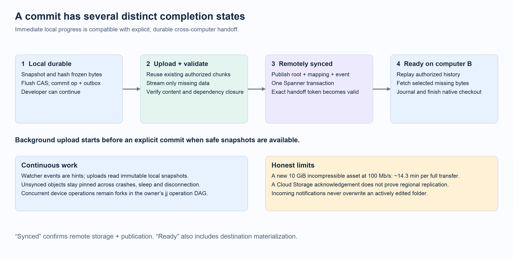
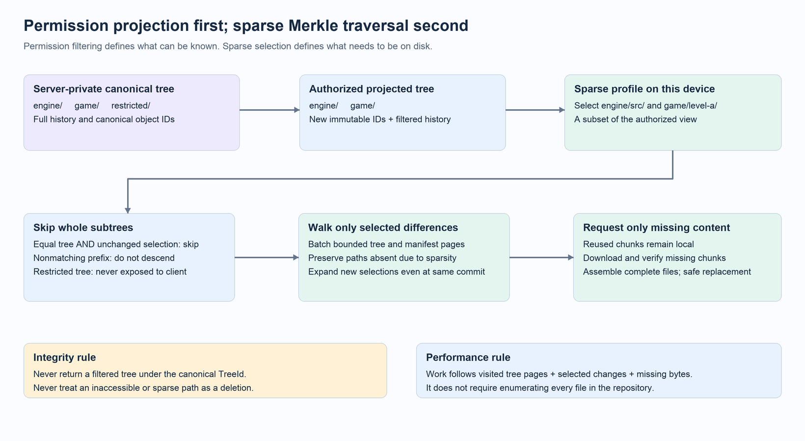

# Proposed architecture: scalable Jujutsu Commit Cloud

## High-level overview

Build a Rust synchronization platform in which developers work in ordinary filesystem folders, jj commits become durable locally, and a background daemon continuously publishes verified content to the cloud. Use **Spanner for small transactional metadata and Cloud Storage for immutable file content, manifests, and large indexes**. A second computer can discover the exact published change quickly and download only the authorized files selected for its working folder.

Maintain **one canonical monorepository on trusted servers**. Because folder contents and their history must be confidential across teams, clients receive permission-specific projections of that repository. A projection has its own immutable jj trees, commits, history, and IDs. Devices using the same permission view and projection epoch share those IDs. Changing the sparse checkout does not change the permission view or commit IDs.

Scale the system by distributing independent developer drafts, object transfers, immutable indexes, and projection work. A shared integration bookmark still has an ordered acceptance point; ordinary developer commits must not contend on it.

**Status:** proposed target architecture, reviewed through three independent agent challenges on 2026-10-26. This is a design and implementation roadmap, not an implemented or benchmark-proven Google-scale system. The highest-risk work is the permission projection engine and jj graph/index integration.

## Executive summary

The recommended architecture follows five decisions confirmed by the project owner:

| Decision | Selected behavior |
|---|---|
| Infrastructure | Google Cloud first: Spanner + Cloud Storage, behind portable Rust interfaces |
| Commit behavior | Finish locally without waiting for the network; report remote synchronization separately |
| Durability acknowledgment | Normal Cloud Storage durability after successful storage acknowledgment, with the regional replication window documented |
| Confidentiality | Enforce folder and history confidentiality, including metadata and content APIs |
| Repository semantics | One canonical server monorepo; filtered client histories with view-specific jj IDs and substantial custom jj integration |

Native filesystem folders on Linux, Windows, and macOS remain a requirement. Selected files are real files. An unselected file is absent until an explicit sparse expansion or tool integration requests it.

The main benefit is that routine work follows the developer's changes and working set rather than the size of the whole repository. Background uploads reduce the bytes remaining at commit time; content addressing avoids redundant uploads; chunk reuse reduces transfer for suitable large assets; immutable metadata and bounded graph queries reduce repeated reads. Explicit handoff gives a reliable answer to “can I continue on another computer?”

The main costs are a substantially more capable client daemon, a security-sensitive projection service, new jj index behavior, and cloud storage/network spend. New large binary content still needs to cross the network. Strictly confidential views increase projection and indexing costs. This design requires staged correctness and performance gates before a large production rollout.



*Figure 1. Metadata coordination and file transfer scale independently. Canonical objects remain behind trusted services; client-visible objects and events belong to an authorized view. The local cache contains durable unpublished work as well as disposable downloaded content. Editable [SVG](docs/proposed_architecture/overview.svg).*

## 1. What “near instant” means

Expose these states for an exact operation or commit, rather than one ambiguous progress indicator:

| State | Promise |
|---|---|
| Local durable | Required bytes and jj operation state are on local durable storage; publication intent is recorded |
| Uploading | Missing immutable objects are being transferred or verified; the developer can continue working |
| Synced | Referenced content is verified and stored, and the remote publication transaction has committed |
| Known on computer B | B has imported the authorized metadata for the exact published state |
| Ready on computer B | B has completed materialization of its selected files and recorded a completed checkout |

“Commit immediately” means no network wait after required local snapshot work. Reading, hashing, and persisting a newly changed 100 GiB file can still take substantial time. Watchers and earlier snapshots can reduce that cost, but they cannot eliminate it for arbitrary newly written bytes.

For a warm working set and small code changes, aim for publication and discovery within seconds. For large files, the useful quantity is **missing encoded bytes**, not the logical file size alone:

```text
transfer_time >= missing_encoded_bytes / effective_network_bytes_per_second
```

A new incompressible 10 GiB file takes approximately 14.3 minutes over an ideal 100 Mb/s connection for each full transfer, before protocol, verification, and disk overhead. A cold B may require a second transfer. Upload/download pipelining and prefetch can overlap work; they do not remove the bandwidth requirement. If a 10 GiB asset retains most existing chunks, the missing data can be much smaller.



*Figure 2. A successful handoff waits for the selected remote publication. It does not claim that every destination already has every file. Editable [SVG](docs/proposed_architecture/handoff.svg).*

## 2. Current project: what must change

The assessment below refers to the inspected checkout at commit `4768880`, with the existing workflow documentation and launcher changes present. Changing the database alone will not address these paths.

| Current implementation | Consequence | Proposed replacement |
|---|---|---|
| [`cc_backend.rs`](lib/src/cc_backend.rs): `concurrency()` returns 1 | Backend work cannot exploit bounded parallel object requests | Adaptive concurrency with request and byte budgets |
| Same file: upload reads all bytes into a `Vec`; download accumulates the complete stream | RAM grows with file size; unary uploads hit message limits | Stream immutable chunks with bounded buffers and resume support |
| [`backend.rs`](server/src/backend.rs): download loads the entire file and emits one frame | A streaming RPC name does not produce streaming storage behavior | Streaming range/chunk reads from the content layer |
| [`Store`](server/src/store/mod.rs): file access uses whole `Vec<u8>` values | Metadata database and file payloads share the storage abstraction | Separate `MetadataStore`, `ContentStore`, and transfer services |
| [`cc_index_store.rs`](lib/src/cc_index_store.rs): lists project commits and recursively imports missing ancestors | Small commands can grow with total project history | Scoped incremental graph segments and remote graph queries |
| [`cc_op_heads_store.rs`](lib/src/cc_op_heads_store.rs): reconciliation on repository load | Broad shared views would become contention and privacy problems | Owner-private operation DAGs; synchronization outside routine local command loading |
| [`connection.rs`](daemon/src/connection.rs): persistent channel reuse | Helps connection setup but provides no durable content cache or outbox | Durable local content storage, snapshot scheduling, upload queue, replay cursors |
| [`main.rs`](daemon/src/main.rs) and [`client.rs`](lib/src/client.rs): Unix socket implementation | Current daemon transport is not a complete Windows implementation | Platform IPC abstraction and native packaging |
| [`init.rs`](cli/src/commands/init.rs): native mode selects upstream local working copy directly | It bypasses the custom working-copy reporting wrapper | Explicit durable sync integration in backend/op-store/daemon, independent of VFS |
| [`cc_working_copy.rs`](lib/src/cc_working_copy.rs): workspace reporting discards errors | Remote workspace state cannot be the source of a reliable handoff acknowledgment | Transactional publication state and explicit error/status reporting |
| [`backend.proto`](common/proto/backend.proto): project-scoped raw object access and project-wide commit listing | Registration checks are not folder/history authorization | View-scoped authenticated APIs; canonical APIs inaccessible to clients |

The existing custom `jj` binary remains necessary. A stock installed `jj` cannot load this custom backend. Packaging should make the custom client identity and compatible backend format explicit.

## 3. Architecture variants and tradeoffs

All credible storage variants need a durable local workflow, separate content storage, sparse traversal, and the selected confidentiality projection. Choosing another database does not remove those requirements.

| Variant | Why it fits | Main drawbacks | Recommendation |
|---|---|---|---|
| **A. Spanner + Cloud Storage** | Managed transactional metadata; existing Spanner integration; separate scalable immutable object storage | GCP dependency, cost, regional write latency, asynchronous object georeplication | First production adapter |
| **B. CockroachDB or YugabyteDB + qualified S3 storage** | Provider/on-premises flexibility; familiar SQL tooling; control of placement | Operating distributed SQL and object storage; topology and licensing decisions; compatibility qualification | Preserve interfaces; implement when portability justifies the work |
| **C. FoundationDB + object storage** | Transactional ordered KV fits custom head, mapping, and event structures | Build query/index/schema tooling; short transaction constraints; substantial operational expertise | Specialist alternative for a dedicated storage team |
| **D. Regional metadata cells + immutable content** | Independent drafts can be assigned near writers; smaller failure domains | Ownership routing, migration fencing, cross-cell operations, shared-ref authority | Later scaling option, following measured bottlenecks |

### A. Managed Spanner and Cloud Storage

Spanner coordinates references, permissions, publication receipts, and event sequence changes in short transactions. Cloud Storage holds immutable file chunks, tree and file manifests, packs, and large index segments. Stateless Rust services authenticate, validate, and translate operations. Regional transfer gateways and caches reduce repeated origin traffic.

Spanner's serializable transactions offer external consistency, but leader/quorum placement still affects write latency. Randomized or hashed leading key components distribute independent streams; a single heavily updated row remains a bottleneck. [Spanner consistency](https://docs.cloud.google.com/spanner/docs/true-time-external-consistency), [schema design](https://docs.cloud.google.com/spanner/docs/schema-design).

This variant minimizes database operations work and fits the confirmed cloud choice. It does not minimize every bill: projection CPU, small object operations, graph storage, cache capacity, and egress need explicit budgets. Use topology and load measurements to choose regions and instance capacity.

### B. Portable distributed SQL and S3-compatible storage

Keep the same application protocol and invariants. Map short metadata transactions to a chosen distributed SQL implementation and immutable content to an object service with verified read-after-write, conditional creation, version/generation, checksum, and range-read behavior.

Do not treat products as interchangeable. Cockroach regional survival settings affect write latency; Yugabyte synchronous replication and asynchronous xCluster are different guarantees. AWS S3 documents strong object consistency, but an “S3 compatible” label does not prove another provider has equivalent behavior. Review licensing as part of selection. [Cockroach configuration](https://www.cockroachlabs.com/docs/stable/choosing-a-multi-region-configuration), [Yugabyte topologies](https://docs.yugabyte.com/stable/explore/multi-region-deployments/), [S3 consistency](https://docs.aws.amazon.com/AmazonS3/latest/userguide/Welcome.html), [Cockroach licensing](https://www.cockroachlabs.com/docs/stable/licensing-faqs).

The portability benefit is real when the organization needs it. The cost is qualifying and operating a second set of failure semantics, backup procedures, observability, and scaling limits. A PostgreSQL-like wire protocol alone is not a migration plan.

### C. FoundationDB and object storage

A custom transactional KV metadata layer can represent versioned heads, compact mappings, and ordered stream ranges without a general SQL model. Large immutable data remains in object storage. This can fit a team that deliberately wants to own a storage layer.

FoundationDB's documented transaction/value limits require small bounded transactions, and application authorization must sit in trusted services. The team would also own query planning, index lifecycle, schema evolution, and much of the operating model. [FoundationDB limitations](https://apple.github.io/foundationdb/known-limitations.html).

This is technically credible but adds work before it improves the developer experience. It is not the recommended first backend for this POC.

### D. Regional cells

A cell is an independently operated group of metadata, projection, and transfer services assigned a set of owner streams or security profiles. A routing service maps each mutable authority to one cell and ownership epoch. Immutable objects can be served near readers without making every mutable write globally multi-master.

Cells distribute independent work and limit failures. They also require fenced ownership transfer, resumable routing changes, and an explicit authority for shared integration refs. Avoid putting a multi-cell transaction on every local snapshot. Start with one managed metadata authority and partitioned services; introduce cells only when measurements justify them.

### Confidentiality alternative considered and declined

The reviewers recommended separate security-domain repositories assembled into one native folder as the lower-risk initial solution. It preserves ordinary jj history semantics within each domain. A cross-domain change becomes a coordinated changeset rather than one canonical jj commit.

The project owner explicitly chose a single canonical monorepo with projected client histories instead. The remainder of this proposal implements that choice and treats projection as a major engineering and security milestone. Merely hiding refs or using sparse checkout is insufficient; Git's own namespace documentation also warns against using namespaces as read access control. [Git namespaces](https://git-scm.com/docs/gitnamespaces).

## 4. One canonical repository, permission-specific client histories

### 4.1 Identities and authority

Use distinct typed identities:

| Identity | Meaning |
|---|---|
| `CanonicalCommitId` | Full server-side monorepo commit; available only through trusted internal APIs |
| `ViewId` + `ProjectionEpoch` | Effective read policy and projection format/history epoch |
| `ViewCommitId` | Immutable jj commit in an authorized projection; same bytes always mean the same identity |
| `CanonicalBaseAnchor` | Opaque authenticated token binding a view base to an exact canonical snapshot |
| `OwnerRepoId` | Private developer operation DAG and draft namespace within the monorepo |
| `DeviceWorkspaceId` | Unique working folder identity; two computers do not both overwrite a global `default` workspace row |
| `SecurityDomainId` | Classification boundary used for content authorization, packing, and historical provenance |

One canonical repository can contain many private draft branches. It does not require every draft to advance one global head. Public integration refs and owner-private draft heads have separate mutable authorities.

Two developers with different permission views can receive different jj commit IDs and histories for the same canonical change. Within one unchanged view/epoch, A and B receive identical private draft objects. Display opaque review/change handles where cross-view collaboration needs a shared reference; do not expose a canonical graph as a shortcut.

### 4.2 Projection algorithm

The trusted projection service takes a canonical snapshot and effective permission profile:

1. Determine authorized historical content using its security classification and current access policy. A rename must not accidentally expose a restricted file's old history.
2. Construct a projected tree containing only authorized paths. A partly filtered directory gets a new logical tree identity. Fully authorized unchanged subtrees can reuse their representation within the permitted scope.
3. Project parents, change aliases, conflict terms, descriptions, and other metadata. The client receives projected graph segments, never raw canonical graph packs.
4. Collapse a canonical revision that introduces no authorized content, metadata, or meaningful visible topology. Hidden-only revisions do not generate visible empty commits or event sequence gaps. A merge with distinct visible parents may still be necessary even if its tree equals one parent.
5. Project every term of a jj conflicted tree and simplify with jj's conflict algebra. Labels and copy/predecessor metadata need the same filtering. A clean visible merge may still contain hidden canonical conflicts.
6. Cache the result by tenant, canonical immutable inputs, effective permission profile, owner/private-versus-integrated visibility namespace, and projection epoch. Equal folder permissions do not grant access to another owner's drafts. Share memoized subtrees only where their classification allows it; private graph roots, mappings, and events retain the owner boundary. Publish a view event only when that view's observable state changes.

Free-form commit messages cannot be safely sanitized by a generic string filter. Require explicitly scoped descriptions and metadata. Other views receive approved scoped text or a neutral description; author identity, timestamps, signatures, and branch names follow the same policy. Never relabel altered content with its original hash.

JJ exposes separate backend, operation store, index, and working-copy interfaces, which are useful extension points. The projection behavior above is new application functionality, not a claim about existing upstream support. [JJ architecture](https://docs.jj-vcs.dev/latest/technical/architecture/), [JJ conflicts](https://github.com/jj-vcs/jj/blob/main/docs/technical/conflicts.md).

### 4.3 Translating local changes back to the canonical repository

A projected ID alone cannot identify a canonical base: several hidden-only canonical revisions can map to the same visible state. Submit an exact `CanonicalBaseAnchor` together with the projected base, ordered parent/predecessor mappings, policy epoch, and explicit path mutations with expected old identities. Keep an existing anchor stable across hidden-only canonical updates when its authorized view state is unchanged; rotating visible tokens must not become a hidden-activity notification. Staleness is handled during authorized integration.

The server authenticates the caller, resolves those mappings privately, rechecks read/write policy, and applies only authorized mutations to the anchored canonical tree. Missing paths in a projected or sparse tree mean “unknown/unselected,” never “delete.” Recursive deletion, directory moves, symlinks, and cross-domain copies must be checked against hidden descendants and historical classification. Unsafe operations fail without exposing restricted names.

Upload private draft DAGs in topological order. Canonical assembly preserves inaccessible subtrees and creates a private canonical draft; it does not replace current shared `main`. Rewrites create new revisions and scoped lineage mappings. Shared integration is a separate authorized operation with expected ref generation and conflict checks.

For a multi-parent operation, use real canonical merge semantics. If hidden conflicts remain, retain them in private canonical state or route shared integration to an authorized maintainer. Never ask an unauthorized client to resolve hidden content, and never silently take a parent's full hidden subtree.

Preserve the exact client-authored projected draft object. B can fetch it unchanged. If canonical integration produces a different projected result, import it as an explicit jj reconciliation/rewrite and retain lineage. A client signs its visible commit and patch intent; the server separately attests to canonical assembly. The client cannot sign hidden canonical bytes it never saw.

### 4.4 Permission changes and scale limits

Permission expansion can reveal previously collapsed history, changing descendant projected IDs. Use a new projection epoch and explicit local-work migration. Permission reduction blocks fresh access to obsolete grants. Retain unsynchronized local work safely for authorized recovery rather than deleting it during migration.

An access revocation cannot erase plaintext already downloaded to an offline developer machine. The contract is prevention of unauthorized retrieval from the service and its managed caches. Timing and shared-resource side channels need a defined threat model; this proposal does not claim constant-time information hiding.

Prefer managed permission profiles shared by cohorts over an unbounded number of unique per-user ACL combinations. Build projections lazily, memoize filtered tree pages, use internal changed-domain indexes, and incrementally update subscribed profiles. Do not project the entire history for every user on every commit. Projection storage and CPU scale with **active distinct permission views and relevant changes**, as well as repository size. Measure and quota that dimension explicitly.

Maintain projections per active ref or draft frontier with lazy graph segments. An internal changed-domain-to-active-cohort index selects candidate updates; unchanged profiles receive no event or sequence gap. A new profile or expanded permission epoch can require substantial cold construction. Report a preparing state or unavailable history while it is built; permission expansion is not promised to be instant.

## 5. Content storage and identity

### 5.1 Three representations

Keep these concepts separate:

- **Logical jj objects:** commits, operation DAGs, trees, and file identities used by jj semantics.
- **Transfer representation:** versioned file manifests, immutable chunks, compressed frames, and bounded batches.
- **Physical placement:** Cloud Storage object generations, packs, regional caches, and local disk locations.

Repacking or rechunking a file must not change its logical file or commit identity. Filtering a tree for confidentiality does change logical content and therefore creates a new projected identity.

The existing backend uses Git-compatible SHA-1 blob/tree identities in [`hash_utils.rs`](server/src/hash_utils.rs). Retain those logical IDs during a transport migration, with collision detection and a verified mapping to stronger content digests. Use versioned, domain-separated SHA-256 digests for new storage objects and exact reconstructed bytes; do not treat SHA-1 as sufficient protection against malicious collisions. A future logical ID format change is an explicit repository migration. Projection creates new valid logical objects using the selected versioned backend format.

A file manifest records format version, logical file ID, whole-file digest and size, representation, chunker algorithm/version/parameters, ordered chunk identities and decoded lengths, and integrity metadata. Very large chunk lists use bounded immutable pages. Canonical serialization is specified byte-for-byte; ordinary protobuf serialization must not be assumed canonical by accident.

### 5.2 Small code files

Keep each small file as a logical object. Batch uploads/downloads to amortize request overhead. Persist small objects promptly, then compact into immutable physical packs within one security/visibility scope. Do not make an interactive commit wait for a pack to fill.

Packs contain independently decodable frames and a verified offset/length index. Repacking changes locators, not object identity. Range coalescing can reduce requests but increases transferred bytes; measure both. Never expose a whole pack or pack index unless the recipient may read every member, including private draft members. The default client data path uses an authorization gateway that returns only approved objects/ranges.

### 5.3 Large binary files

Use streaming content-defined chunking for large files whose revisions retain common byte regions. FastCDC is a candidate algorithm; a rolling boundary hash chooses cuts, while SHA-256 verifies chunk content. Specify the exact chunker variant and parameters in the manifest for reproducible behavior. [FastCDC paper](https://www.usenix.org/conference/atc16/technical-sessions/presentation/xia).

Initial tuning experiments, not contractual defaults: whole-object treatment below 1–4 MiB; chunk minimum 256 KiB, average 1 MiB, maximum 4 MiB; compare 256 KiB, 1 MiB, and 4 MiB averages on actual assets. Use independent zstd frames when compression helps. Already compressed/encrypted data may gain nothing and should avoid unnecessary recompression.

A small logical edit to a compressed archive, cooked game package, or encrypted file can change almost every chunk. In those cases transfer the new data efficiently without promising deduplication. Keep source assets separately versioned when practical; generated build products belong in separately governed build/artifact storage. Format-aware splitting is a later opt-in optimization with exact byte reconstruction, not a universal binary merge mechanism.

Avoid long delta chains for interactive checkout. Chunk references should reconstruct a revision directly without fetching many historical versions. Hashing and CDC can still require reading the entire modified file locally.

### 5.4 Content catalog at enormous scale

Spanner stores compact commit/root records, publication mappings, refs, ACLs, upload sessions, validation certificates, and catalog roots. It does not store file payloads or a new SQL row for every chunk occurrence in every revision. Trees, chunk lists, large views, and graph segments live in immutable content storage.

Start with a sharded catalog of unique objects/locators. Benchmark its cost early: one PiB of unique 4 MiB chunks is roughly 268 million chunks before indexes and replication. A production catalog can use immutable partitioned pack indexes plus small Spanner-controlled generations and hot locator caches. That is a separate index implementation; avoid assuming it is free or already solved.

The transfer protocol should borrow proven patterns: bounded missing-object checks, small-object batches, streaming large blobs, chunk mappings, capability negotiation, and retryable offsets. A version-control authority needs longer-lived retention guarantees than an evictable build cache. [Remote Execution CAS protocol](https://github.com/bazelbuild/remote-apis/blob/main/build/bazel/remote/execution/v2/remote_execution.proto).

## 6. Durable local work and remote publication

### 6.1 Local transaction

The daemon uses a local transactional metadata store plus files/packs for content. SQLite is acceptable here as a small single-device metadata store; it is not the central service or a large-blob database. A Rust embedded transactional KV such as redb is another candidate. Select through crash and packaging evaluation, behind a trait; this is not the main horizontal scaling decision.

1. Snapshot through jj's working-copy semantics under the appropriate lock. Watcher events prioritize scans; journal gaps/overflow force reconciliation. They are never proof that an entire mutable file is stable.
2. Follow jj's snapshot semantics, capture the bytes actually read, and use best-effort concurrent-write detection to retry or report changes. Ordinary filesystem reads and pre/post metadata checks cannot guarantee a point-in-time image against arbitrary in-place or memory-mapped writers. Stronger consistency for an actively written asset requires writer coordination or a suitable filesystem snapshot facility. Hash and persist the captured immutable bytes; uploads always read this frozen content.
3. Flush content and containing directory metadata with the required platform durability primitives.
4. In one local transaction, advance operation heads and record publication intent. A crash exposes either the prior operation or a durable new operation plus its outbox record. Recovery also checks live roots for missing queue entries.
5. Pin unsynced objects and active checkout dependencies. Evict only reconstructible, unpinned cache data.

Coalesce transfer work by object identity, but do not silently discard committed user revisions or undo history merely because a newer snapshot exists. Retention of automatic intermediate snapshots is an explicit product policy.

Never hardlink mutable working files into the immutable cache. Use real copies or verified copy-on-write clones with a safe fallback. Cache quota exhaustion must produce backpressure and a useful error rather than deleting unpublished work.

### 6.2 Remote prepare and commit

The upload protocol has an explicit preparation boundary:

1. `BeginUpload` authenticates the owner/view/epoch and creates a bounded upload intent and retention lease.
2. `FindMissing` checks only objects the caller is entitled to reference or has uploaded; it is not a cross-domain hash-existence oracle.
3. Transfer missing chunks with resumable, bounded streams through regional gateways. A gateway computes cryptographic digests, validates lengths and representation, and waits for successful authoritative storage completion. A direct-to-staging optimization requires trusted finalization before availability.
4. Validate new manifests/tree pages and their authorized references bottom-up. Reuse retained, verified immutable subtree certificates so a new commit does not traverse the entire monorepo. Reusing bytes requires an authorized origin grant or verified upload, not just knowledge of a digest.
5. Assemble canonical draft mappings and projected private operation state. Produce a scoped prepared publication certificate bound to validated roots, object generations, policy epoch, and retention protection.
6. In a short serializable metadata transaction, recheck policy and expected stream generation, consume/promote the preparation lease, advance the private head and its ready projected frontier, and write the durable event and idempotency receipt.
7. Return `synced` for that exact publication. Notification delivery and destination checkout happen afterward.

No atomic transaction spans Spanner and Cloud Storage. Upload-first plus immutable verification, protected preparation, and metadata publication supplies the required invariant: **an advertised root never points to content that was only promised by a client**. Crash-created unreferenced objects are recoverable garbage, not visible incomplete commits.

Cloud Storage's transport checksums do not establish an application-level cryptographic object name supplied by an untrusted client. Validate content in a trusted service. [Cloud Storage data validation](https://docs.cloud.google.com/storage/docs/data-validation).

Metadata transactions must remain small regardless of asset size or repository size. Validation is resumable preparation outside the transaction; publication checks bounded certificates. Retries use an idempotency key scoped to caller and operation, returning the original result if the first response was lost.

### 6.3 Two-computer workflow

The following commands illustrate proposed UX; they do not exist yet:

```bash
# Computer A, in the native working folder
jj commit -m "Update animation tooling"   # returns after local durable work
jj cc sync status                       # pending objects, bytes, and last synced operation
jj cc sync wait                         # wait for the captured operation, not an endless moving target
jj cc handoff create --wait              # exact scoped token; optionally include a fresh tracked snapshot

# Computer B
jj cc handoff inspect TOKEN              # view/epoch compatibility and required materialization
jj cc handoff accept TOKEN               # preserve B's work, then adopt exact imported state
```

A handoff token binds the authorized owner/view, exact projected commit and operation, canonical base mapping, and sparse profile version. The service authenticates token use. Unsaved editor buffers, ignored files, and untracked files outside snapshot policy are outside the promise.

B first records its current tracked work safely. If B has divergent work, preserve it as a separate change/workspace and require an explicit integration action. Do not silently reset an open folder. Adoption creates a new local operation assigning B's own `DeviceWorkspaceId` to the imported commit; it does not reuse A's workspace identity. B retains its sparse profile unless the user explicitly adopts the suggested profile in the token. Different permission epochs require a migration flow rather than treating the token as interchangeable.

Private operation DAGs preserve simultaneous offline work as branches and merge through jj semantics. Last-writer-wins synchronization is unsuitable for operation heads. JJ documents the operation DAG and conflict-preserving reconciliation model. [JJ concurrency](https://jj-vcs.github.io/jj/latest/technical/concurrency/).

## 7. Sparse checkout and selective download algorithm



*Figure 3. Authorization filters the available history before the sparse planner runs. Sparse selection is a performance preference inside the authorized view. Editable [SVG](docs/proposed_architecture/sparse.svg).*

Maintain a prefix trie or compiled path matcher for the device's sparse selection, and compare **authorized projected** old and new trees. Simple subtree inclusion profiles should be the fast path; complex patterns may require more directory metadata.

```text
plan(old_tree, new_tree, path, old_selection, new_selection):
    if neither selection can intersect path:
        return
    if old_tree == new_tree and selection is unchanged below path:
        return
    fetch missing bounded directory pages for relevant path ranges
    for entry in the selected union of old and new entries:
        if directory:
            recurse on selected differing ranges
        else:
            if selected in new_selection and
               (newly selected or logical content changed or required local bytes missing):
                schedule manifest and required content
            if clean materialized file is now excluded or deleted:
                schedule safe removal
            preserve metadata-only changes without fetching unchanged bytes
```

For each selected file, read its manifest, compare required chunks against verified local content, request only missing chunks in bounded batches, verify, and assemble the full file into a temporary path. Rename/replace with platform-safe primitives. A permission-approved rename can reuse bytes, while copy/rename provenance remains subject to policy.

Selection expansion must fetch newly selected content even when the commit did not change. Selection contraction must not delete dirty user work. Snapshotting preserves tree entries omitted by sparsity; it must not convert absence into a repository deletion. Merges/conflict resolution can require additional authorized content beyond the ordinary checkout plan and should report that work explicitly.

Let `P` be visited tree/index pages, `F` selected changed files, `C` required chunk references, and `B` missing encoded bytes. Planning and transfer should approximately follow `O(P + F + C)` metadata work plus `B` bytes, with bounded parallelism. This is not a guarantee of `O(number of changed files)` for arbitrary glob patterns, flat million-entry directories, or complex history operations.

A logical directory containing millions of entries needs a deterministic paged sorted index. Keep its physical page root separate from the logical jj `TreeId`, unless intentionally migrating the backend format. A path index is rebuildable from authoritative trees. Any range-page response must remain tied to its immutable tree and scope; a client must never be handed a partial tree as though it were the complete original logical tree.

The custom working-copy/index integration must actually consume selective metadata. If an upstream API insists on constructing an entire huge `Tree` first, object pagination alone will not fix the memory cost. Prove a paged planner interface or modify that integration before claiming enormous flat-directory support.

Record checkout intent, base generation, destination commit, sparse profile version, completed file mutations, and recovery state in a local journal. Advance the applied workspace generation only on completion. After a crash, recovery resumes/reconciles before ordinary snapshotting can mistake an interrupted checkout for user deletions.

A native folder cannot be atomically changed across many files while arbitrary tools hold handles. Per-file atomic replacement plus recovery is realistic. Build/editor integrations should wait for the completed checkout state. Missing unselected paths do not hydrate transparently: dependency-aware profiles and explicit expansion supply them. The build graph must itself respect read permissions.

## 8. Network and cache architecture

Use persistent HTTP/2 gRPC for control, watch, batched metadata, and baseline streaming transfer. TLS is mandatory off-device. HTTP/3 is an optional measured transport improvement, not a prerequisite for content deduplication.

Transfer scheduling has separate pools for interactive metadata, selected checkout content, and background upload/prefetch. Limit both request count and total bytes in flight. Initial experiments can use 8–32 transfer workers and a 64–256 MiB buffer budget; tune by RTT, available memory, disk speed, loss, and server feedback. Retry individual chunks with backoff and jitter; cancellation must release buffers and preserve resume state.

Cache tiers are local disk, regional authorized SSD caches, and authoritative Cloud Storage. Immutable objects need no content invalidation, but authorization must be checked before cache delivery. Mutable head caches are hints and never replace a required authoritative read.

Strict confidentiality makes authenticated transfer gateways the default. They can coalesce storage range reads and stream only approved members. Avoid long-lived bearer URLs for confidential content; access changes otherwise leave a revocation window. Direct URLs are an optional explicitly bounded policy, not a universal optimization. Packs, indexes, local namespaces, and observable dedup are partitioned by security/visibility scope, including private drafts.

Prefetch the next likely authorized working set only within user-controlled bandwidth/disk budgets. Prioritize selected files. A second device may prefetch remotely published content into its cache while the developer works elsewhere, but incoming changes do not automatically overwrite that device's working folder.

Track metadata/chunk/full-file cache budgets separately. Pin current work, pending uploads, and active mutations. Detect corruption by digest, discard reconstructible corrupt cache entries, and retry another source. Authoritative history must not depend on a cache retaining an object.

## 9. Metadata, events, and horizontal scaling

### 9.1 Partition by independent authority

Illustrative logical keys; production schema must be load-tested:

```text
DraftHeads   (hash(owner_repo, stream), tenant, owner_repo, stream) -> generation, roots
SharedRefs   (hash(repo, ref), tenant, repo, ref)                   -> generation, canonical_root
ViewHeads    (hash(scope, view, ref), tenant, scope, view, epoch, ref) -> ready frontier, projected roots
ViewMappings (hash(mapping_id), tenant, scope, view, epoch, mapping_id) -> protected canonical mapping
Events       (hash(stream), tenant, scope, stream, sequence)       -> publication/change event
UploadIntent (hash(upload_id), tenant, scope, upload_id)           -> lease, preparation state
CatalogRoots (hash(scope, shard), tenant, scope, shard)             -> immutable catalog generation
```

An owner's operation DAG can span several devices. Use independent device publication streams with a bounded owner-scoped reconciliation operation; retain concurrent heads. Avoid a single global operation view, giant mutable head array, repository-wide incrementing counter, or per-draft update to shared `main`.

Protected integration refs use compare-and-swap and an acceptance queue. Batching compatible submissions can improve throughput, but one globally ordered branch has a real serialization limit. Measure it separately from total draft publication throughput. Multiple integration refs are a workflow choice, not a transparent consistency trick.

### 9.2 Durable replay and notifications

In the same transaction that publishes a stream head, allocate that stream's next sequence and write its application event and idempotency receipt. A relay publishes event hints through Pub/Sub. Watch gateways distribute authorized hints to connected clients, which resume from durable scoped cursors.

Expect duplicate, late, and reordered delivery. Pub/Sub's default behavior is at-least-once without ordering; correctness must come from sequence/generation checks and authoritative replay. Do not create one ordering key for an entire giant monorepo. [Pub/Sub subscription semantics](https://docs.cloud.google.com/pubsub/docs/subscription-overview).

Subscription bootstrap reads an authorized snapshot with a replay fence. Reconnect replays events after that fence, closing the snapshot/watch race. Beyond retained events, return a new fenced snapshot. Multi-stream subscriptions use scoped cursor vectors or an equivalent checkpoint, never a global sequence that reveals hidden changes.

Canonical publication and projection readiness are distinct. Public changes may become visible to a cohort only after its projection is built. A projection worker prepares verified content, mappings, and graph segments outside a transaction, then atomically advances `ViewHeads` to a ready frontier and appends that view's event. An internal source-ref version and compare-and-swap fence prevent an older worker from replacing a newer ready projection. Ref resolution, graph queries, and checkout planning bind to this same immutable frontier; they must not combine a newer canonical ref with incomplete or older projected segments. While a worker catches up, readers retain the previous complete authorized frontier. Expose and measure this lag. Private handoff between the owner's compatible devices uses the already validated projected draft, avoiding a fanout wait across all permission views.

Spanner change streams can feed internal relays, but their partition lifecycle, ordering, and retention are infrastructure details. Devices consume the application's scoped replay protocol. [Spanner change streams](https://docs.cloud.google.com/spanner/docs/change-streams/details).

### 9.3 What actually scales

| Work | Scaling unit | Remaining bound |
|---|---|---|
| Draft publication | Owner/device streams | Per-stream transaction contention and quotas |
| Transfers | Regional gateway workers and object partitions | Network, object service throughput, verification CPU |
| Immutable metadata reads | Security-scoped caches and bounded pages | Cache misses and exceptionally wide directory/index nodes |
| Projection | Active view/cohort workers with immutable memoization | Number of distinct views, policy changes, graph semantics |
| Graph queries | Partitioned immutable graph segments + query workers | Expensive revsets and dependency on exact graph state |
| Shared integration | Ref-specific acceptance service | One ref's required serialization |
| Recovery/GC | Content/security-domain shards | Marking cost, historical retention, safe publish/delete coordination |

Use per-tenant/view fairness and admission limits. A broad refactor, fresh projection, or mass asset upload must not starve interactive status and small handoffs.

## 10. Huge history requires a new jj index

Sparse file downloads do not solve a billion-node commit graph. Replace the current project-wide commit enumeration with a custom `IndexStore`/`Index` containing:

- Compact immutable **view-scoped** graph segments, incrementally imported by explicit frontier/version.
- A durable local overlay for unpublished commits, rewrites, and private operations.
- Snapshot-bound server graph queries for expensive ancestry, common ancestors, prefix/change resolution, and supported revsets.
- Exact reconciliation of local overlay and the selected remote graph snapshot.

Preserve jj's semantics for hidden commits within the authorized view, divergence, change IDs, merge bases, operation undo, and conflicts. “Hidden” in jj is not a security permission. Unknown history while offline must produce an explicit unavailable-history result when required, not a false “no ancestor,” ambiguous prefix accepted as unique, or invented shallow root.

Arbitrary extension predicates and content-sensitive revsets may require more client evaluation or data. Define a supported remote query subset and explicit expensive fallbacks. Bound interactive traversal and make broad queries cancellable. [JJ revset evaluation](https://github.com/jj-vcs/jj/blob/main/docs/technical/revset-evaluation.md).

This is an early go/no-go prototype. If exact jj behavior still forces every client to materialize all authorized ancestry, the giant-monorepo objective has not been met. Do not hide that failure behind a faster blob store.

## 11. Durability, garbage collection, and recovery

### 11.1 Declared cloud guarantee

The confirmed `synced` contract is verified content successfully stored by Cloud Storage plus committed Spanner publication. Cloud Storage provides strong read-after-write behavior. Its dual/multi-region writes are initially redundant within one region; geographic replication is asynchronous. A regional failure during that interval can make recent data unavailable. Turbo replication on a dual-region bucket offers a 15-minute replication RPO; it is not proof of synchronous per-object replication. [Consistency](https://docs.cloud.google.com/storage/docs/consistency), [availability and durability](https://docs.cloud.google.com/storage/docs/availability-durability).

Recommend a configurable dual-region content bucket, considering turbo replication against the agreed recovery requirements and budget. Select actual regions after residency and developer-location review. The choice of normal durability is confirmed; exact placement and spending are deployment decisions.

No “geo-protected” claim is made from elapsed time or a successful metadata write. If a later requirement demands immediate region-loss protection, add independently verified storage in two regional buckets before that stronger acknowledgment.

### 11.2 Reachability and deletion

Retention roots include public refs, retained canonical/private drafts, projected private objects and required epoch mappings, jj operation/undo history, legal/admin retention where configured, active uploads, and checkout/handoff leases. Valid canonical base anchors must retain their canonical bases and required mappings. Give anchors an explicit renewable lifetime: if an offline client's anchor expires, preserve its local changes and require an authorized re-anchoring/rebase flow rather than promising publication against a deleted base. Automatic workspace snapshots need a documented retention policy. Unbounded history has a real cost.

Start with retention and conservative deletion disabled during early correctness milestones. Production GC needs an explicit protocol, not just a time-based sweep:

1. Mark from a consistent root snapshot within each retention/security domain.
2. Protect active uploads and roots published after the snapshot through an epoch/pinning barrier.
3. Move an unreferenced object generation from `Available` to `Deleting(epoch)` through coordinated catalog state.
4. Publication cannot acquire or promote a closure lease over a deleting generation. It must retry/revalidate/reupload. Reusing an old subtree certificate requires live retention protection.
5. Delete only the recorded Cloud Storage generation, then retire the catalog entry. Retried deletes must not remove a later recreated object.

The publish/pin versus deleting transition must be proven race-free, including reuse of old subtree closures; grace periods alone do not prove this. Avoid synchronous transitive reference-count updates for every draft rewrite. Pack compaction publishes new locator generations and retains old packs until all active readers/leases are safe. [Cloud Storage preconditions](https://docs.cloud.google.com/storage/docs/request-preconditions).

Back up metadata, policy/mapping state, and content coherently. A Spanner restore is useful only if all referenced object generations remain retained. Recovery exercises must include a metadata snapshot older than ongoing content GC and projection/index rebuild from authoritative objects.

### 11.3 Failure behavior

| Failure | Required outcome |
|---|---|
| Network unavailable | Continue local work within available cached history/content; queue durable publication |
| Upload interrupted | Resume verified missing chunks; never advertise incomplete closure |
| Lost publication response | Idempotent retry returns the existing receipt |
| Notification missing/duplicated | Replay from durable view-scoped cursor |
| B is dirty or diverged | Preserve its work; explicit adoption/integration |
| Crash midway through checkout | Recover journal before normal snapshotting |
| Local disk full | Preserve unpublished objects; report blocked progress and reclaim only safe cache data |
| Permission changes during upload | Recheck policy at publication; retain local work for authorized recovery |
| Regional origin unavailable | Use available replicas/caches; report unavailable fresh content honestly |
| GC races with publication | Generation/lease fencing prevents publishing a deleted dependency |

## 12. Game assets and cross-platform working folders

Text changes use jj's merge behavior in the authorized view. Binary asset transfer efficiency does not make arbitrary assets mergeable.

Offer optional exclusive-edit policies for designated asset paths. Server-issued locks carry owner, expiry, and monotonically increasing fencing tokens. Renew and transfer them explicitly during a handoff. Enforce required tokens at **shared integration**, including moves/deletions, so a disconnected stale holder cannot submit over another editor. Local editing and private draft synchronization remain possible; losing a lease is visible before shared acceptance. Engine integrations can encourage safe editing and reload behavior.

Implement a portable client core in Rust and isolate platform details:

| Concern | Linux | macOS | Windows |
|---|---|---|---|
| File change hints | inotify | FSEvents | ReadDirectoryChangesW; optional journal support |
| Daemon IPC | User-private Unix socket | User-private Unix socket | Named pipe with explicit user ACL |
| Service lifecycle | User service / launch on demand | Launch agent / launch on demand | Per-user background process / supported service packaging |
| File replacement | Native rename/flush handling | Native rename/flush handling | Handle sharing violations, antivirus interference, native replace/flush behavior |

All platforms need watcher-overflow recovery, process locking, crash recovery, long-path handling, executable-bit policy, symlink policy, and case/Unicode collision checks. Reject incompatible selected path sets before destructive checkout steps. Confine traversal and writes to the intended workspace with platform-safe path/handle operations, accounting for symlink and Windows reparse-point replacement races. Preserve canonical bytes; do not silently normalize line endings or asset bytes. Do not assume symlinks or path case have identical behavior on every filesystem.

A monorepo may contain Linux-only paths that cannot materialize on default Windows/macOS filesystems. State this explicitly and provide portable naming policy or platform-specific sparse profiles. Cross-platform support does not make every possible filename portable.

## 13. Confidentiality invariants

These are part of the selected functionality, not an optional production hardening appendix:

1. Authenticate every request. A claimed project ID, object hash, or hidden jj ref grants no read permission.
2. Authorize by current policy and reachable authorized revision/path or narrow server-issued grant. Apply this to chunks, manifests, trees, commits, private drafts, graph queries, search, annotate, locks, and exports.
3. Canonical endpoints, graph packs, op logs, and full root manifests remain internal. User-visible errors, metrics, counters, and cursors must not enumerate hidden history.
4. Partition packs, observable deduplication, and caches by security/visibility scope. A security domain is a minimum boundary; private drafts and narrower historical grants may require additional separation or mandatory member-level gateway checks.
5. Cross-domain copies require source read, destination write, and applicable declassification authorization. They do not grant access to the source's older history.
6. Current authorization is checked before serving historical cached content. Permission epochs invalidate remote grants; identity bytes never mutate under old IDs.
7. Build/search services follow the same rules. Derived outputs can disclose restricted sources or assets.

A core test property: two canonical histories differing only in information inaccessible to a view should yield equivalent view objects and visible event sequences. Exercise this with hidden-only commits, merges, conflicts, rewrite metadata, path moves, cache hits, prefix resolution, and retries. Treat exceptions for authorized metadata explicitly. Shared timing/resource side channels require separate analysis; previously downloaded plaintext cannot be revoked retroactively.

## 14. Rust implementation shape

Keep the first deployment as a small number of processes with modular crates; split services when load and isolation justify it. The local daemon and backend stay tightly integrated. Data gateways can scale separately from CPU-heavy projection/query workers.

| Proposed module/crate | Responsibility |
|---|---|
| `cc-protocol` | Versioned types, capability negotiation, authenticated scoped RPCs |
| `cc-content` | Streaming hashes/chunking, manifests, pack indexes, verification |
| `cc-local-store` | Durable local metadata/outbox, immutable content, cache pinning |
| `cc-sync` | Upload state machine, replay cursors, retries, handoff |
| `cc-projection` | Permission-aware tree/history/conflict projection and mapping |
| `cc-policy` | Domain classifications, view epochs, grants, integration authorization |
| `cc-jj-backend` | Logical object adapters, private op DAGs, canonical patch intents |
| `cc-jj-index` | View graph segments, local overlay, remote query evaluation |
| `cc-workspace` | Native snapshot/checkout journal, sparse planner, platform handling |
| `cc-metadata-spanner` | Short transactions, stream heads, events, publication receipts |
| `cc-object-gcs` | Immutable generations, conditional writes, streaming/range reads |
| `cc-gateway` | Authenticated regional transfer, caching, limits, backpressure |
| `cc-maintenance` | Compaction, retention, GC barriers, repair, audit/recovery jobs |

Use Tokio for async IO, Tonic/protobuf for control, explicit bounded channels, and cancellation throughout. CPU-heavy hashing/chunking/projection runs in bounded worker pools rather than blocking async executors. Instrument request scope, queue time, bytes, verification, and publication phases without leaking restricted paths into broadly readable logs.

Provider interfaces must express required semantics, not just `get`/`put`: conditional create, generation-fenced delete, resumable upload, immutable verification receipt, transactional publication, idempotency, fenced snapshots, and cursor replay. A backend adapter passes a conformance suite before it can support `synced`.

The project currently uses `google-cloud-spanner = 0.34.4-preview`. Google's Rust Spanner client documentation labels the client preview. Pin versions and qualify retry/session/transaction behavior behind the adapter rather than implying production maturity from a crate name. [Official Rust Spanner client](https://github.com/googleapis/google-cloud-rust/blob/main/src/spanner/README.md).

## 15. Implementation sequence and migration

| Stage | Deliverable | Exit gate |
|---|---|---|
| 0. Contracts and prototypes | Versioned IDs, state machine, projection threat model, scoped graph prototype | Permission and jj semantics demonstrated on adversarial small histories |
| 1. Streaming content | Separate content interface, GCS adapter, verified bounded transfers, manifests | Large files transfer/resume with bounded memory and exact reconstruction |
| 2. Local durability | Local CAS, atomic op/outbox, cache pinning, portable daemon | Crash/offline/full-disk tests preserve local work; two-device draft sync works |
| 3. Confidential projection | Canonical private draft mapping, view histories, scoped queries/events | No unauthorized metadata/content paths; merges and epoch migration pass |
| 4. Sparse and graph scale | Paged tree planner, incremental graph segments, remote index, checkout recovery | Small working-set commands avoid whole-repo enumeration; exact jj behavior |
| 5. Operational scale | Fanout, packing, quotas, GC fencing, backups, asset locks | Load/failure/recovery gates and measured cost envelope |

Projection and graph/index prototypes run early because their failure would change the architecture. Stage numbering is dependency guidance, not a promise that all work is strictly sequential or that this is a small patch.

Migration from the POC should use a versioned protocol and repository format. Export existing objects, compute/verify strong digests, migrate content to object storage, and retain checked legacy-ID mappings. Use a read-through legacy adapter during backfill where useful, with an explicit cutoff and rollback path. Validate complete retained object closures before directing an existing repository to the new authority.

Existing clients must fail clearly when encountering an unsupported projection or storage format. Do not serve different projected content under existing canonical IDs. Clients changing security views need an explicit local-work migration; an ordinary config edit cannot safely rewrite history identity.

## 16. Performance evaluation and acceptance criteria

These are proposed test envelopes and targets, not measured results or claims about this repository today. Publish benchmark hardware, regions, client cache state, bandwidth, RTT, loss, asset distribution, permission-view count, and retained history.

### Workload matrix

| Workload | What it challenges |
|---|---|
| Millions of 1–64 KiB source files; small scattered edits | Request amplification, packing, metadata caches, watcher scan cost |
| 10–100 GiB stable binaries with inserts and local edits | CDC reuse, local scan cost, reconstruction, bounded RAM |
| Fully recompressed/encrypted binaries | Worst-case missing bytes and honest progress estimates |
| Narrow sparse checkout in 100 million-path synthetic tree; very wide directory | Pruning, page size, path-index/API limitations |
| Large view graph, including 100 million+ synthetic history nodes | Bootstrap, local overlay, remote revsets, memory and query limits |
| Tens of thousands of independently active owner streams | Metadata sharding, fairness, notification fanout |
| 1 / 10 / 100 / 1,000 distinct active permission views, then policy changes | Projection multiplicity, cache reuse, epoch migration cost |
| Concurrent shared-ref submissions and binary locks | Serialization ceiling, fencing, conflict behavior |
| Cold, warm, partially cached, interrupted and corrupted transfers/checkouts | Real handoff latency, recovery, integrity |

Progress toward larger envelopes only after smaller ones pass. Synthetic results must be complemented with representative code and game repositories.

### Initial measurable objectives

- Local ordinary commands on a warm selected working set should not block on remote synchronization. Measure local snapshot/hash/durable-write time separately.
- For small code changes with at most 1 MiB of missing bytes, warm services, an established connection, effective uplink of at least 20 Mb/s, and RTT at most 50 ms: initially target p95 remote publication under 2 seconds after local durability, and p95 notification under 1 additional second after publication. These are engineering targets to validate.
- Destination readiness is measured separately, including sparse planning, disk writes, and existing file handles. Never include a warm-cache run under a cold-checkout label.
- Transfer RAM stays within configured budgets as file size grows; throughput should approach the measured bottleneck of network, hashing, and disk rather than one unary message limit.
- Checkout requests no unselected file payload except explicitly measured pack coalescing or authorized merge dependencies. Report byte amplification and skipped subtrees.
- Ordinary commands should not call `ListProjectCommits` or enumerate the entire canonical graph. Record graph pages and RPC counts per command.
- Independent streams should scale with added service capacity until a measured backing resource saturates. Report shared-ref throughput separately; do not extrapolate it from independent drafts.

Record p50/p95/p99 latency, errors, local scan/hash CPU, peak RSS, bytes transferred, chunk reuse, object-store requests, Spanner transaction retries, projection lag, cache hits, physical write amplification, and cost per workload. Compare whole-file streaming against chunking and packing before committing tuning defaults.

Correctness gates include kill/restart at every durable boundary, lost response/retry, corrupted chunks, simultaneous rewrites, hidden merge conflicts, unauthorized hashes, permission changes mid-upload, sparse expansion without commit change, interrupted Windows checkout, and GC concurrent with publication. Restore a retained old revision after compaction and backup recovery.

## 17. Agent challenges and resulting decisions

Three agents independently reviewed synchronization correctness, blob/sparse algorithms, and infrastructure alternatives. Their challenges changed the proposal rather than serving as a vote that it is proven.

| Challenged claim | Resolution in this proposal |
|---|---|
| “Replace SQLite and sync becomes instant” | Separate streaming content, local durability, graph indexing, and metadata coordination; measure each |
| “One repository head can scale horizontally” | Independent private draft streams; explicit serialized shared integration refs |
| “Streaming RPC means bounded memory” | Replace whole-buffered client/server storage paths; test RAM against file size |
| “All large binary edits transfer only a few chunks” | Benchmark CDC suitability; acknowledge archives/encryption can invalidate almost all chunks |
| “Sparse checkout enforces confidentiality” | Server-only canonical graph; authorized projected histories and all-endpoint authorization |
| “Filtering can preserve original tree/commit IDs” | New immutable view IDs; explicit base anchors and mappings |
| “One projected ID determines canonical base” | Opaque exact base anchor; mapping may be many-to-many |
| “Original signatures survive redaction” | Separate client delta signature and trusted canonical/projection attestations |
| “Any projected merge is a simple patch” | Preserve jj merged-tree terms, hidden conflicts, and scoped lineage |
| “Cloud acknowledgment means immediate regional disaster protection” | Confirmed normal durability contract with asynchronous replication window |
| “All history fits in every client” | Custom index/remote query prototype is an early go/no-go gate |
| “Native checkout is atomic across the folder” | Per-file replacement, mutation journal, explicit completion and recovery |
| “A grace period makes GC safe” | Generation-fenced deletion coordinated with publication/closure leases |

The reviewers preferred independent security-domain repositories for a lower-risk first release. The owner deliberately selected canonical-monorepo projections. This tradeoff is recorded prominently because it increases the engineering and security scope even if the cloud services themselves scale well.

## 18. Confidence and remaining deployment decisions

There is strong architectural justification for local durable work, immutable content addressing, chunk reuse where appropriate, separate metadata transactions, permission-scoped graph services, and selected-tree traversal. The recommended design provides independent scaling units and explicit failure boundaries.

There is no basis yet to promise Google-scale throughput, subsecond arbitrary large-file checkout, or constant-cost permission projection. The highest-risk gates are projection of merges/rewrites and permission epochs, exact jj history/index semantics at scale, closure publication versus GC, and portable crash-safe working-copy mutation. If a gate fails, revisit the corresponding semantics before production.

Before infrastructure provisioning, confirm actual regions/residency, retention and backup targets, developer/view counts, representative asset formats, acceptable monthly spend, and the set of paths requiring enforced binary integration locks. These refine deployment and capacity; the major repository, confidentiality, durability, and commit-latency choices above are already confirmed.

Google's published monorepo account is useful evidence that huge repositories require coordinated tooling and developer workflows. It is not evidence that this design reproduces Google's current internal system or performance. [Google's monorepo paper](https://research.google/pubs/why-google-stores-billions-of-lines-of-code-in-a-single-repository/).
